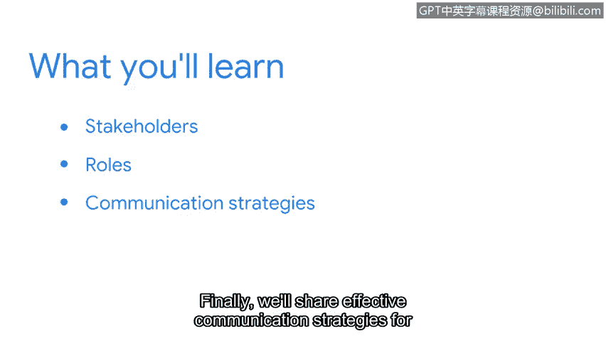

# 谷歌网络安全专业证书第八课：《投入实践：为网络安全工作做好准备》（中英字幕，前面分p中字，后面分p英字） - P55：12_01_welcome-to-week-3.en_subtitled - GPT中英字幕课程资源 - BV12x4y1X7h8

We've covered so much in previous courses， from the foundations of security to a basic understanding of networks and programming languages like SQL and Python。

These concepts are core knowledge when preparing for a role in the security profession。

But how does this information help you on a day to day basis and to whom do you communicate this information。

In this course， we'll start by discussing who stakeholders are。

 Then we'll identify their roles in relation to security。 Finally。

 we'll share effective communication strategies for relaying key information to stakeholders。

But before we can communicate with stakeholders， we have to understand who they are and why they are important。

So let's get started。