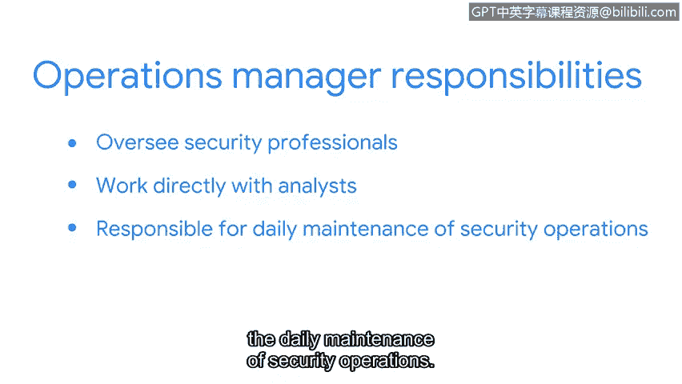

# 谷歌网络安全专业证书第八课：《投入实践：为网络安全工作做好准备》（中英字幕，前面分p中字，后面分p英字） - P56：13_02_stakeholders-in-cybersecurity.en_subtitled - GPT中英字幕课程资源 - BV12x4y1X7h8

Let's discuss the hierarchy within an organization。 It goes from you， the analyst to management。

 all the way up to executives。Hierarchy is a great way to understand stakeholders。

A stakeholder is defined as an individual or group that has an interest in the decisions or activities of an organization。

This is important for your role as and entry level analysts because the decisions made on a day to day basis by stakeholders will impact how you do your job。

Let's focus on stakeholders who have an interest in the daily choices analysts make。After all。

 you may be asked to communicate your findings to them。

So let's learn a little bit more about who they are and the roles they play in regards to security。

Security threats， risks and vulnerabilities can affect an entire company's operations。

From financial implications to the loss of customer data and trust。

The impact of security incidents are limitless。Each stakeholder has a responsibility to provide inputs on the various decisions and activities of the security team and how to best protect the organization。

There are many stakeholders that pay close attention to the security of critical organizational assets and data。

We're going to focus on five of those stakeholders。 risk managers， the chief executive officer。

 also known as a CEO， the chief financial officer， also known as a CFO。

 the chief information security officer or CecO and Op managers。

Let's discuss each of these stakeholders in more detail。

Risk managers are important to an organization because they help identify risks and manage the response to security incidents。

They also notify the legal department regarding regulatory issues that need to be addressed。

Additionally， risk managers inform the organization's public relations teams in case there is a need to publish public communications regarding an incident。

Next is the chief executive officer， also known as the CEO。

 This is the highest ranking person in an organization。

Ceos are responsible for financial and managerial decisions。

 They also have an obligation to report to shareholders and manage the operations of a company。

So naturally， security is a top priority for the CEO。Now。

 let's discuss the chief financial officer known as the CFO。

CfoOs are senior executives responsible for managing the financial operations of a company。

They are concerned about security from a financial standpoint because of the potential cost of an incident to the business。

They are also interested in the costs associated with tools and strategies that are necessary to combat security incidents。

Another stakeholder with that interest in security is the chief information security officer or CecO。

Ciss are high level executives responsible for developing an organization security architecture and conducting risk analysis and system audits。

They're also tasked with creating security and business continuity plans。Last。

 we have operations managers。Operations managers overs security professionals to help identify and safeguard an organization from security threats。

These individuals often work directly with analysts as the first line of defense when it comes to protecting the company from threats。

 risks and vulnerabilities。They are also generally responsible for the daily maintenance of security operations。

As an entry level analyst at a large organization， it's unlikely that you'll communicate directly with the risk manager。

 CEO， CFO or the CO。However， the operations manager will likely ask you to create communications to share with those individuals。

Coming up， we'll focus a bit more on stakeholders and how to effectively communicate with them。

