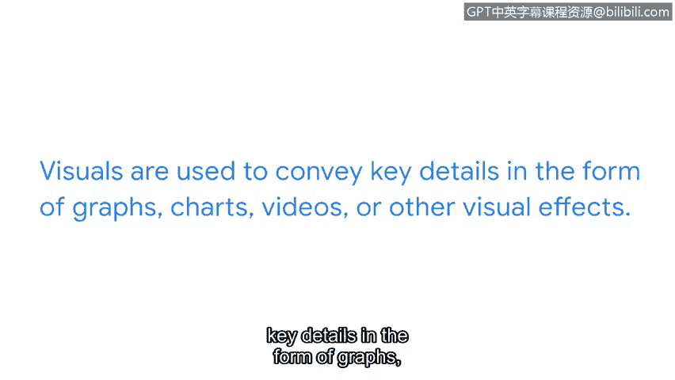

# 谷歌网络安全专业证书第八课：《投入实践：为网络安全工作做好准备》（中英字幕，前面分p中字，后面分p英字） - P58：15_02_building-blocks-of-cybersecurity-communications.en_subtitled - GPT中英字幕课程资源 - BV12x4y1X7h8

Previously， we discussed communicating information that is important to stakeholders。

It's essential that communications are specific and clear。

 so stakeholders understand what's happening and what actions may need to be taken。 In this video。

 we'll go into more detail about how to create precise and clear communications。

Creating security communications to share with stakeholders is similar to telling a great story。

Stories typically have a beginning， middle and end。

Somewhere in that story there some sort of conflict and an eventual resolution。

This concept is also true when telling security stories to stakeholders。

The security story details what the security challenges。

 how it impacts the organization and possible solutions to the issue。

The security story also includes data related to the challenge， its impact and proposed solutions。

This data could be in the form of reports that summarize key findings or a list of issues that may need immediate attention。

Let's use the following scenario as an example。You've been monitoring system logs and notice possible malicious code execution in the logs that could lead to the exposure of sensitive user information。

Now you need to communicate what is happening to a stakeholder。 in this case。

 your immediate supervisor。The first step is to detail the issue。

 potential malicious code execution found while monitoring the logs。

The next step is to refer to the organization's incident response playbook and mention the suggested guidance from the playbook regarding malicious code found in system logs。

This shows your supervisor that you've been paying attention to the procedures already established by the team。

The final piece of your story is to provide a possible solution to the issue。In this scenario。

 you may not be the final decision maker regarding what action is taken。

 but you've explained to the stakeholder what has happened and a possible solution to the problem。😡。

You can communicate the story we just discussed in various ways。Send an email。

 share a document or even communicate through the use of a visual representation。

 You can also use incident management or ticketing systems。

Many organizations have incident management or ticketing systems that follow the steps outlined in their security playbooks。

Some scenarios are better expressed by using visual elements。

Visuals are used to convey key details in the form of graphs， charts， videos or other visual effects。

This allows stakeholders to view a pictorial representation of what is being explained。

Visual dashboards can help you tell a full security story to stakeholders。Later in this course。

 you'll have an opportunity to learn how to use Google Sheets to create a visual security story。

 That's going to be fun。😊，A security professional who knows how to tell a compelling and concise security story can help stakeholders make decisions about the best ways to respond to an incident。

Ideally， you want to be someone that makes stakeholders jobs easier。

And communicating effectively will certainly help you do that。Coming up。

 we'll continue our discussion about communicating with stakeholders。

