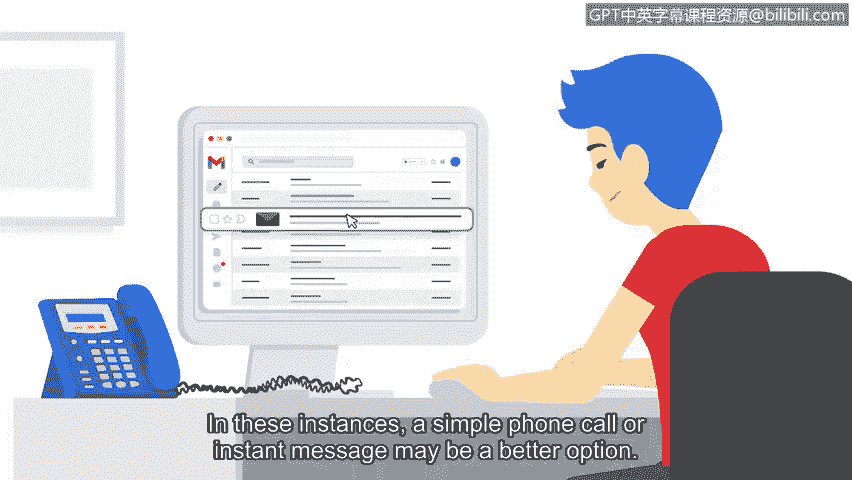

# 谷歌网络安全专业证书第八课：《投入实践：为网络安全工作做好准备》（中英字幕，前面分p中字，后面分p英字） - P59：16_01_visual-storytelling-in-cybersecurity.en_subtitled - GPT中英字幕课程资源 - BV12x4y1X7h8

The ability to communicate threats， risks， vulnerabilities or incidents and possible solutions is a valuable skill for security professionals in this video we'll focus on various communication strategies that can help you engage with and convey key ideas to stakeholders。

Let's start with visuals。The use of visuals to tell a security story can help you communicate impactful data and metrics。

 chartts and graphs are particularly helpful for this。

 They can be used to compare data points or show small parts of a larger issue。

Using relevant and detailed graphics can help you develop the story you want to tell stakeholders so they can make decisions that would help protect the organization。

While visuals are a compelling way to capture the attention of your stakeholders。

 some issues are best explaineding an email or even a phone call。

Be mindful of the sensitive information contained in these types of communications。

For security purposes， it's important to communicate sensitive information with care。

Be sure to follow the procedures outlined in your organization's playbook and always make sure to send emails to the right email recipient。

😡，As it could create a risk if the wrong person receives confidential security information。

One challenging thing about emails is a potentially long wait time for response。

Stakeholders have many responsibilities。 This means they may sometimes miss an email or fail to respond in a timely manner。

In these instances， a simple phone call or instant message may be a better option。

My experience in security has taught me that sometimes a simple instant message or a call can help move a situation forward。

Direct communication is often better than waiting days or weeks for an email response and issue that requires immediate attention When appropriate。

 take the initiative to follow up with a stakeholder if they haven't responded to an email in a timely manner。

😡，It sounds simple， but a friendly call can often prevent a major issue from occurring。

It's important to stand out in the security profession。

Especially if you don't have previous experience in the industry， Vi representations。

 emails and phone calls are great ways to showcase your written and verbal communication skills。

The visual aspect shows your ability to put metrics and data together in an impactful way。

If you don't receive a timely response from a stakeholder， following up shows initiative。

