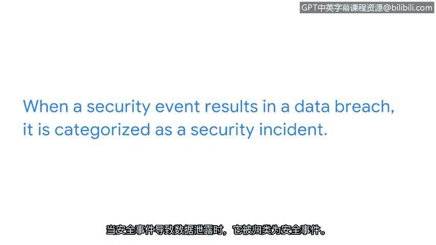

# 谷歌网络安全专业证书第八课：《投入实践：为网络安全工作做好准备》（中英字幕，前面分p中字，后面分p英字） - P5：4_在不忽视的情况下进行检测和保护.zh - GPT中英字幕课程资源 - BV12x4y1X7h8

Welcome back。In earlier courses， we discussed the impact that security incidents can have on the critical data and assets of an organization。

If data and assets are compromised， it can lead to financial pains for an organization。

It can even lead to regulatory fines and the loss of credibility with customers or other businesses in the same industry。

This is why your role in protecting company data and assets is so valuable。

 Collaboration is an exciting part about working in security。

 There are so many individuals across an organization that are interested in various functions of security。

😊，No security professional can do this alone。 Some team members are focused on protecting sensitive financial data。

 Others work on protecting usernames and passwords。

 Some are more focused on protecting third party vendor security。

 and others may be concerned with protecting employees， P I I。

These stakeholders and others have an interest in the role the security team plays for keeping the organization and the people it serves safe from malicious's attacks。

It's important to recognize that the assets and data you protect affect multiple levels of your organization。

One of the most important concerns for an organization is the protection of customer data。

Customers trust that an organization they engage with will protect their data at all times。

 This means credit card numbers， Social Security numbers， emails， usernames。

 passwords and so much more。It's important to keep this in mind when taking on a security role。

Understanding the importance of the data you're protecting is a big part of having a strong security mindset。

As a security professional， it's important to handle sensitive data with care。

While being mindful of the little details to ensure that private data is protected from breaches。

When a security event results in a data breach， it is categorized as a security incident。

However， if the event is resolved without resulting in a breach， it's not considered an incident。

 It's better to be safe when it comes to taking a job in the security profession。

 That means paying attention to details and raising your issues to your supervisor。For example。

 a seemingly small issue， like an employee installing an app on their work device without getting permission from the help desk should be escalated to a supervisor。

This is because some apps have vulnerabilities that can pose a threat to the security of the organization。

An example of a bigger issue is noticing that a log may have malicious code executed in it。

Militious code can lead to operational downtime， survey financial consequences。

 or the loss of critical high level assets。The point is that there are no issues that are too small or too big。

If you're not sure of the potential impact of an incident。

 it's always best to be cautious and report events to the appropriate team members each day on the job as a security professional comes with a level of responsibility to help protect the organization and the people itself。

The decisions you make not only affect the company。

 but also its customers and countless team members across the organization。Remember。

 what you do matters。