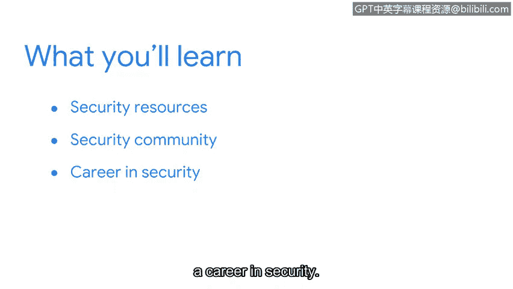

# 谷歌网络安全专业证书第八课：《投入实践：为网络安全工作做好准备》（中英字幕，前面分p中字，后面分p英字） - P62：19_01_welcome-to-week-4.en_subtitled - GPT中英字幕课程资源 - BV12x4y1X7h8

Welcome back。 I'm Emily， and I've been working in security education at Google for nearly nine years。

My team works closely with our remarkable security experts to craft innovative and engaging educational solutions for our workforce to keep security at the forefront。

 I'll be your instructor for the remainder of the course to discuss important career related topics。

 such as how to engage with the security community， find jobs in the security field。

 C a resume and navigate the interview process。😊，We're approaching the end of the certificate program。

 What an incredible journey it's been so far。 We've discussed a lot up to this point。

 including incident detection and escalation and the roles that stakeholders play in protecting an organization。

😊，We've also explored the sensitive nature of the communications we share and strategies for conveying critical information to stakeholders。

 But does the learning stop now that we're approaching the end of the program， Absolutely not。

 In the following videos willll identify reliable security resources you can use to stay up to date on security news and trends。

😊，Then we'll share some ways to become involved with the security community。

We'll end with a discussion about how to establish and advance a career in security Coming up。

 well highlight some great resources to help you stay current on what's happening in the security industry。

😊。

