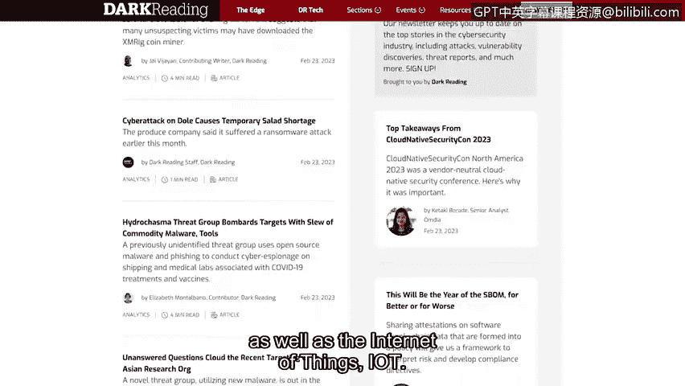

# 谷歌网络安全专业证书第八课：《投入实践：为网络安全工作做好准备》（中英字幕，前面分p中字，后面分p英字） - P63：20_02_helpful-cybersecurity-resources.en_subtitled - GPT中英字幕课程资源 - BV12x4y1X7h8

As we approach the end of our program， it's important to start thinking about ways to engage with the security community。

As the industry evolves， it's essential to stay up to date on the latest security trends and news。

 Let's discuss a few good resources for you to review periodically。

What excites me about the security profession is the constant evolution of the industry。

Take the OOSP top 10， for example。Earlier in the program。

 we discussed the facts that this is a globally recognized standard awareness document that lists the top 10 most critical security risks to web applications。

This list is updated every three to four years， so it's a great example of the evolving nature of the field。

Continuing your security education beyond this certificate program will help you stand out to hiring managers and could give you an extra edge over other candidates。

 because it shows your willingness to remain current on what's happening in the industry。

A few well known security websites and blogs to get you started are CSO Online。

 Krebs on Security and dark Read。The CSL Online site provides news。

 analysis and research on various security and risk management topics。

Many Csos view this site for tips and ideas。 It would be great for you to review this publication every now and then。

😊，Krebs on Security is an in depth security blog created by former Washington Post reporter Brian Krebs。

This blog covers security news and investigations into various cyber attacks。

Accessing the Krebs blog is a good way to stay up to date on the latest security news and happenings around the world。

Dark reading is a popular website for security professionals。

 This site provides information about various security topics like analytics and application security。

 mobile and cloud security， as well as the Internet of things， Io T。

Security is a constantly evolving industry。 As professionals in security。

 we must evolve with it by seeking out new information。

Be sure to explore a few of the websites and blogs we discussed in this video to stay up to date with what's happening in the industry。

Coming up， we'll discuss how to become engaged with the security community and ways to establish and advance your career in security by for now。

😊。