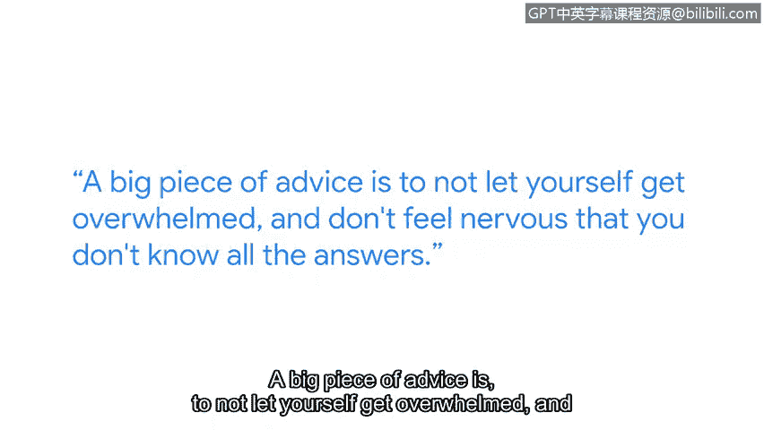
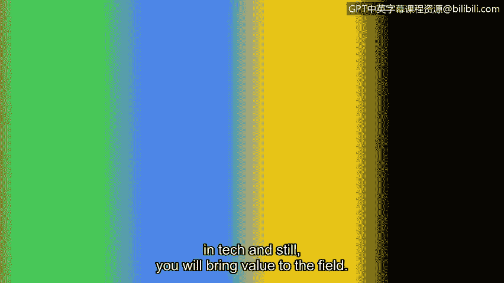

# 谷歌网络安全专业证书第八课：《投入实践：为网络安全工作做好准备》（中英字幕，前面分p中字，后面分p英字） - P66：23_03_sarah-network-in-the-cybersecurity-community.en_subtitled - GPT中英字幕课程资源 - BV12x4y1X7h8

Hi everyone， I'm Sarah and I am a senior program manager on Google's privacy safety and security engineering team One of the communities I'm most involved in is a group called Women in Cysecurity and so I've found that community really helpful to me when I first joined because I felt super new and slightly overwhelmed I listened to a lot of their webinars I kind of look in on their forum board and now I always attend their conference and actually I just joined their board which I'm super excited about one of the things that I find most excited is that ability to be within cybersecurity without this long history I don't have a computer science degree I don't have a masters I don't have a PhD but through networking and figuring out where my areas of interest lie I actually was able to get into this field and grow in advance within this field I've really found that it is a welcoming community that is looking and needs more people to be a part of it there's a huge range of people that are coming into this again with the big wide range of experiences and I think everyone has found or is exploring what their passion。

In the areas they want to dig in networking is really important to be able to meet peers who might be at the same stage as you or people who might have hiring opportunities I definitely recommend connecting with your peers in the certificate program it's a great form of motivation for yourself and to motivate others having these points where you're either talking about the specific content or just doing a checkin is going to be really helpful for you to continue through the course program and to help others continue through the course program as well There's also the series of conferences that exist called besideside so these are super informal security conferences that take place in communities around the world many also have virtual components they're kind of a fun place to meet people。

A big piece of advice is to not let yourself get overwhelmed and don't feel nervous that you don't know all the answers。

 because you know what， Nobody knows all the answers。

 It's okay to come into this with not a ton of background in computer science。

 not a ton of background in tech。 And still you will bring value to the field。

