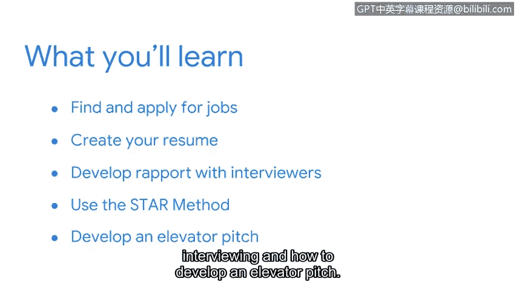

# 谷歌网络安全专业证书第八课：《投入实践：为网络安全工作做好准备》（中英字幕，前面分p中字，后面分p英字） - P68：25_01_welcome-to-week-5.en_subtitled - GPT中英字幕课程资源 - BV12x4y1X7h8

Welcome back。 We've covered so many security related topics in detail。Throughout this program。

 we've discussed protecting organizational assets and data and the tools and procedures used to protect them。

 We've also explored how to communicate with stakeholders。

 reliableable sources to help you stay up to date on security news and trends and ways to get involved with the security community to help establish and advance your career in the field。

 Now， we need to get you prepared to find a job as an entry level security analyst。😊。

Security is a huge field， with countless job opportunities。By 2030。

 the US Bureau of Labor Statistics expects the number of security roles to grow by more than 30 per cent。

But how can you find the right opportunity for you in the next several videos。

 we'll discuss specific strategies to help you find and apply for jobs in the industry。

 including how to create your resume and develop rapport with interviewers。

We'll also cover how to use the star method for interviewing and how to develop an elevator pitch。

I remember initially being interested in my role， because education is my passion。

 Researching the security field and industry in preparation for my interviews cemented my fascination for cyberseity。

😊，I'll be honest， I had taken a lot of what security does for granted。 Now。

 I feel incredibly fortunate to be a part of this industry and the exciting opportunities it offers。

😊，Now， it's time to get you ready to find security jobs。 Let's get started。

