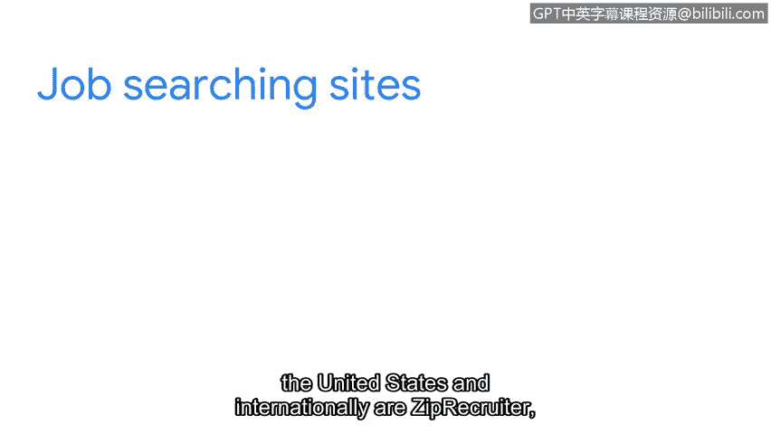

# 谷歌网络安全专业证书第八课：《投入实践：为网络安全工作做好准备》（中英字幕，前面分p中字，后面分p英字） - P69：26_02_find-cybersecurity-jobs.en_subtitled - GPT中英字幕课程资源 - BV12x4y1X7h8

I hope you feel really proud of how far you've come。😊，You may remember that earlier in this program。

 we discussed a few security roles in the industry。 Now we'll explore three of those roles。

We'll start with security analystly。Security analyst is typically an entry level role that might interest you as you prepare to enter the security field。

The role generally focuses on monitoring networks for security breaches。

 developing strategies to help secure an organization and even researching IT security trends。

In previous courses， we discussed log monitoring and SIM tools。

Having a solid foundational understanding of how to use those tools will certainly be useful in this role。

 Another role that might interest you is information security analyst。

This role generally focuses on creating plans and implementing security measures to protect organizations。

 networks and systems。Earlier in the program， you learned about controls and frameworks that can be used to develop security plans and procedures。

 as well as how to use Sims and packet sniffs to identify risks。

That knowledge will be beneficial when it comes to developing plans and determining the best tools to strengthen an organization's security posture。

Finally， we'll explore the Security Op Center analyst role。Security Op Center analystly。

 also known as a SoC analyst， is another role you might find exciting。

This role generally focuses on ensuring security incidents are handled rapidly and efficiently by following established policies and procedures。

Earlier in this program， we discussed security playbooks and how they are unique to each organization。

We also covered the importance of being able to follow the processes outlined in playbooks to respond to security events or incidents。

That knowledge will certainly help you stand out as a potential candidate for this role。

 There are many more job roles that you may be interested in。

A great way to find more of these roles is to create an account on various job sites and search for cybersecurity positions。

A few well known job sites in the United States and internationally are zip recruitcruiter， indeed。

 and monster jobs。

Each of these sites have hundreds of open job listings with roles， responsibilities。

 and skill set requirements posted under the job title。

How exciting is it that we're now discussing jobs and sites that you can use to apply for them。

 It's important that you do your research before applying to any position。😊。

Gather plenty of information about the company， the job role。

 as well as required and preferred skills。This will help prepare you for a potential interview by knowing exactly what the employer is looking for and how your skills align with the employer's expectations。

 This will also help you align your own values and passions with the organization's mission and vision。

 But before you can apply for a security job。 It's important to create a resume that will catch an employer's attention。

 Coming up， we discuss the resume development process in detail。😊。

