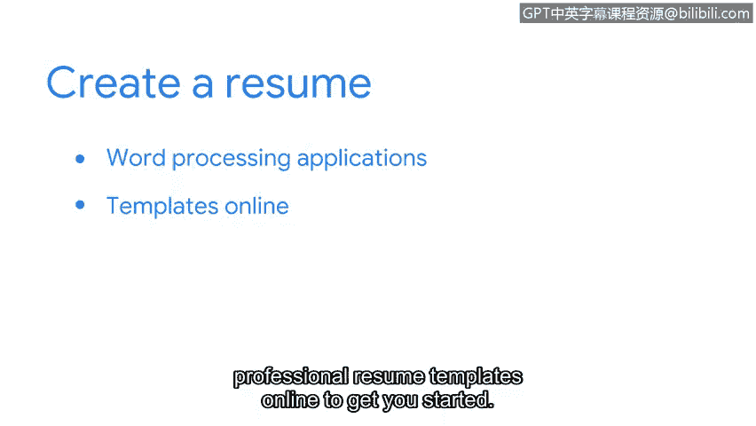

# 谷歌网络安全专业证书第八课：《投入实践：为网络安全工作做好准备》（中英字幕，前面分p中字，后面分p英字） - P70：27_03_create-a-resume.en_subtitled - GPT中英字幕课程资源 - BV12x4y1X7h8

In this video， we'll discuss how to create a resume that is tailored to the job you're applying for。

 Note that a resume is sometimes called a curriculum Vita or C V for short。

Remember that it's okay if you don't have any cybersecurity experience。

 This certificate program has covered key skills and concepts that employers are looking for in an entry level security analyst position。

You can mention all that you've learned in this program on your resume。

 including programming languages such as Python and SQL and Linux line command。

 You can also share your understanding of what it means to have a security mindset。

 your knowledge of standard frameworks and controls like the NISist， CF and CIA triad model。

 as well as your familiarity with how to use Sim tools and packet s sniffs。

It's also possible that some of your earlier job experiences allowed you to develop knowledge and skills that are transferable to a security role。

 These skills could include being detail oriented， collaborative and having strong。

 written and verbal communication skills。 Here's an example of a resume。

You'll want to start with your name at the top of the resume， followed by your professional title。

Your title could be something like security analyst or a title that matches the position you're applying for。

You'll also want to include at least one way that employers or recruiters can contact you。

 For example， an email address or phone number。After your name and title。

 you'll provide a summary statement。This section should be brief。

 Just one or two sentences related to your strengths and relevant skills。

 Make sure the statement includes specific words from the responsibilities section of the job description。

You can include something like this in your statement。

 I am a motivated security analyst seeking an entry level cyberse position to apply my skills in network security。

 security policy and organizational risk management。

Following your name and summary statement is the skills section。

 This is a bulleted list of the skills you've learned in this program that are related to the position。

Employers usually like to know about your previous work experience in the experience section。

 you'll list your work history underneathath each job entry。

 provide a list of the skills and responsibilities you performed。😊。

It's a good idea to start each bullet with a verb。 And if possible。

 details that quantify an accomplishment。😊，For example。

 collaborated with a team of six to develop training for more than 25 company employees。

Try to highlight the security or technology related skills and knowledge that you have based on your experiences in previous jobs and this certificate program。

The next section of the resume lists your education and certifications。

 Start with the most recent education you've completed， including certifications， trade schools。

 online courses or college experience。 Also include the names of sites and organizations that issued your certifications and schools you attended。

 List any subjects you studied related to the job youre applying for。

If you're currently enrolled in school or a certification program， but haven't graduated。

 note in progress。As you develop your resume， keep a couple of things in mind。

 Make sure there are no spelling or grabbmatical errors in your resume before sending it to your potential employer。

 Also， note that resumes are typically about two pages long and list only your last 10 years or less of work experience。

Resumes can be created using Word processing applications like Google Docs or Open Office， however。

 you might find some simple but professional resume templates online to get you started to find them type free resume template or a similar search term into your internet browser。

If you use a template， be sure to replace all of the prefil text with your information and qualifications。

There is so much to consider when creating your resume。

 But what we covered today will help you get started。Coming up， we'll explore the interview process。

