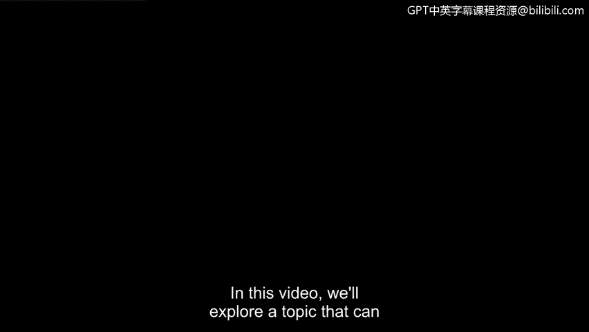
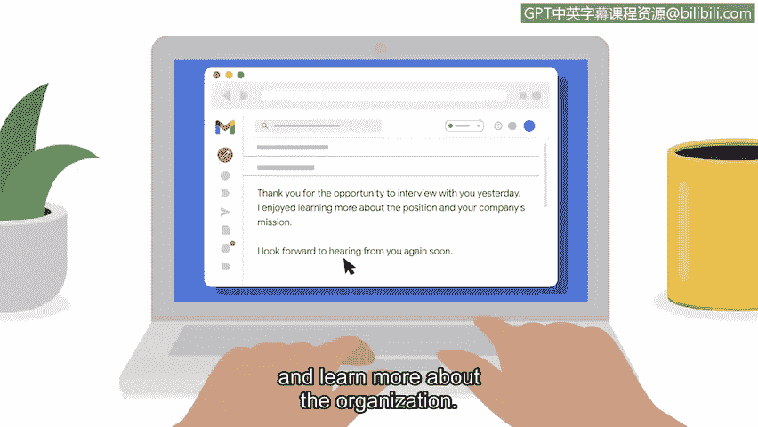

# 谷歌网络安全专业证书第八课：《投入实践：为网络安全工作做好准备》（中英字幕，前面分p中字，后面分p英字） - P75：32_06_build-rapport-with-interviewers.en_subtitled - GPT中英字幕课程资源 - BV12x4y1X7h8

In this video， we'll explore a topic that can contribute to your success during the interview process。

 how to build rapport with your potential employer。

 rapport is a friendly relationship in which the people involved understand each other's ideas and communicate well with each other。

😊，Building rapport begins with the very first interaction you have with the company's staff by phone。

 email， or video conference。It's important to use a professional tone in the email you write。

 expressing your interest in the job。But it's also important to be polite and friendly。

Expressing appreciation for being considered and having the potential opportunity to interview is one way to build rapport。

When and if you have an initial phone screen， you can use a friendly。

 conversational tone of voice to do this， try smiling while you talk。😊。

And while it's true that nobody can see you smile on a phone call。

 smiling while you talk can make you sound friendlier。😊。

During the phone screening and in person interview。

 you can ease interview nervousness by engaging actively in a way that feels natural to you。

 That can mean simply saying， hello， nice to meet you。😊，You can even start a short。

 friendly conversation by asking the interviewer how their day is going。

Or if the weekend just passed， you might ask the interviewer， how is your weekend。

Make eye contact when you ask these questions during an in person interview。

 or be sure to look directly into the camera during a video interview。

This will show the interviewer that you're engaged in the conversation。Oftentimes。

 during the second half of an interview， the interviewer will ask if you have any questions for them。

As we discussed earlier， it's important to have some questions prepared to ask at this point。

 Here are some suggestions。 You could ask， what is the biggest challenge I might face coming into this role。

 And how would I be expected to meet that challenge， or you might ask。

 what would you say is the best part about working for this company or what is the typical day like for an analyst。

Another great question is， what is the potential for growth in this role。

Asking questions shows that you're engaged in the conversation and are interested in the company and the position。

It also shows the employer that you are confident and that you want to make sure that their company is a good match for you before you make a commitment。

 It's nice to send a follow up email a day or two after your in person interview。

 This is just a brief email。 Thanking the interviewer for the opportunity to meet with them and learn more about the organization。

😊。

It's also a good idea to mention something specific from your interview in this email。

 It shows that you are actively engaged in the conversation。 Remember。

 the employer is probably interviewing other candidates。

 So sending a follow up email will help set you apart and remind the interviewer of your discussion。

Building rapport with the interviewer and other employees is an important skill when interviewing for your first security position。

Writing friendly but professional emails before and after the interview and engaging in friendly conversation during the interview can help set you apart as a great candidate for the job。

😊。