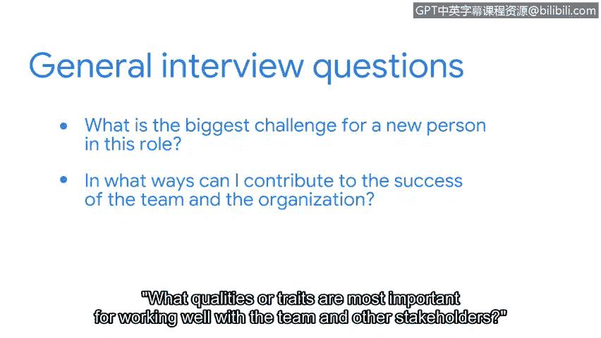

# 谷歌网络安全专业证书第八课：《投入实践：为网络安全工作做好准备》（中英字幕，前面分p中字，后面分p英字） - P77：34_05_ask-the-interviewer-questions.en_subtitled - GPT中英字幕课程资源 - BV12x4y1X7h8

In this video， we'll take a little time to discuss additional strategies you can use during a job interview。

In past job interviews， your potential employer may have asked，Do you have any questions for me？

This type of question can be an opportunity for you to show the interviewer that you're prepared and ready to have a meaningful conversation with them。

A big part of interview preparation is researching the company before the interview。

 because it will allow you to ask questions that demonstrate you took the time to learn about the organization and its needs。

These kinds of questions show that you are passionate about your career and that you want to help the company strengthen its security posture。

There are also some general questions you can ask the interviewer to determine if the job and the organization itself are a good match for you。

Here are some examples。What's the biggest challenge for a new person in this role？

In what ways can I contribute to the success of the team and the organization？

What qualities or traits are most important for working well with the team and other stakeholders？

Questions like these can help you develop rapport with the interviewer and show that you're interested in learning more about the role and the organizational culture。

Interviewing for jobs can be a really exciting process when you're prepared and asking questions is an essential part of the interview process。

😊，Don't be afraid to ask potential employers tough questions。

 This will help them understand you as a thoughtful， curious person who can add value to the team。

Coming up， we'll discuss another strategy， the elevator pitch。

