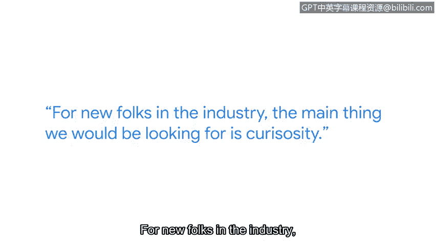
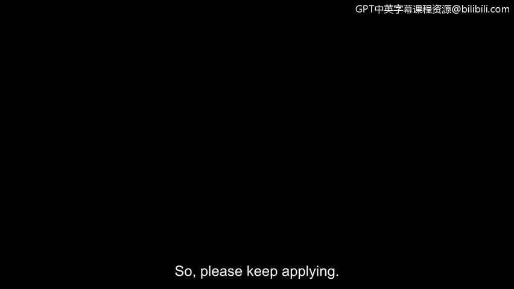

# 谷歌网络安全专业证书第八课：《投入实践：为网络安全工作做好准备》（中英字幕，前面分p中字，后面分p英字） - P78：35_06_karan-interview-tips-from-a-hiring-manager.en_subtitled - GPT中英字幕课程资源 - BV12x4y1X7h8

。

Hi， I'm Karan。 I'm a security engineering manager here at Google as part of my job I do participate in hiring candidates and so far I've spoken to like hundreds of candidates。

 potential candidates， people who actually got into Google almost every time I meet somebody I get to see a new path and that's always fascinating for me to learn about somebody else One thing I'm seeing very interestingly is the increase in the number of people who come from nontechnical background so that can be recruiting sales like you name it like we are we' are seeing a ton of people So for preparing for interviews。

 I think you can break down that question into technical preparation and non-technical preparation and so for technical preparation I advise people to build up on networking fundamentals information security fundamentals get all of those concepts right so you understand how things work how are they related and all of that make sure you ask clarifying questions to get to the root of the problem and what the interviewer wants from you a lot of people just dive into the problem without really clarifying if you don't know something't。

Afraid to say I don't know and say， but here's how I would approach the problem for the non-technical pieces。

 I think it's practice with a friend have an interview partner and see how you respond。

 see where you fumble and be kind to yourself as you're doing that focus on bringing your whole self to the interview。

 So that means showcasing how youll work with the team bring up examples of projects you have done with others how you have led those projects have you done open source collaborations a lot of these soft scale。

 if I might put them as are super crucial when even when you' are solving a security problem。

 So those are some key aspects that we are looking for when we are interviewing for roles for new folks in the industry。

 the main thing we would be looking for is curiosity like personally speaking。

 I look for people who have drive who are very driven to learn more about the field they may not know everything and we know that but we want to make sure that they are asking the right questions and getting to the problem by working with others。

 So if you get an answer like I don't know， but I'll figure it out。

Here's how that's amazing。 Also， I'll say， don't be afraid of rejection， right。

 because it takes time to find your first role。 It took me hundreds of applications to find much a first job。

 And then don't be afraid to apply， even if you don't meet all the required or preferred qualifications。

 right， just look at the minimum qualifications。 And if you do pass that， you know。

 it doesn't have to apply。 So please keep applying。😊。

