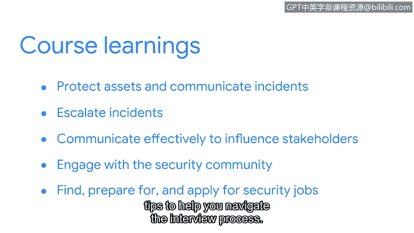

# 谷歌网络安全专业证书第八课：《投入实践：为网络安全工作做好准备》（中英字幕，前面分p中字，后面分p英字） - P82：39_03_course-wrap-up.en_subtitled - GPT中英字幕课程资源 - BV12x4y1X7h8

Congratulations on completing the final course of the certificate program。

 We covered a lot of information。 So let's take a moment to review。

 We started by discussing how to protect assets and communicate incidents by developing a security mindset。

 Then we covered when and how to escalate incidents to the appropriate team members to make sure that small issues don't become big problems for an organization and the people it serves。

 Next， we explored ways to communicate effectively to influence stakeholders' decisions related to security。

😊，This included discussions about how to use visuals to convey important information and sending emails。

 making phone calls or sending instant messages。After that。

 we shared some ways to engage with the security community。

 including attending conferences and connecting with other analysts through a networking site。

 Then we moved on to the final section of the course， which covered how to find。

 prepare for and apply for jobs。 This included discussions about how to create a compelling resume。

 and tips to help you navigate the interview process。😊。

It's been an absolute pleasure guiding you through this journey。

