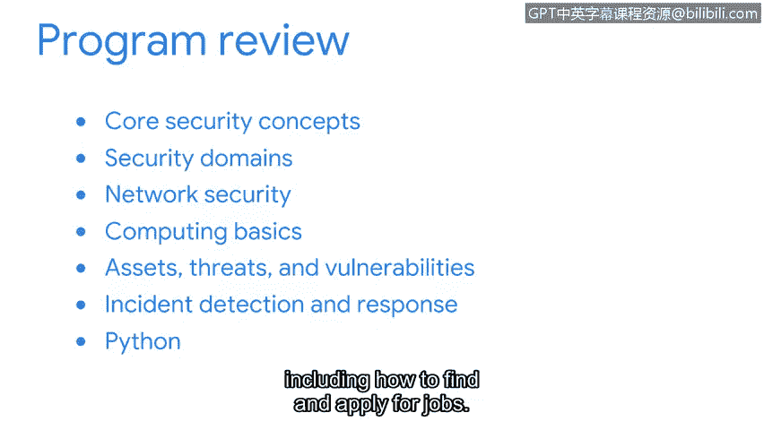
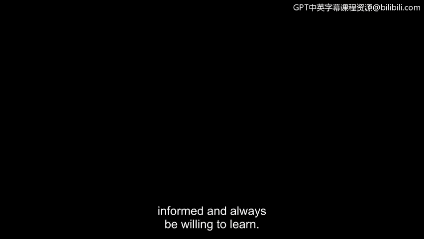

# 谷歌网络安全专业证书第八课：《投入实践：为网络安全工作做好准备》（中英字幕，前面分p中字，后面分p英字） - P83：40_01_recap-of-the-google-cybersecurity-certificate-program.en_subtitled - GPT中英字幕课程资源 - BV12x4y1X7h8

This certificate covered some rigorous security content。 You could have given up at any point。

 but you didn't。 And for that， you deserve to be proud of yourself。

As we discussed at the beginning of this program， the security field is growing and in need of security professionals。

 just like you， to help protect organizations around the world and the people they serve。

 The knowledge and skills you've obtained throughout this certificate program will allow you to begin applying for entry level security analyst jobs。

 Now， let's take a moment to summarize what we've discussed throughout this program。😊。

We started by exploring core security concepts， including the definition of security and core skills。

Then we covered the focus of eight security domains and discussed how security supports critical organizational operations。

Following that， we discussed network security， including network architecture and the mechanisms used to secure an organization's network。

In the next course， we turned our focus to computing basics for security analysts。In this section。

 we introduced Linux and SQL， After that， we explored assets， threats and vulnerabilities in depth。

This included discussions about how assets are classified and the security controls used by organizations to protect valuable information and minimize risks。

In the next course， we focused on incident detection and response here。

 we defined what a security incident is and explained the incident response life cycle。

In the following course， we introduced the Python programming language and explored how to develop code related to common security tasks。

Finally， in the last course of the program， we explored topics related to your pathway into the security profession。

 including how to find and apply for jobs。

You put a lot of valuable time and energy into completing this certificate program。

Remember that the learning doesn't stop here as you move forward in your career。

 Always be mindful of the new trends developing in the world of security。😊。

As technology continues to advance， the threats to organizations and people will evolve as well。

 It's up to you to stay informed and always be willing to learn。

