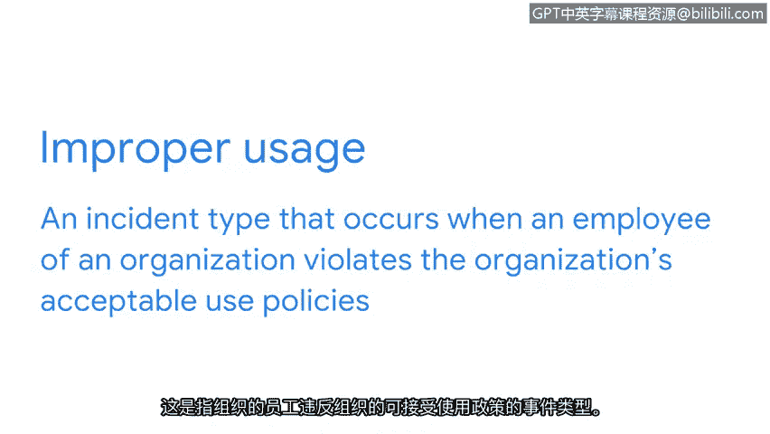

# 谷歌网络安全专业证书第八课：《投入实践：为网络安全工作做好准备》（中英字幕，前面分p中字，后面分p英字） - P9：8_准备通过安全认知进行升级.zh - GPT中英字幕课程资源 - BV12x4y1X7h8

Previously， we defined what it means to escalate an incident。

We also discussed the skills needed to properly escalate incidents when the time comes。

 In this video， we're going to cover a few incident classification types to be aware of。

Maway infection， unauthorized access and improper usage。

A malway infection is the incident type that occurs when malicia software designed to disrupt a system。

 infiltrates an organizations， computers or network。As discussed in a previous course。

 malware infections can come in many forms。Some are simple， and others are a bit more complex。

One example is a phishing attempt。 These are relatively simple malware infections。

Another example is a ransomware attack， which is considered much more complex。

Mware infections can cause a systems network to run at unusually low speeds。

Attackers can even prevent an organization from viewing critical data unless the organization pays the attacker ransom to unlock the data。

This incident type is especially impactful to an organization because of the amount of sensitive data stored on an organization's network and computers。

Escalating mali infections is an important aspect of protecting the organization that you work for。

But wait， there's more。The second incident type we'll discuss is unauthorized access。

This is an incident type that occurs when an individual gains digital or physical access to a system or application without permission。

As you may recall， earlier in the program we discussed brute force attacks。

 which used trial and error to compromise passwords， login credentials and encryption keys。

These attacks are often used to help attackers gain unauthorized access to organization systems or applications。

All unauthorized access incidents are important to escalate。😡，However。

 the urgency of that escalation depends on how critical that system is to the organization's business operations。

We'll explore this idea in more detail later in this course。

The third incident we'll discuss is improper usage。

This is an incident type that occurs when an employee of an organization violates the organization's acceptable use policies。

This one can be a bit complicated。Their instances when improper usage is unintentional。 For example。

 an employee may attempt to access software licenses for personal use or even use a company system to access a friend's or coworkerer's data。

Maybe the employee wasn't not aware of the policy they were violating。

Or maybe the policy wasn't properly defined and communicated to employees。

But there are other times where improper usage is an intentional act。

So how do you know if an improper usage incident is accidental or intentional？

That can be a difficult decision to make。That's why improper usage incidents should always be escalated to a supervisor as a member of an organization security team。

 it's likely that you'll encounter a variety of incident types while on the job。

So it's important to know what they are and how to escalate them。

