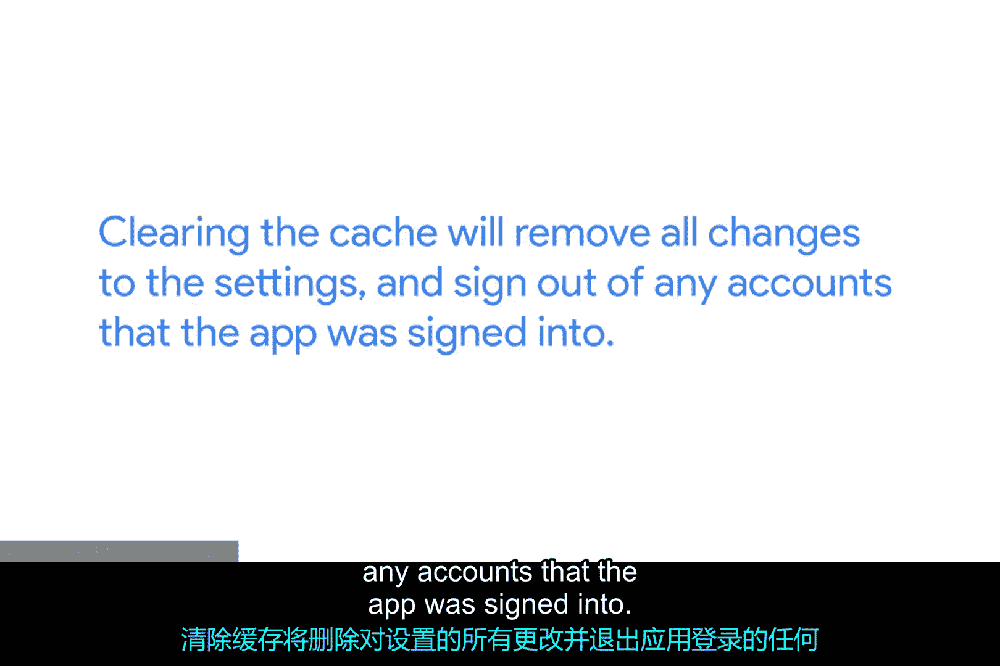

# 谷歌《IT支持（计算机网络⧸操作系统，第2、3课⧸共5课）｜Google IT Support》中英字幕deepseek -BV1uyqcYpExr_p145-

Now， let's talk about software and mobile operating systems。

We're going to mostly use examples from i and Android。

 but other mobile operating systems work in a similar way。

 If your mobile device is using a specialized O， you'll find information on how that software works and the device's documentation。

 Soft from mobile Os is is distributed as mobile applications or apps。

 Apps have to come from a source that the mobile device has been configured to trust。On most Oss。

 you can't just download an app from a random website and install it。 Instead。

 mobile operating systems use app stores。Appt stores are a central managed marketplace for app developers to publish and sell mobile apps。

The app store app acts like a package manager， and the app store service acts like a package repository。

 People use app stores to access free and paid applications from a central source through a single interface。

 Apps published through an app store have usually been through a security review and have been approved by the store owner。

Apps published through an app store are signed by the developer of the app。

The O S is configured to only trust code that's been signed by publishers that it recognizes。

We'll talk more about code signing in a future module。 For now。

 just think of it like signing a letter。 The developer is saying I wrote this。

 There is one way that code signing is different than signing a letter， though。

 If anyone changes the code， the signature becomes invalid。

 This lets the operating system know if the codes been tampered with centralized app stores work great for apps that are available to the public。

 But what if your organization needs to run some type of custom app。

You'll need to use Enterprise app Management， which allows an organization to distribute custom mobile apps。

These apps were developed by or for the organization and aren't available to the general public。

 Enter apps are signed with an enterprise certificate that has to be trusted by the devices that are installing the applications As an I T support specialist。

 you might help manage enterprise app installation through a mobile device management or M DM service。

Which we'll learn about in a future video。 There's one other way to install an app onto a mobile O S。

 And that's called side loading。 Side loading is where you install mobile apps directly。

 without using an app store。Site loading packages is riskier than installing through an app store。

 and you would generally only do this if you're an app developer。

 mobilele apps are standalone software packages， so they contain all their dependencies。

When you install an app， it will already have everything it needs to run baked in。

 mobile apps are assigned a specific storage location for their data as they use a mobile app。

 anything that's changed or created with that app will end up in that app。

 assigned storage location or cash。So resetting a mobile app to how it was when it was first installed is as simple as deleting or clearing the cache in your I T support role。

 you might help people troubleshoot mobile apps。 Cling the cache will remove all changes to the settings and sign out of any accounts that the app was signed into。

It might not be the first thing you should try when trying to wrangle in unruly app。

But it is a great technique for when things are really broken。

Check out the supplemental reading for a guide on how to do this mobile devices will usually be configured to check for app updates on a regular schedule in IT support you might need to make sure an app's updated。

You'll find details on how to check for app updates in the supplemental reading。

