# 谷歌《IT支持（计算机网络⧸操作系统，第2、3课⧸共5课）｜Google IT Support》中英字幕deepseek -BV1uyqcYpExr_p70-

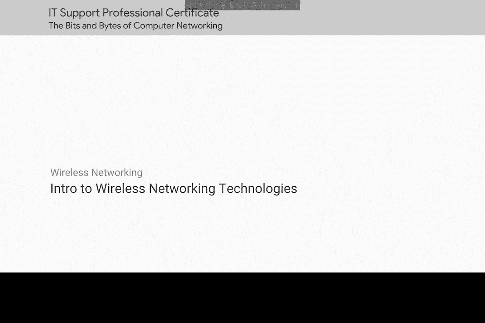

In today's world， fewer and fewer devices are weighed down by physical cables in order to connect to computer networks。

With so many portable computing devices in use from laptops to tablets to smartphones。

 we've also seen the rise of wireless networking。 Wire networking is exactly what it sounds like。

 a way to network without wires。 By the end of this lesson。

 you'll be able to describe the basics of how wireless communication works。

 you'll know how to tell the difference between infrastructure networks and ad hoc networks。

 you'll be able to explain how wireless channels， help wireless networks operate。

 and you'll understand the basics of wireless security protocols。😊。

These are all invaluable skills as an IT support specialist since wireless networks are becoming more and more common in the workplace。

 the most common specifications for how wireless networking devices should communicate are defined by the iEE802。

11 standards。This set of specifications also called the 80211 familyMake up the set of technologies we call Wi Fi。

Wireless networking devices communicate with each other through radio waves。Different 802。

11 standards generally use the same basic protocol but might operate at different frequency bands。

 a frequency band is a certain section of the radio spectrum that's been agreed upon to be used for certain communications in North America。

 FM radio transmissions operate between 88 and 108 MHz。

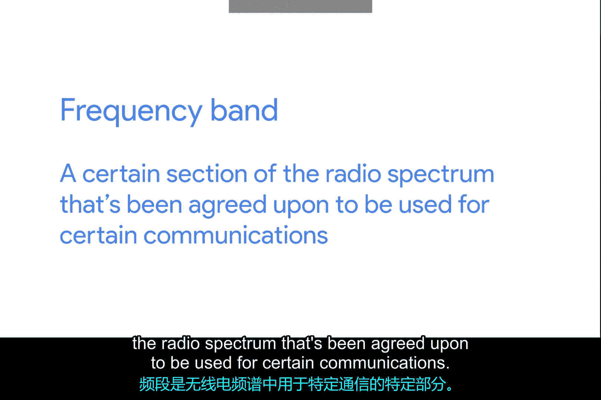

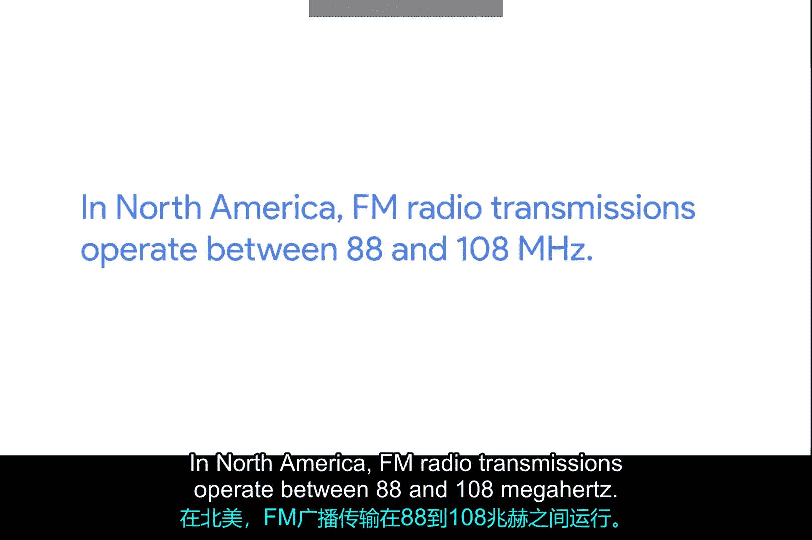

This specific frequency band is called the FM Bro band。

Wifi networks operate on a few different frequency bands， most commonly the 2。

4 gigahz and 5 gigahHz bands， there are lots of 802。11 specifications。

 including some that exist just experimentally or for testing。

 the most common specifications you might run into are 802。11 B。802。11 A， 802。11 G。802。11 n and 802。

11AC。 We won't go into detail about each one here for now。

 just know that we've listed these in the order they were adopted。Each newer version of the 802。

11 specifications has generally seen some improvement。

 whether it's higher access speeds or the ability for more devices to use the network simultaneously in terms of our networking model。

 you should think of 802。11 protocols as defining how we operate at both the physical and the data link layers。

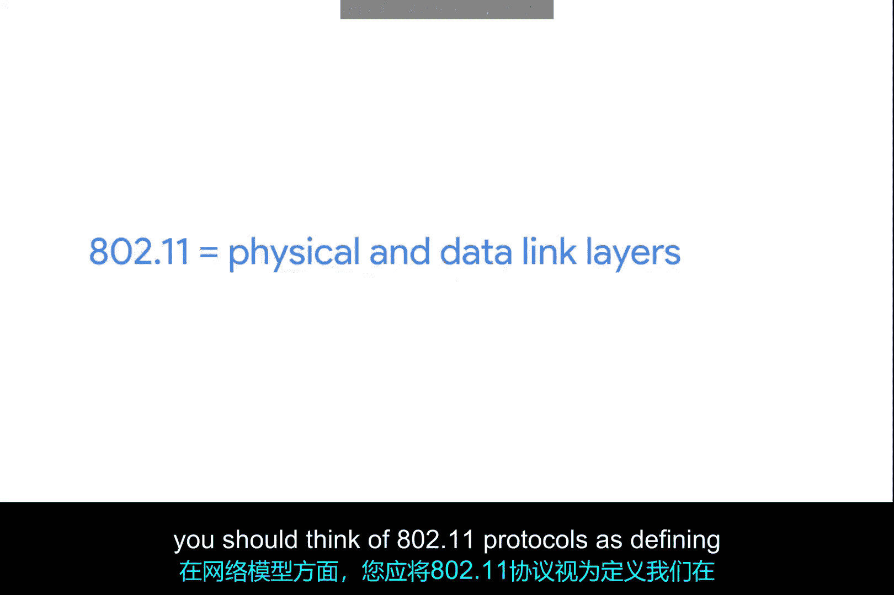

An 802。11 frame has a number of fields。The first is called the frame control field。

 This field is 16 B long and contains a number of sub fields that are used to describe how the frame itself should be processed。

 This includes things like what version of the 802 do 11 was used。

 The next field is called a duration field。 It specifies how long the total frame is。

 So the receiver knows how long it should expect to have to listen to the transmission。 After this。

 our four address fields。 Let's take a moment to talk about why there are 4。

 Instead of the normal two。 We'll discuss different types of wireless network architectures in more detail later in this lesson。

 but。😊。

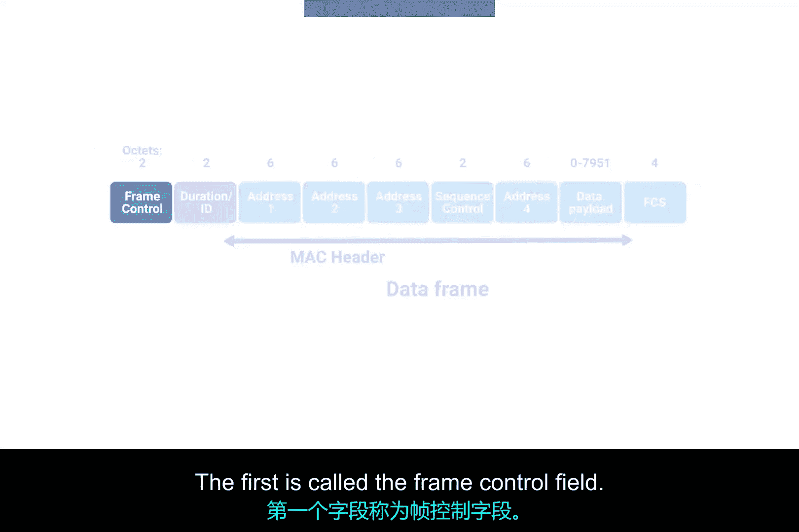

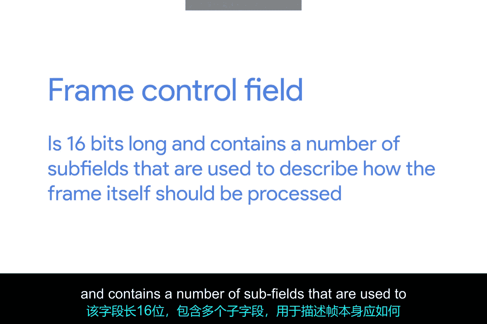

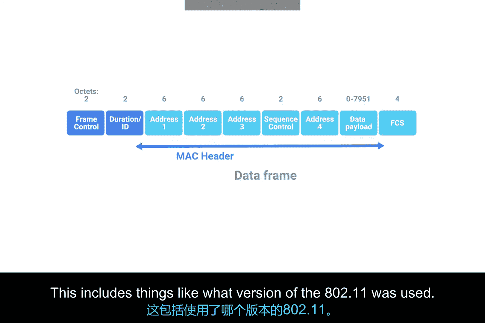

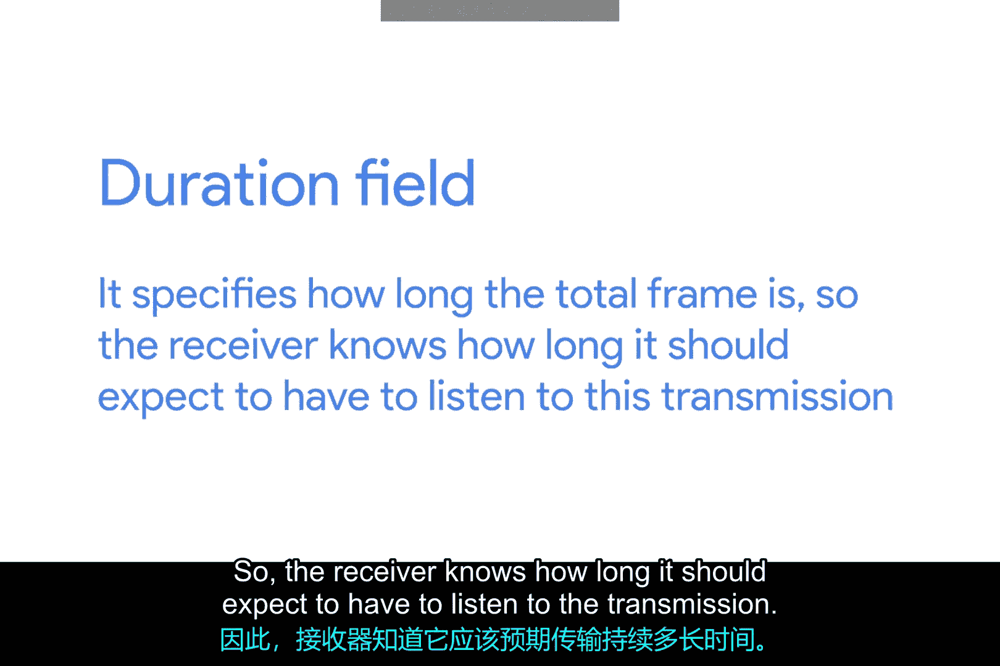

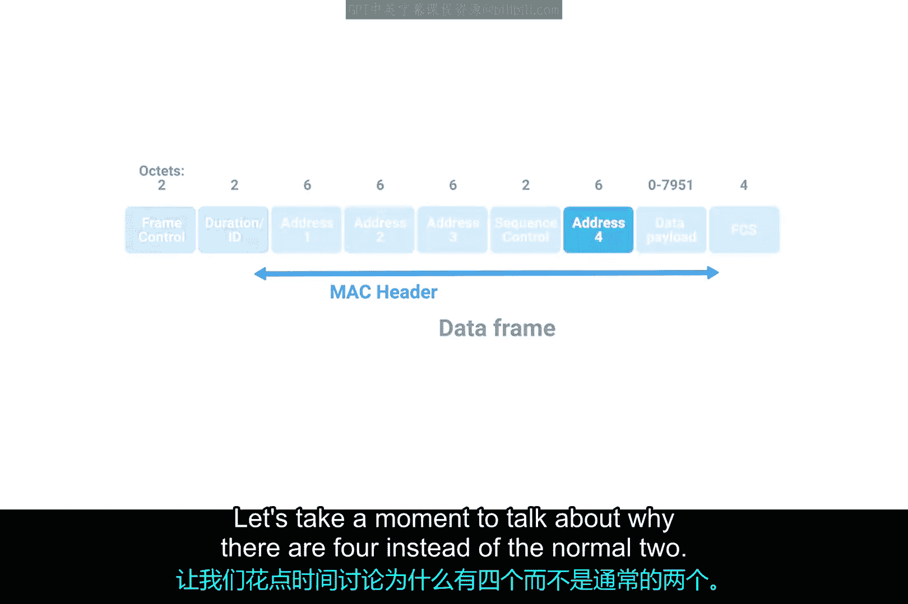

The most common setup includes devices called access points。

 A wireless access point is a device that bridges the wireless and wired portions of a network。

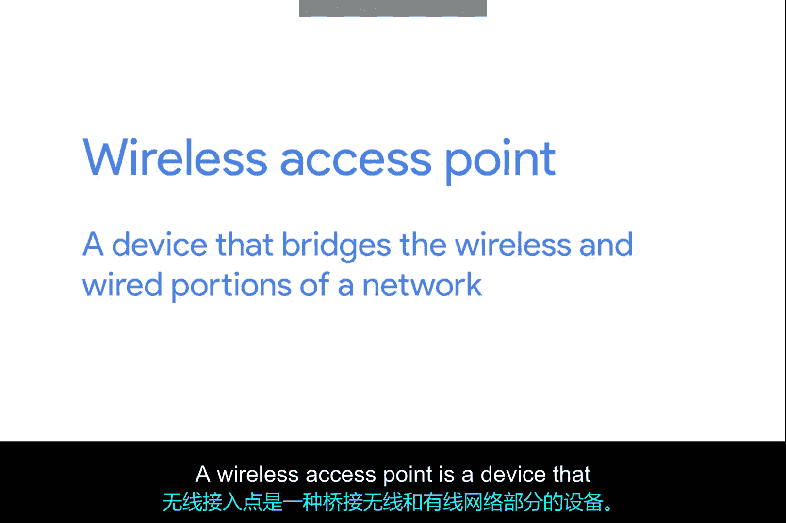

A single wireless network might have lots of different access points to cover a large area devices on a wireless network will associate with a certain access point。

This is usually the one they're physically closest to。

 but it can also be determined by all sorts of other things like general signal strength and wireless interference。

Associations isn't just important for the wireless device to talk to a specific access point。

 it also allows for incoming transmissions to the wireless device to be sent by the right access point。

There are four address fields because there needs to be room to indicate which wireless access point should be processing the frame。

 so we'd have our normal source address field， which would represent the Mac address of the sending device。

 but we'd also have the intended destination on the network。

Along with a receiving address and a transmitter address。

 the receiver address would be the Mac address of the access point that should receive the frame and the transmitter address would be the Mac address of whatever has just transmitted the frame in lots of situations。

 the destination and receiver address might be the same。 Usually。

 the source and transmitter addresses are also the same。

 But depending on exactly how a specific wireless network has been architected。

 This won't always be the case。 Sometimes wireless access points will relay these frames from one another。

 Since all addresses in an 802。11 frame or Mac addresses， Each of those four fields is 6 by long。

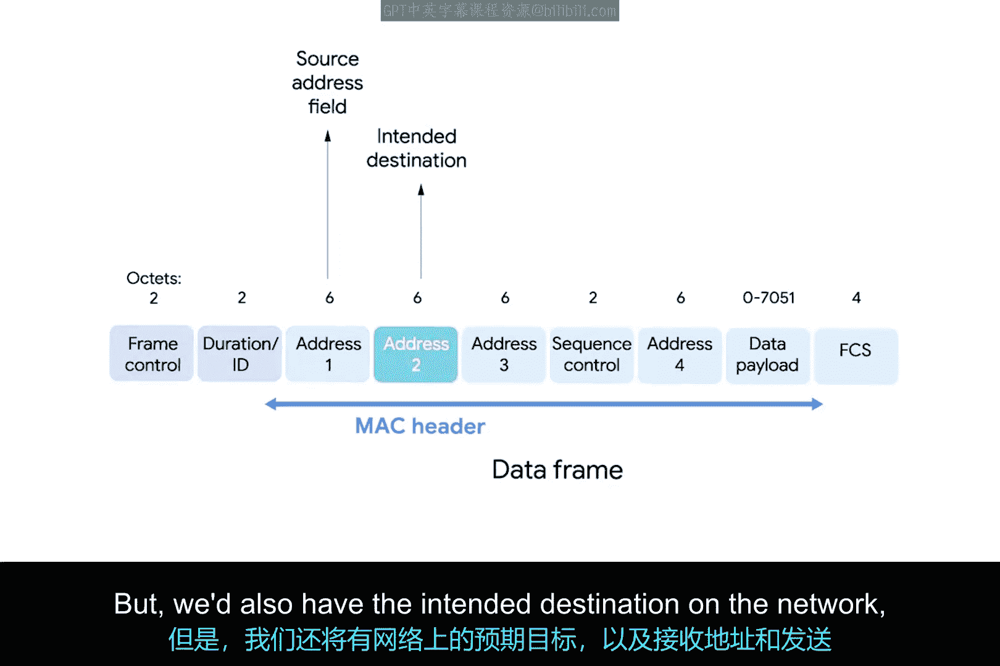

In between the third and fourth address field， you'll find the sequence control field。

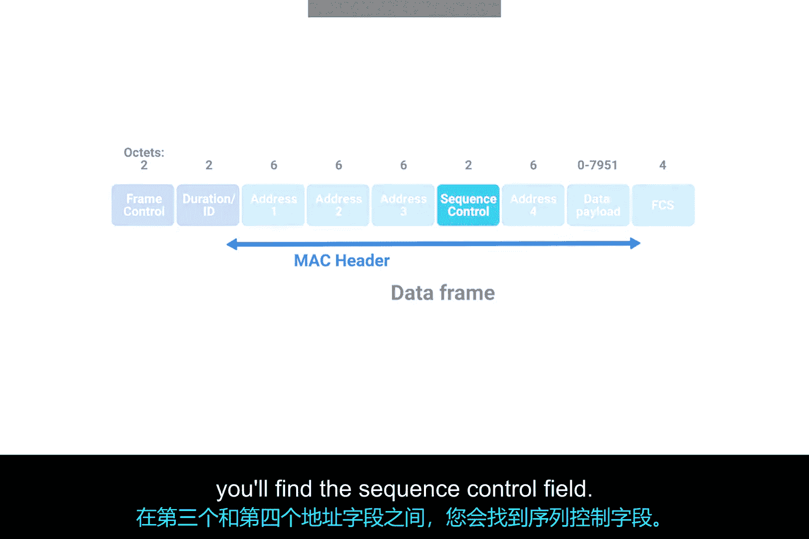

The sequence control field is 16 bits long and mainly contains a sequence number used to keep track of ordering the frames after this is the data payload section。

 which has all of the data of the protocols further up the stack。

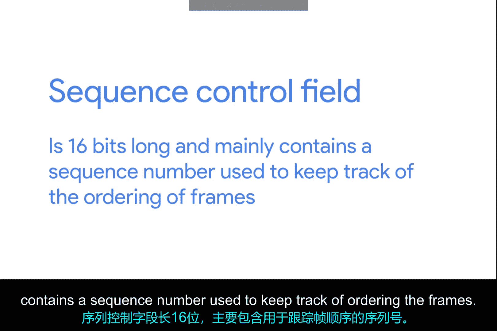

Finally， we have a frame check sequence field， which contains a checkum used for a cyclical redundancy check。

 just like how Ethernet does it。

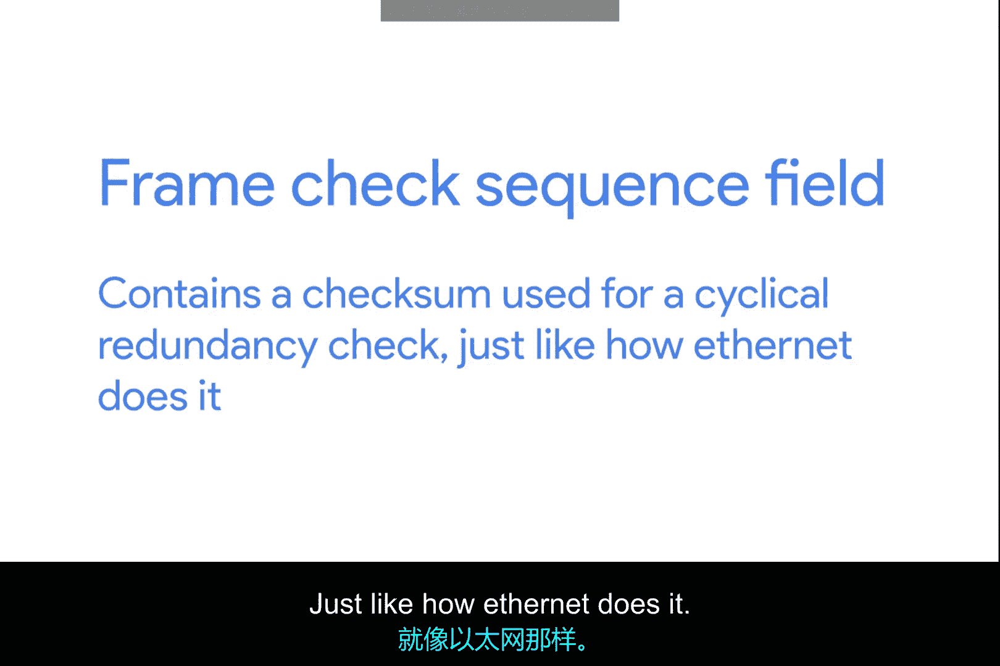