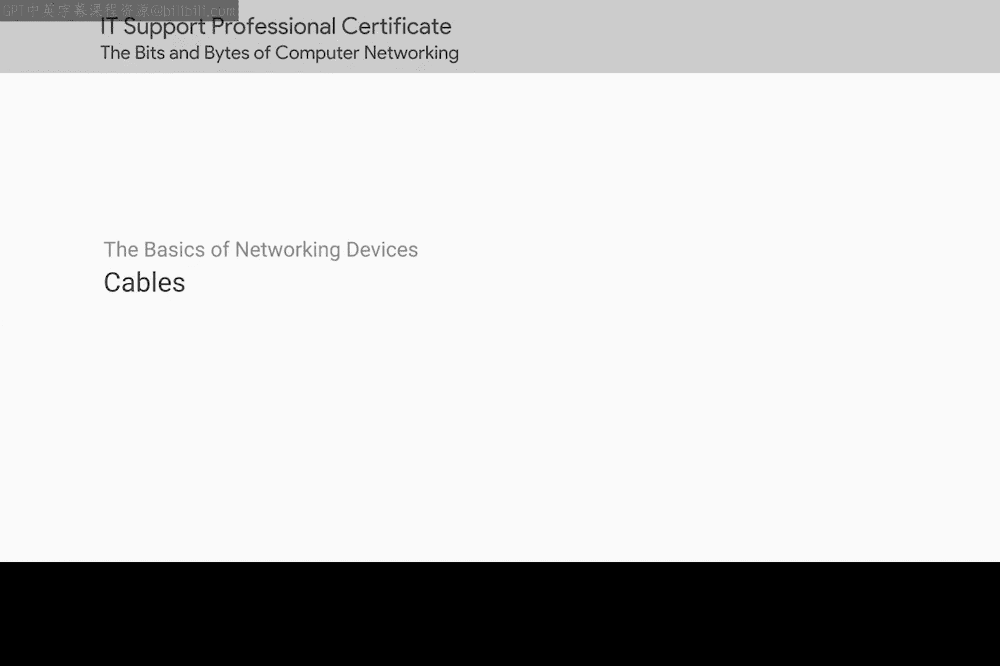
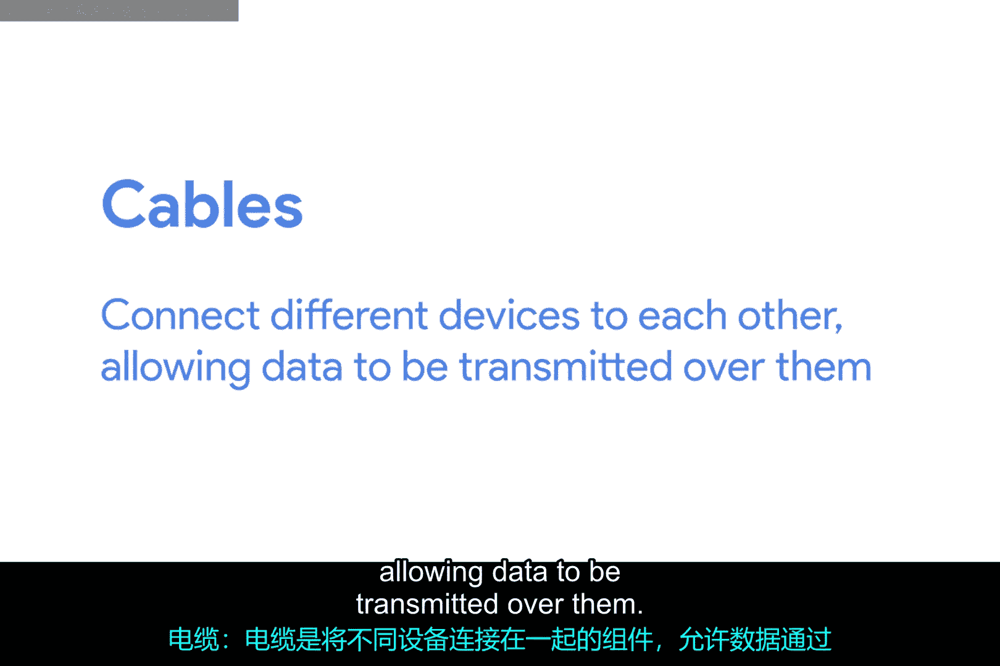
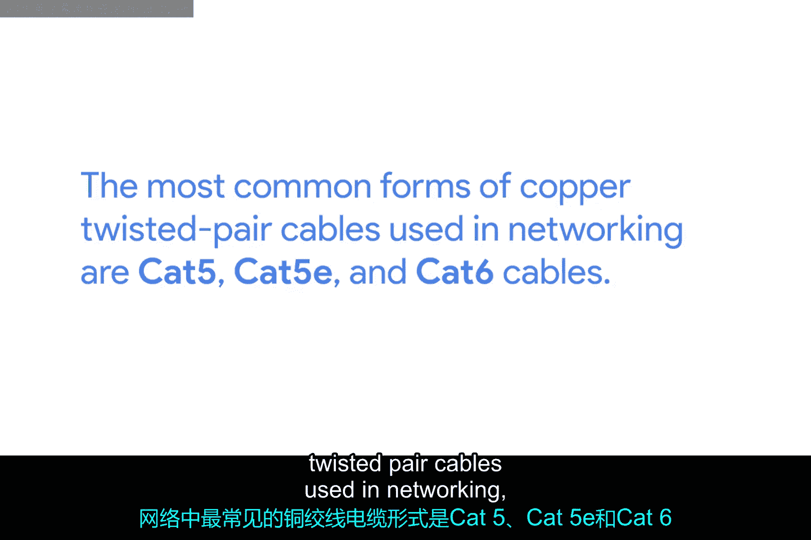
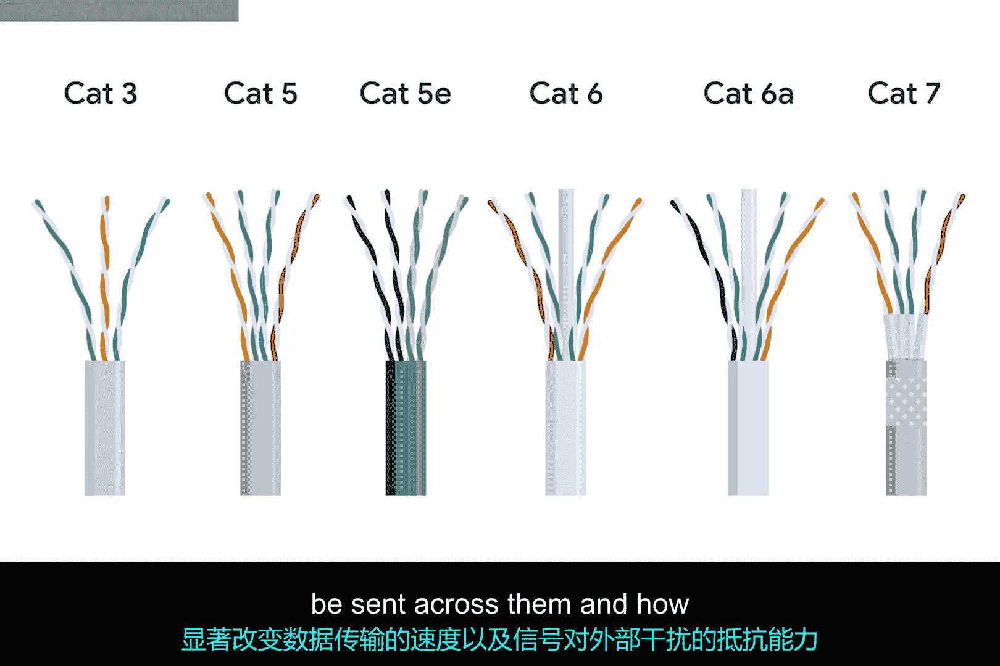
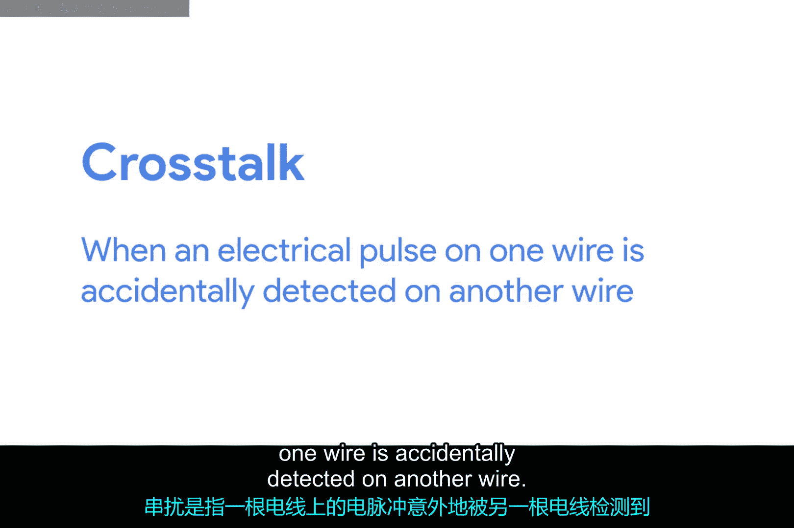
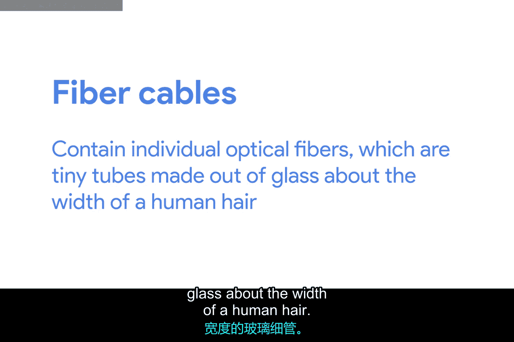
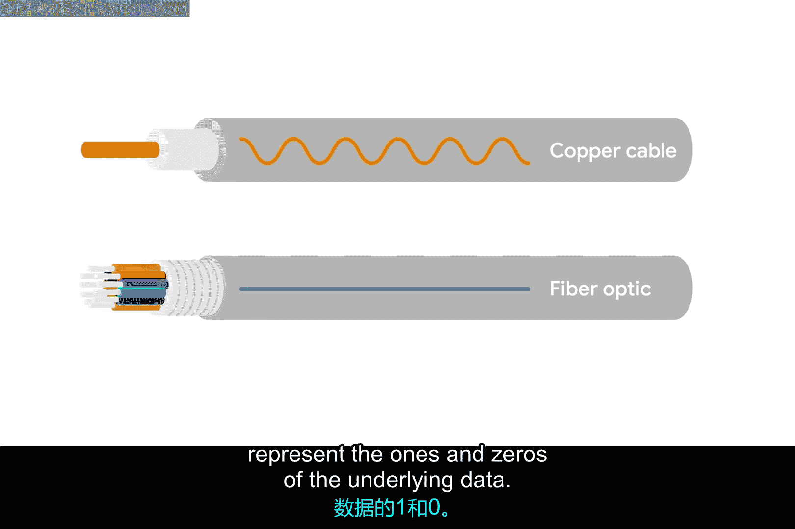
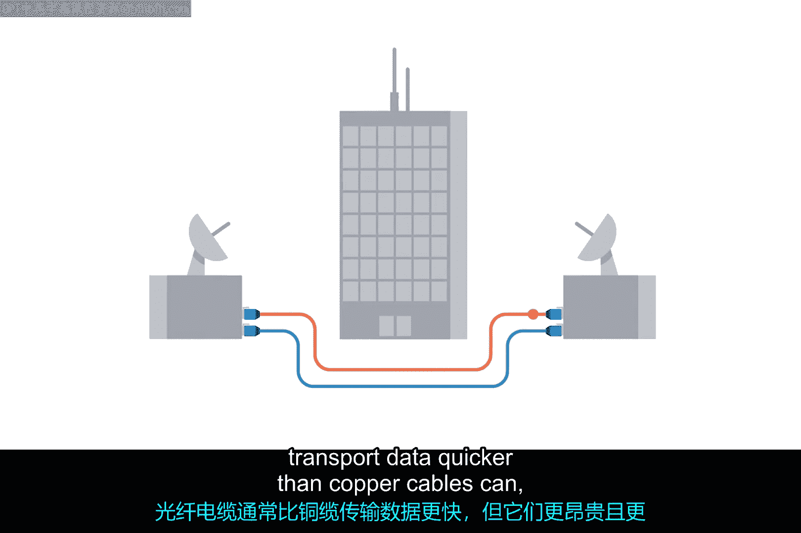

# 谷歌《IT支持（计算机网络⧸操作系统，第2、3课⧸共5课）｜Google IT Support》中英字幕deepseek p05 3_电缆.zh_en -BV1uyqcYpExr_p5-

Lots of different cables and network devices can be used to allow computers to properly communicate with each other。

By the end of this lesson， you'll be able to identify and describe various networking cables and networking devices。

Computer networking is a huge part of the day to day role of many IT specialists and knowing how to differentiate different network devices will be essential to your success。

 Let's start with the most basic component of a wired network cables。

Cables are what connect different devices to each other， allowing data to be transmitted over them。

Most network cables used today can be split into two categories， copper and fiber。

Copper cables are the most common form of a networking cable。

They're made up of multiple pairs of copper wires inside plastic insulator。

 you may already know that computers communicate in binary。

 which people represent with ones and zeros。The sending device communicates binary data across these copper wires by changing the voltage between two ranges。

The system at the receiving end is able to interpret these voltage changes as binary ones and zeros。

 which can then be translated into different forms of data。

 the most common forms of copper twisted pair cables used in networking are CatAT 5。

 Cat 5 E and Cat 6 cables these are all shorthand ways of saying Cat 5 or category 6 cables。

 these categories have different physical characteristics。

 like the number of twists in the pair of copper wires that result in different usable length and transfer rates。

CAT5 is older and has been mostly replaced by CA 5E and CAAT6 cables。From the outside。

 they all look about the same， and even internally， they're very similar to the naked eye。

The important thing to know is that differences in how the twisted pairs are arranged inside these cables can drastically alter how quickly data can be sent across them and how resistant these signals are to outside interference。

CAT5V cables have mostly replaced those older CA5 cables because their internals reduce crossta。

Crosstaal is when an electrical pulse on one wire is accidentally detected on another wire。

 so the receiving end isn't able to understand the data causing a network error。

Higher level protocols have methods for detecting missing data and asking for the data a second time。

 but of course this takes up more time， the higher quality specifications of a CA5 E cable make it less likely that data needs to be retransmitted。

That means on average， you can expect more data to be transferred in the same amount of time。

Cat6 cables follow an even more strict specification to avoid crosstalk。

 making those cables more expensive。Cat 6 cables can transfer data faster and more reliably than Cat 5 V cables can。

 but because of their internal arrangement， they have a shorter maximum distance when used at higher speeds。

 The second primary form of networking cable is known as fiber， short for fiber optic cables。

Fibber cables contain individual optical fibers， which are tiny tubes made out of glass about the width of a human hair。

These tubes of glass can transport beams of light， unlike copper， which uses electrical voltages。

 fiber cables use pulses of light to represent the ones and zeroes of the underlying data。

Fibber is even sometimes used specifically in environments where there's a lot of electromagnetic interference from outside sources。

 because this can impact data being sent across copper wires。

Fibber cables can generally transport data quicker than copper cables can。

 but they're much more expensive and fragile。

Fibber can also transport data over much longer distances than copper can without suffering potential data loss。

Now you know a lot more about the pros and cons of fiber cables， but keep in mind。

 you'll be way more likely to run into fiber cables in computer data centers than you would in an office or at home。

