# 谷歌《IT支持（计算机网络⧸操作系统，第2、3课⧸共5课）｜Google IT Support》中英字幕deepseek p06 4_集线器与交换机.zh_en -BV1uyqcYpExr_p6-

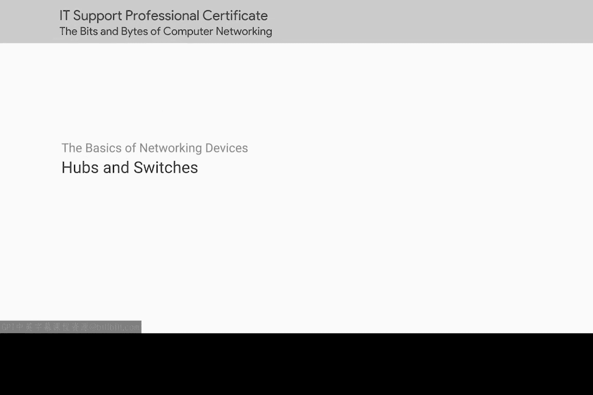

We're going to do a rundown of network devices in this video and the next one。

Almost every IT specialist will have to interact with these sorts of devices on a regular basis。

 cableables allow you to form point to point networking connections。

 These are networks where only a single device at each end of the link exists。

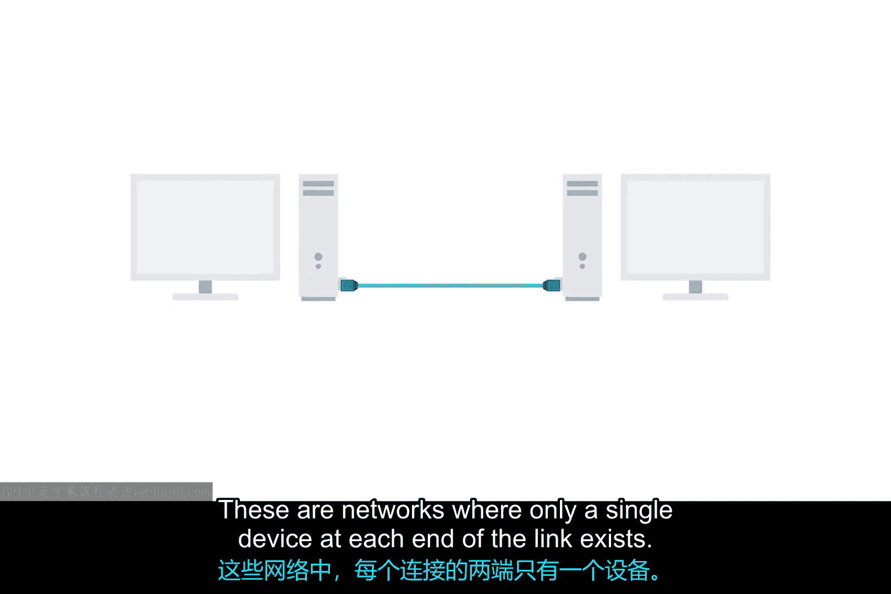

Not to knock point to point networking connections。

 but they're not super useful in a world with billions of computers。Luckily。

 there are network devices that allow for many computers to communicate with each other。

The most simple of these devices is a hub。 A hub is a physical layer device that allows for connections from many computers at once。

 All the devices connected to a hub will end up talking to all other devices at the same time It's up to each system connected to the hub to determine if the incoming data was meant for them or to ignore it if it isn't。

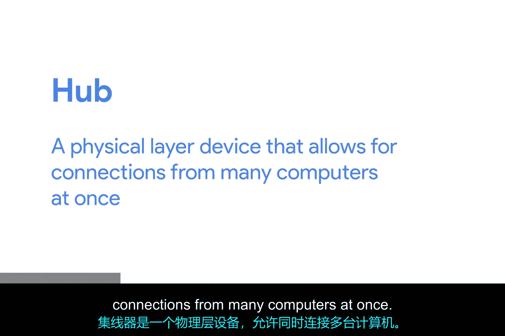

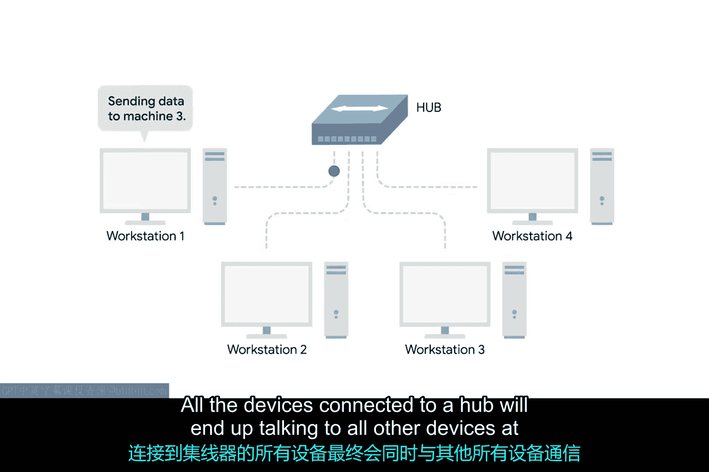

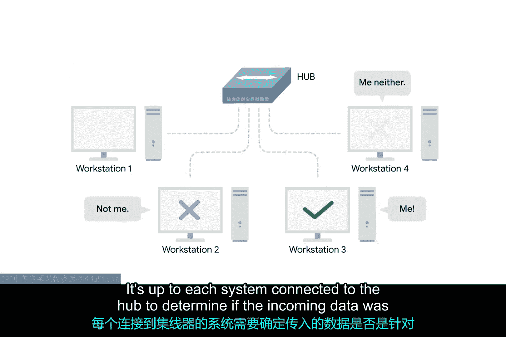

This causes a lot of noise on the network and creates what's called a collision domain。

A collision domain is a network segment where only one device can communicate at a time。

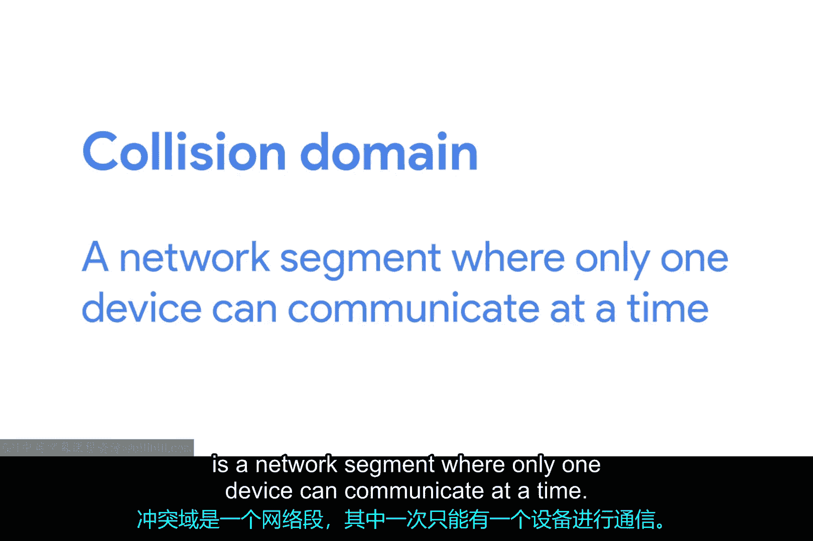

If multiple systems trycending data at the same time。

 the electrical pulses sent across the cable can interfere with each other This causes these systems to have to wait for a quiet period before they try sendingending their data again。

 it really slows down network communications and as the primary reason hubs are fairly rare。

 they're mostly a historical artifact today， a much more common way of connecting many computers is with a more sophisticated device known as a network switch originally known as a switching hub。

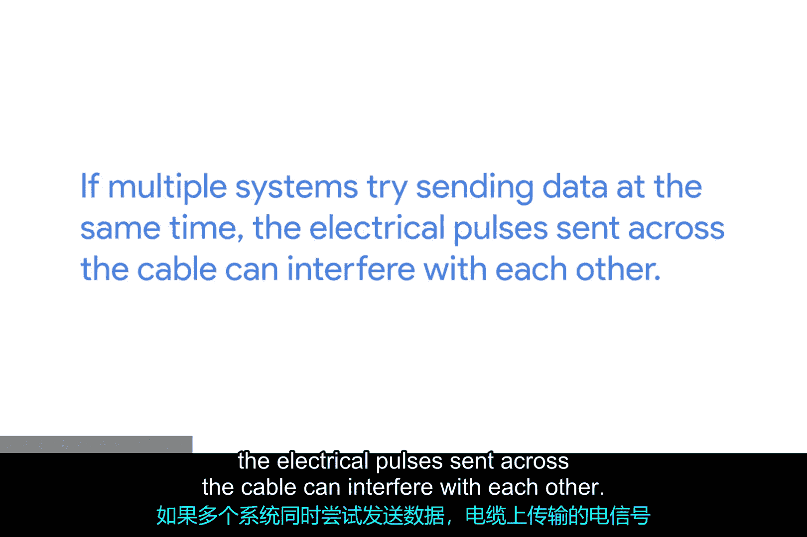

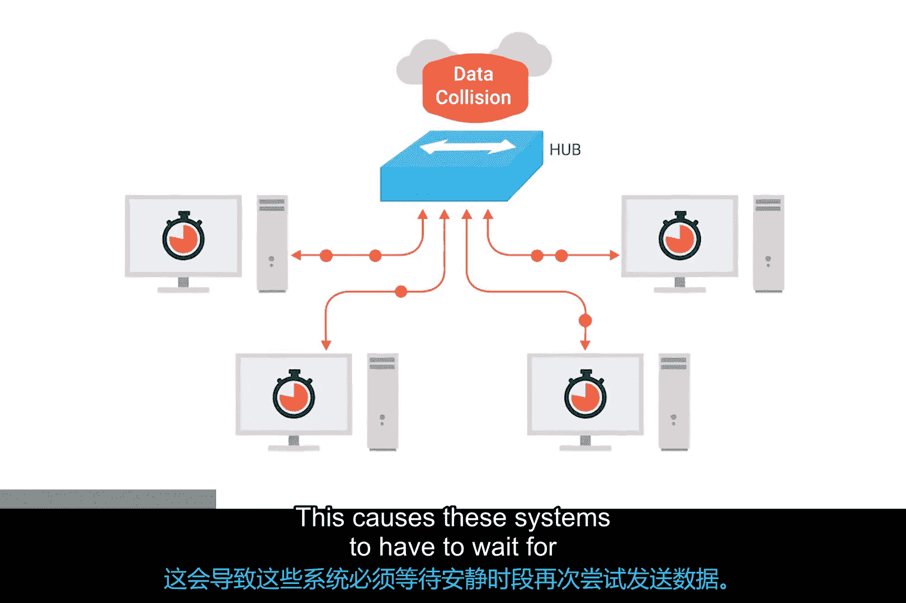

A switch is very similar to a hub since you can connect many devices to it so they can communicate。

 The difference is that while a hub is a layer1 or physical layer device。

 a switch is a layer2 or datalink device This means that a switch can actually inspect the contents of the ethernet protocol data being sent around the network。

 determine which system the data is intended for， and then only send that data to that one system。

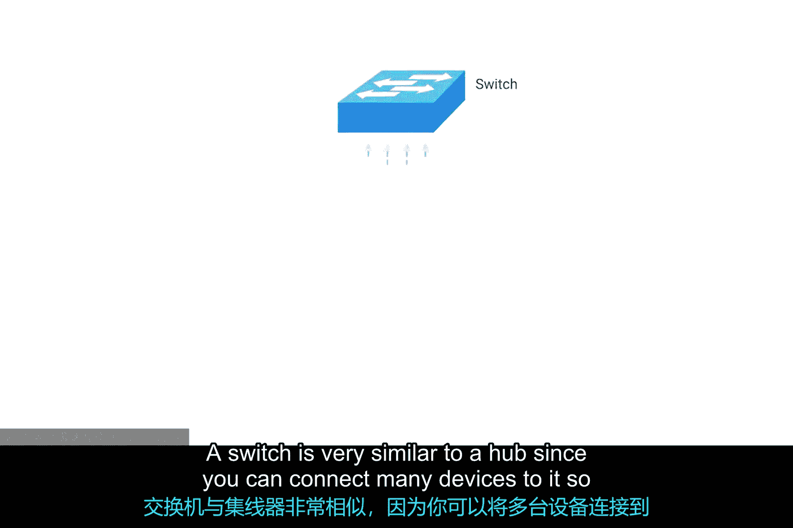

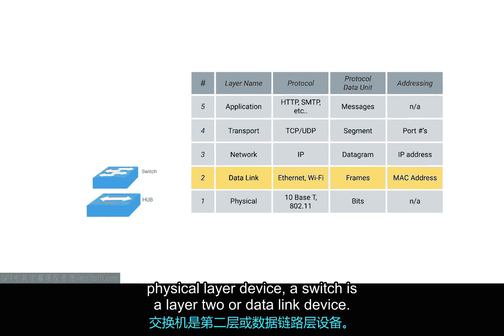

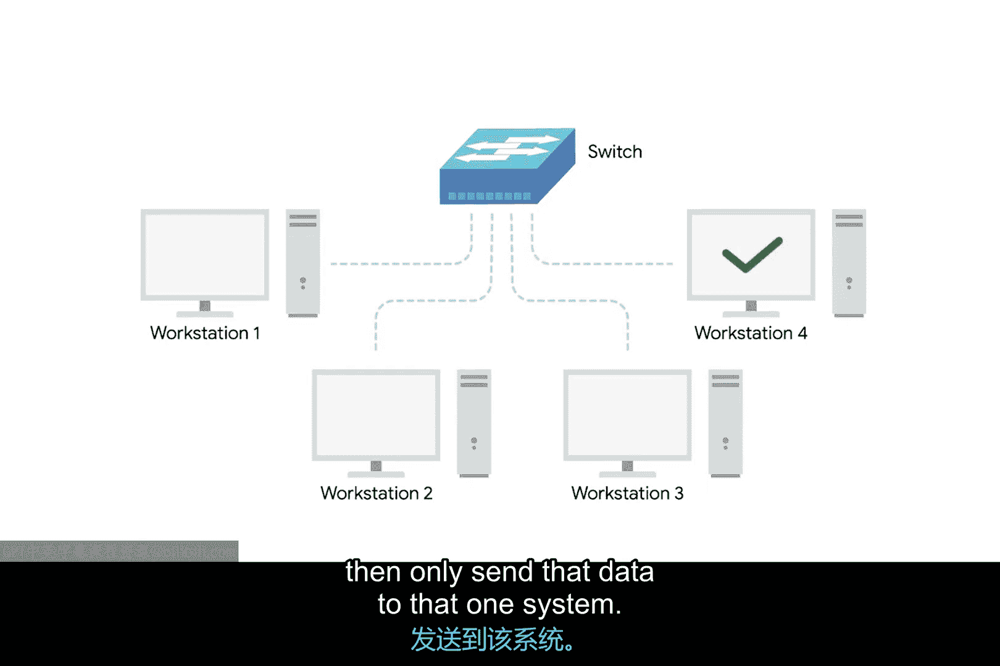

This reduces or even completely eliminates the size of collision domains on a network If you guess that this will lead to fewer retransmissions and a higher overall throughput。

 you're right。

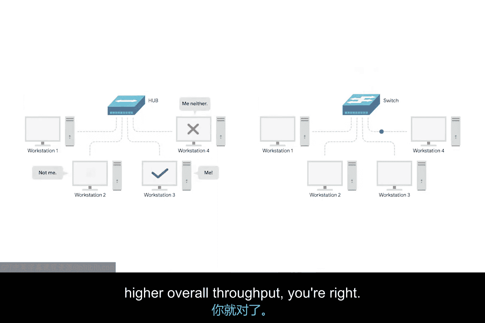