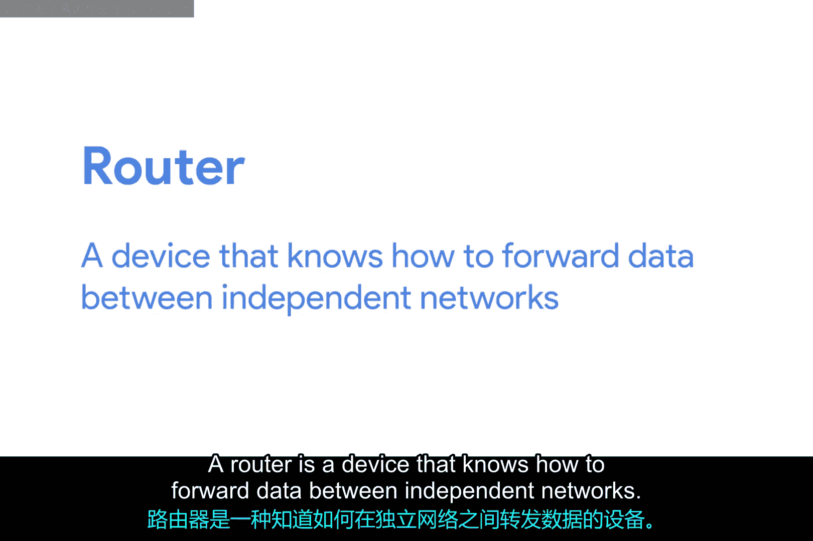
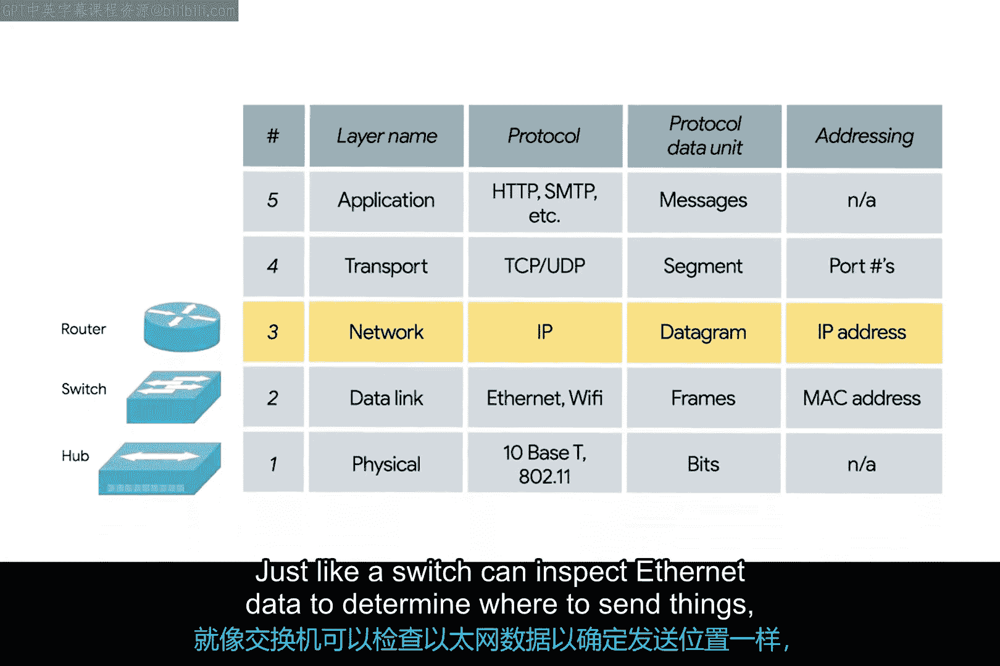
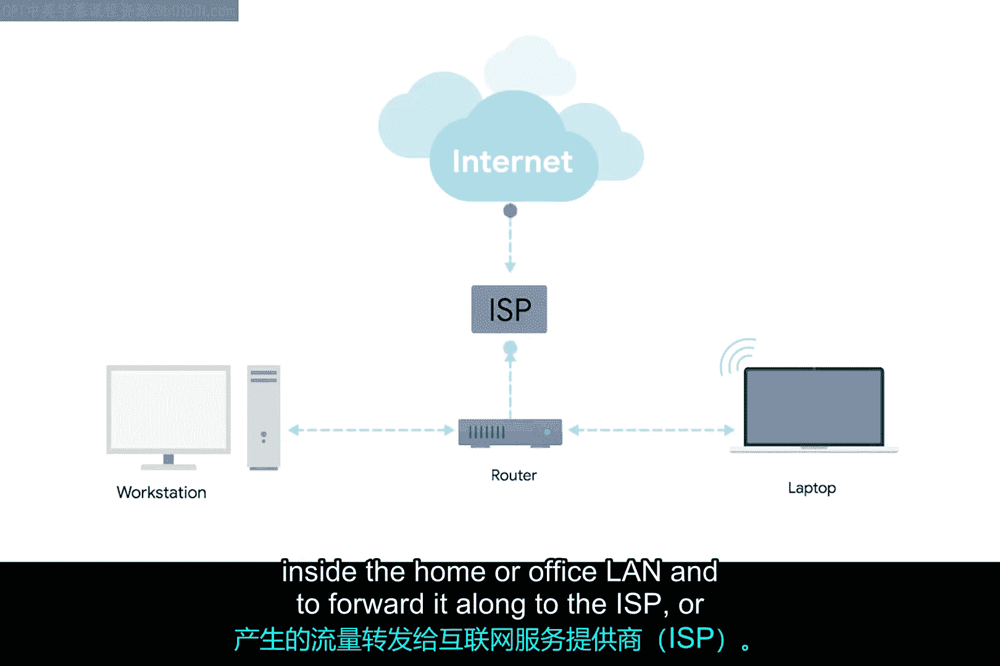
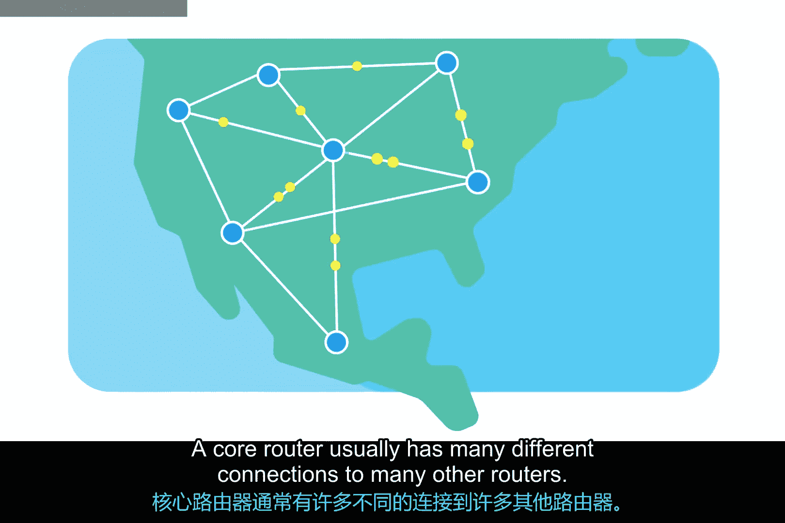
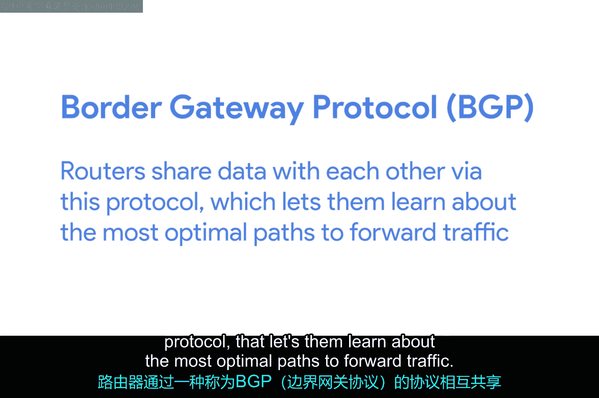

# 谷歌《IT支持（计算机网络⧸操作系统，第2、3课⧸共5课）｜Google IT Support》中英字幕deepseek p07 5_路由器.zh_en -BV1uyqcYpExr_p7-

Hubs and switches are the primary devices used to connect computers on a single network。

 usually referred to as a LA or local area network。

But we often want to send or receive data to computers on other networks。

 this is where routers come into play。A router is a device that knows how to forward data between independent networks while a hub is a layer1 device and a switch is a layer 2 device。

 a router operates at layer 3， a network layer just like a switch can inspect ethernet data to determine where to send things。

 A router can inspect IP data to determine where to send things routers store internal tables containing information about how to route traffic between lots of different networks all over the world。

The most common type of router you'll see is one for a home network or a small office。

 These devices generally don't have very detailed routing tables。

The purpose of these routers is mainly just to take traffic originating from inside the home or office land and to forward it along to the ISP or Internet service provider。

 Once traffic is at the ISP。 a way more sophisticated type of router takes over。

 These core routers form the backbone of the Internet and are directly responsible for how we send and receive data all over the Internet every single day。

 core ISP routers don't just handle a lot more traffic than a home or small office router。

 they also have to deal with much more complexity in making decisions about where to send traffic。

A core router usually has many different connections to many other routers。

Routers share data with each other via a protocol known as BGP or Border Gateway protocolto that lets them learn about the most optimal paths to forward traffic。

When you open a web browser and load a webpage， the traffic between computers and the web servers could have traveled over dozens of different routers。

The internet is incredibly large and complicated， and routers are global guides for getting traffic to the right places。

