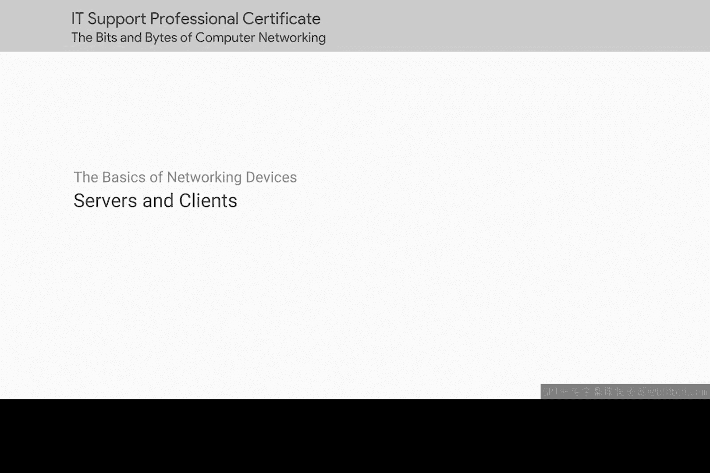
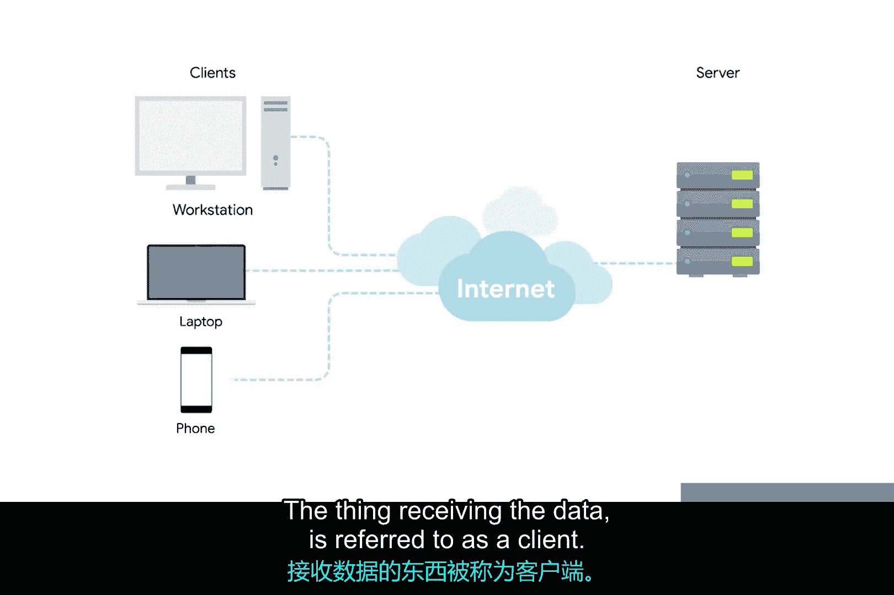
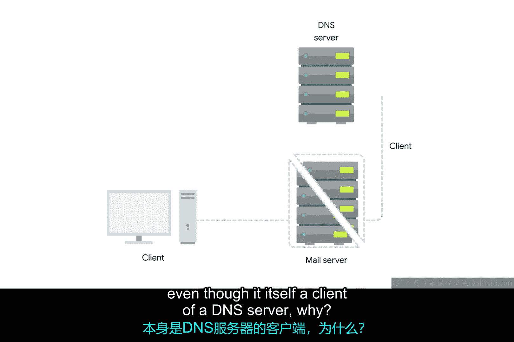

# 谷歌《IT支持（计算机网络⧸操作系统，第2、3课⧸共5课）｜Google IT Support》中英字幕deepseek p08 6_服务器与客户端.zh_en -BV1uyqcYpExr_p8-

All of the network devices you've just learned about exist so that computers can communicate with each other。

 whether they're in the same room or thousands of miles apart。We've been calling these devices nodes。

And we'll keep doing that， but it's also important to understand the concepts of servers and clients。

The simplest way to think of a server is as something that provides data to something requesting that data。

The thing receiving the data is referred to as a client。

While we often talk about nodes being servers or clients。

 the reason our definition uses a word as vague as something is because it's not just nodes that can be servers or clients。

Individual computer programs running on the same node can be servers and clients to each other， too。

 it's also important to call out that most devices aren't purely a server or a client。

 Almost all nodes are both at some point in time， Qui the multitasking over achievers。

That all being said， in most network toppgraphies， each node is primarily either a server or a clientan。

Sometimes we refer to an email server as an email server。

 even though it's itself a client of a DNS server。

Why， because its primary reason for existing is to serve data to clients。Likewise。

 if a desktop machine occasionally acts as a server in the sense that it provides data to another computer。

 its primary reason for existing is to fetch data from servers so that the user at the computer can do their work。

To sum up， a server is anything that can provide data to a client。

 but we also use the words to refer to the primary purpose of various nodes on our network。

Go it cool。Now it's time for a short ungraded quiz to test you on the basics of these networking devices。

