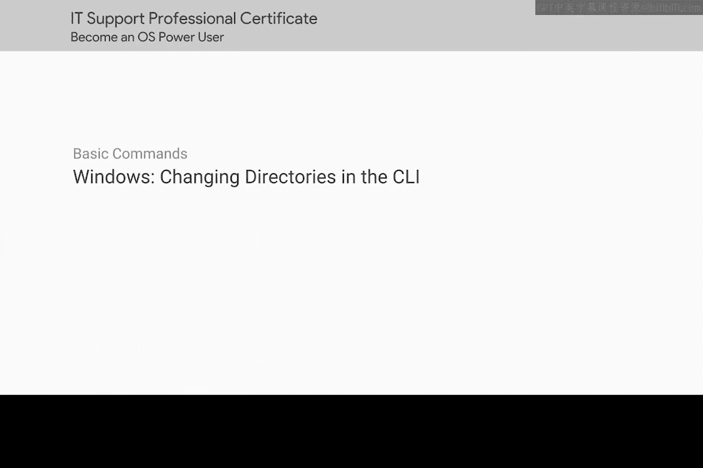
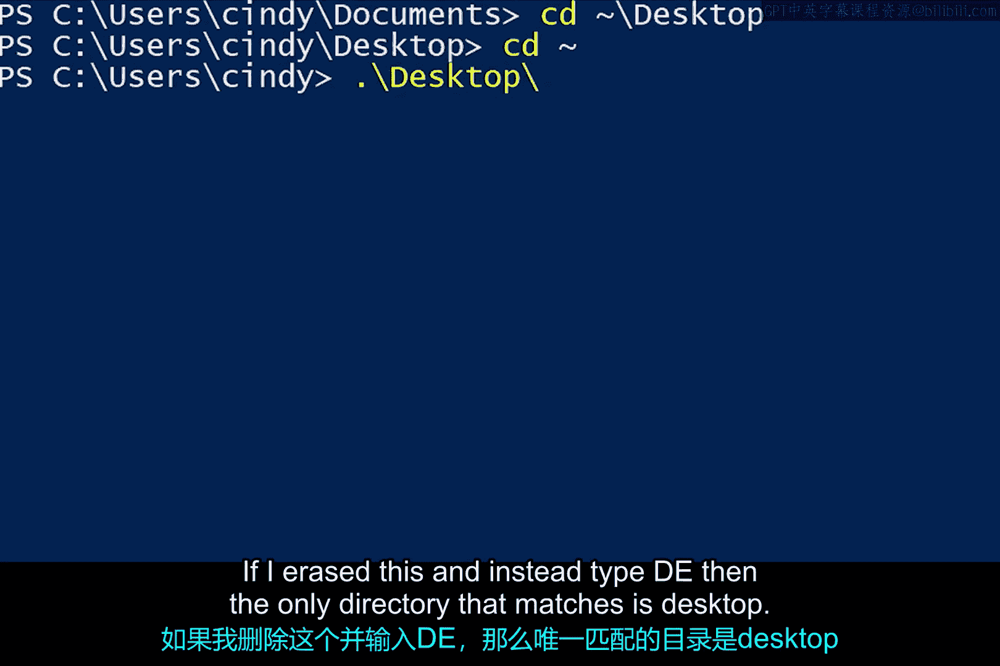

# 谷歌《IT支持（计算机网络⧸操作系统，第2、3课⧸共5课）｜Google IT Support》中英字幕deepseek p100 6_Windows在CLI中更改目录.zh_en -BV1uyqcYpExr_p100-

When you first open Powerhell， you'll usually be in your home directory。

 Your prompt shows you which directory you are currently in。

 but there is also a command that will tell you where you are。

PWD or print Working directory tells you which directory you're currently in。

If we want to change the directory that we're in， we can use the CD or change directory command。

To use this command， we'll also need to specify the path that we want to change to。Remember。

 this path can be absolute， which means it starts from this drive letter and spells out the entire path On the flip side。

 it can be relative， meaning that we only use part of the path to describe how to get to where we want to go relative to where we currently are。

I'll show you what I mean in a minute。So right now we're in C backslash user Cindy。

Let's say that instead I want to go to C， backslash users， backslash Cindy， backslash documents。

 what do you think the command would look like here？Here it is， C。Di。C， back slash users。

 back slash Cindy， back slash。Documents。And now we've changed to the documents directory。

We used an absolute path to get this directory， but this can be a little cumbersome to type out。

We know that the documentscu directory is under the CinD folder。

So can't we just go up one level to get to that folder？We absolutely can。

There's a shortcut to get to the level above your current directory。CD dot dot。

Let's run the PWD command one more time。Now we can see that I'm in C backslash users backslash Cindy。

The parent directory of where I was before。The dot dot is considered a relative path because it'll take you up one level relative to where you are。

 Let's go back to the documents folder and try this again， except this time。

 let's go to the desktop folder using the new command we learned。

 We know that the desktop and document directories are under the home directory so we could run。

CD dot dot then CD desktop， but there's actually an easier way to write this。CD dot， dot。

Backslash desktop。Let's check PWD one more time。PWD now shows that we're in the desktop folder S another cool shortcut for CD that you can use is CD Tilda the Tilda is a shortcut for the path of your home directory。

Let's say I want to get to the desktop directory in my home folder， I can do something like this， CD。

 Tilde backslash desktop。We've done quite a bit of typing so far。

You might actually be wondering what would happen if we messed up while typing these directory names？

How are you supposed to memorize where everything is and if it's spelled correctly？

Fortunately we don't have to do that， our shell has a built in feature called tabab completion。

Tab completion lets us use the tab key to autocomplete file names and directories。

Let's use the tab completion to get to our desktop from our home directory。

If I type D and then tabab。The first file or directory starting with D will now complete。Now。

 if this isn't the file or directory that I was looking for。

 I can continue to press tab and the path will rotate through all the options that complete the name that I started to type。

So I'll see desktop。And then documents。And then downloads。

Take note that the dot in front of the path of dot backslash desktop just means the current directory。

If I erase this and instead type DE。Then the only directory that matches is De Tab completion is an awesome feature that you'll be using more and more as you continue to work with commands。

