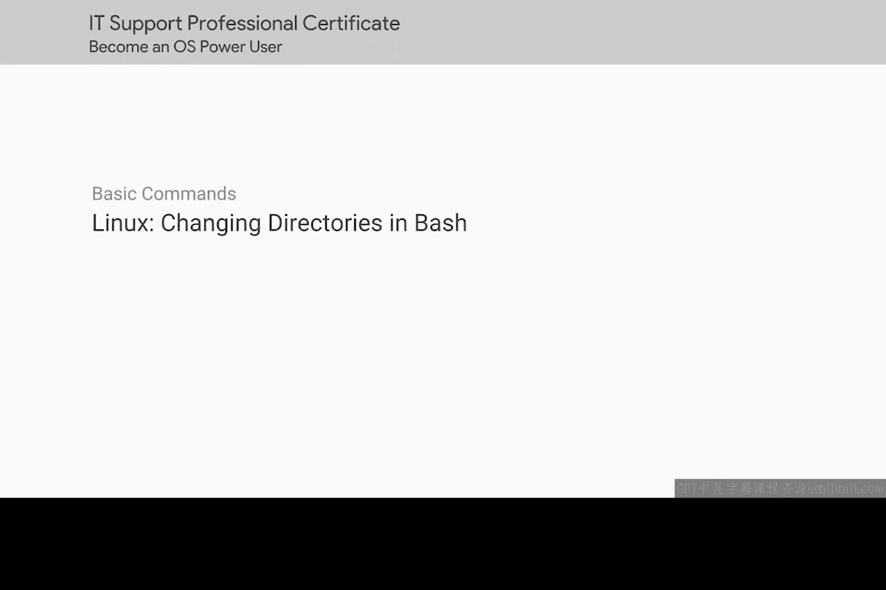
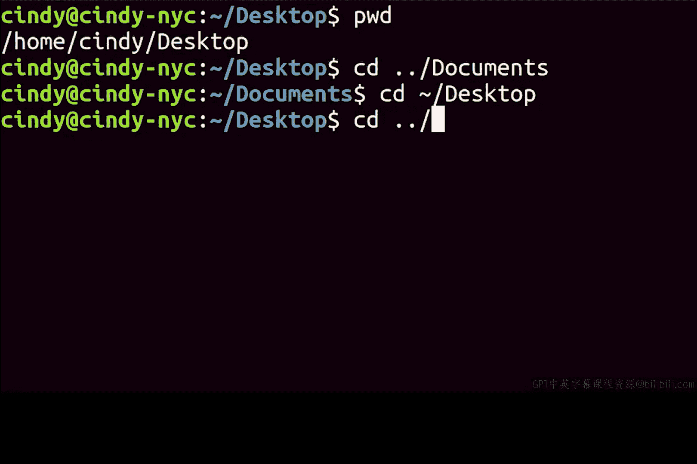

# 谷歌《IT支持（计算机网络⧸操作系统，第2、3课⧸共5课）｜Google IT Support》中英字幕deepseek p101 7_Linux在Bash中更改目录.zh_en -BV1uyqcYpExr_p101-

Let's do the same thing in bash from our desktop， we're going to navigate to the documents folder。

The commands we used earlier in PowerShell are exactly the same here in Bsh。

Print Working directory or PWD again shows us the current pathway in。Yep， looks good。

 we're currently in our desktop directory， which you can see from sho/Cindy/ desktop。

To navigate around， we use the CD command， just like with Windows。

We can give it an absolute path like this。CD/lash home/lashCindy/lash documents。

Or we can give it a relative path like this。Cd。Dot， dot slash documents。In Bsh。

 the Tilde is used to reference our home directory， so Cd Tilde/ desktop。

Well take us back to our desktop and guess what we still have that useful tab completion feature in Bash the difference between Bsh tabab Comple and Windows tab Comp is that if we have multiple options it won't rotate to the options。

 but instead will show us all options at once。Like this。

We can already start connecting the bridge between Windows and Linux。

