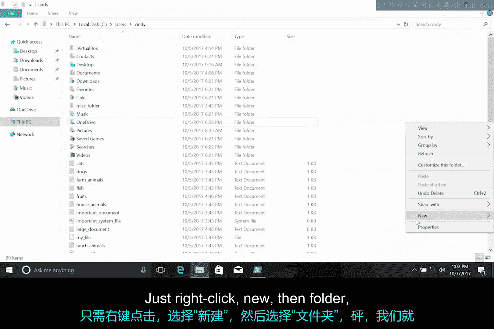
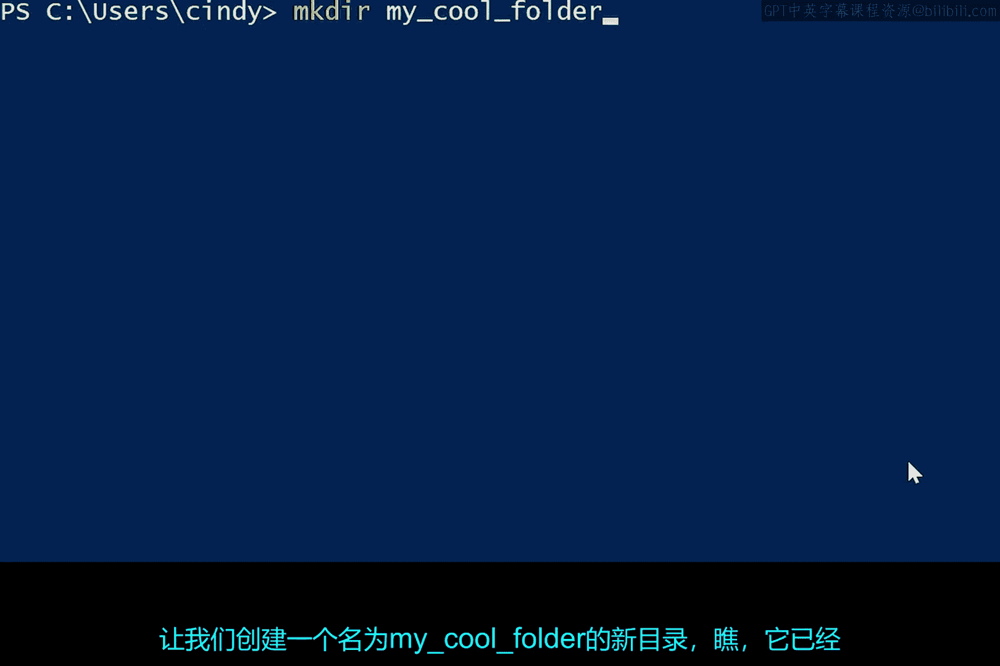
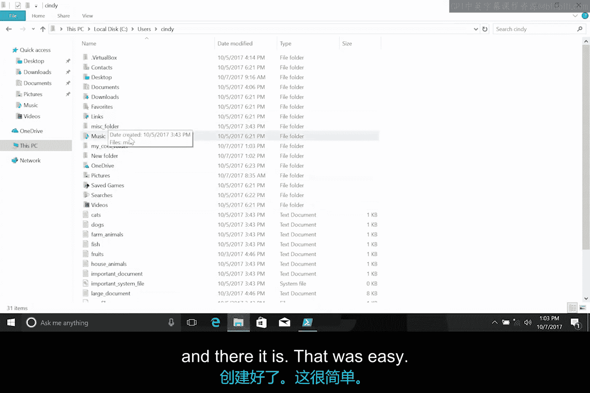
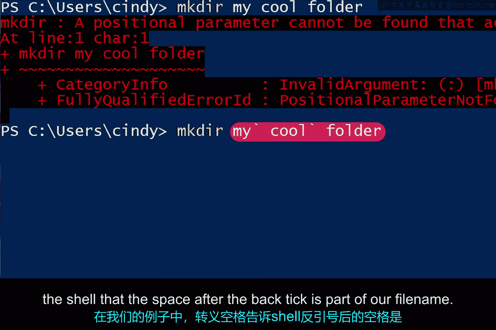

# 谷歌《IT支持（计算机网络⧸操作系统，第2、3课⧸共5课）｜Google IT Support》中英字幕deepseek p102 8_Windows在GUI-CLI中创建目录.zh_en -BV1uyqcYpExr_p102-

Now that we've covered listing and changing directories， let's learn how to add new directories。

 We can do this in the GuI in a super simple way。Just right click。New。

Then folder。And bam， we have a new folder。 Now， what if we wanted to do this in the CLI？In Powerhell。

 the command to make a new directory is calledMakeD or make directory。

Let's make a new directory called My underscore Cool underscore folder。

And there it is。That was easy What if we wanted to use spaces in our folder name instead of underscores？

What do you think would happen if I did this instead？Make dirt my cool folder。That's an error。

Makeder is trying to interpret cool and folder as other parameters to the makeder command。

 It doesn't understand those words as valid parameters。

Turns out that our shelf doesn't interpret spaces the way we do。

 So we need to tell it explicitly that this folder name is one single thing。

We can do this in a variety of ways。We can surround the name with quotes。Like make dirt。

My cool folder。Or we can escape the space by using the backt character。Pter my Batic。

 cool Batic folder。Escaping characters is a pretty common concept when dealing with code。

It means that the next character after the back tick should be treated literally。In our example。

 escaping the space tells the shell that the space after the back tick is part of our file name。

While the back tick is the escape character in Power shell。

 other shells and programming languages may use another character as an escape character。

You'll see this in the next video。