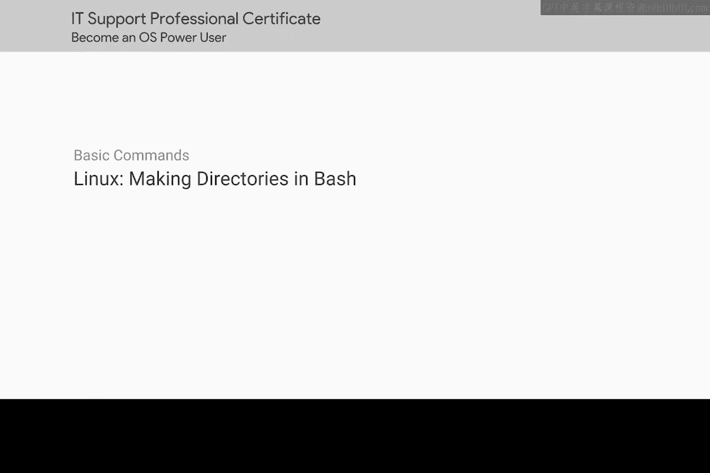
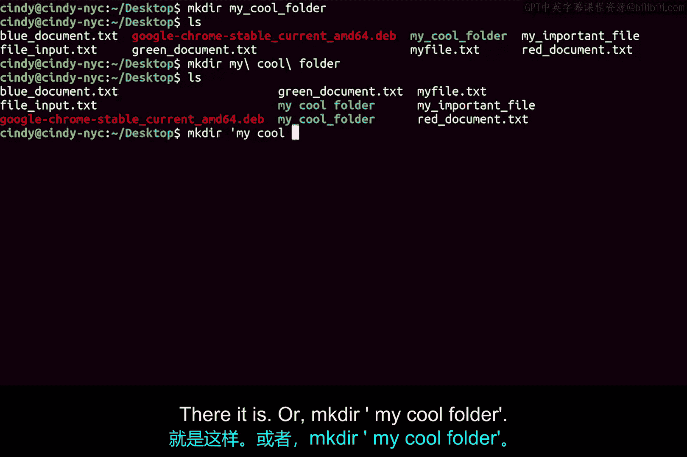

# 谷歌《IT支持（计算机网络⧸操作系统，第2、3课⧸共5课）｜Google IT Support》中英字幕deepseek p103 9_Linux在Bash中创建目录.zh_en -BV1uyqcYpExr_p103-

In Bash， the command to make a new directory is the same as in Windows。

Let's make a new directory called My cool folderolder with the makeD or make directory command。

And now we can verify my cool folder is in our desktop。Instead of using back ticks。

 like in Windows to escape a character in bash， you can use a backslash Smer to Windows。

 you can also use quotes to encompass an entire file name。

 How do you think you would make a directory called My coolol folder and Linux with Spaces。Make dirt。

买。Back slash， cool， back slash folder。Oh there it is， or maketer。Quuotes my cool folder。

Works as well if you guess this， you're right， if you guess wrong， that's okay。

 just rewatch this video so you can get a better grasp of how we came to this conclusion。

