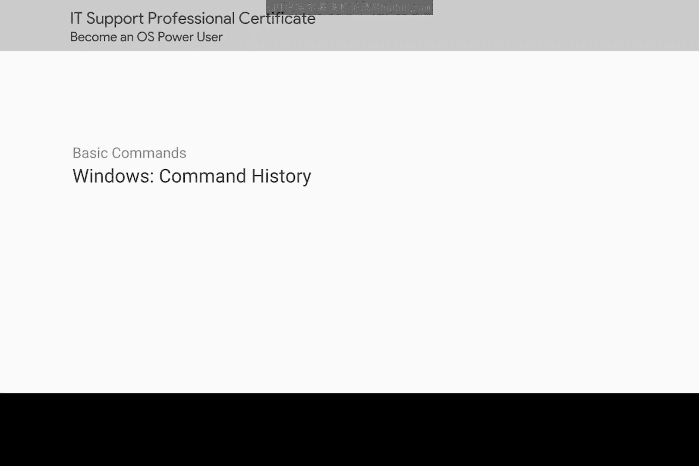
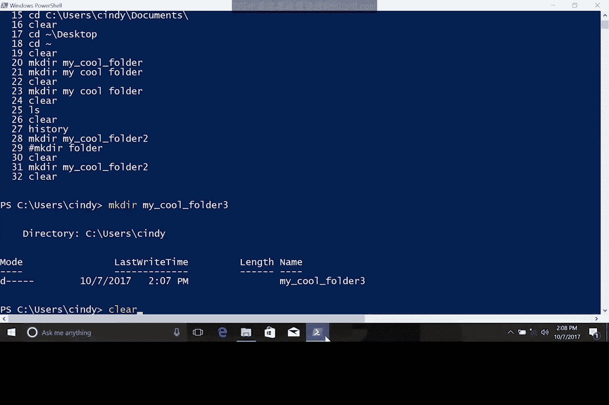

# 谷歌《IT支持（计算机网络⧸操作系统，第2、3课⧸共5课）｜Google IT Support》中英字幕deepseek p104 10_Windows命令历史.zh_en -BV1uyqcYpExr_p104-

Picking right up from the last video， let's say we want to make a couple of directories。

 MyC folder 2 and myC folder3， we could just type maketer myC folder 2 and then type again my baketer MyCo folder 3。

But instead， we're going to use another cool PowerShell feature called History each and every time you enter in a command。

 it gets saved into memory and added to a special file。

You can go through the previous commands you used with the History command。

I'm now showing a list of commands that I entered earlier。This information alone isn't very useful。

 instead there's a better use of the history that lets us quickly scroll through these commands and use them again。

We can scroll through these commands with the up or down keys on our keyboard。

I'm going to go up to my previous command and I should see that I had makeD， my cool folder。

Instead of typing the whole thing to make a new folder。

 I'm just going to append the number two to my command。Boom。

 a new file was created without having to type everything over again。Cool right。

 you can even search through your previously used commands using the history shortcut control R。

From here， you can start typing bits and pieces of the command you want to look for。

 and it'll show you matches， let's search for the word folder。

I should see the maker commands I was using before。

Pretty neat if you're using an older version of Powerhell。

 it may not have the control R feature if that's the case。

 you can type the pound symbol followed by some part of your old command and then use tab completion to cycle through the items in your history。

The history feature， along with tab completion and getHelp will be your best friends while you work in Powerhell。

Keep them close to you and get to know them super well。 Our shell is looking a little cluttered。

 It's kind of hard to see where I'm at。 so let's clean up our shell a little bit。

 We can do that with the clear command。 This doesn't wipe your history。

 It just clears the output on your screen。

Ah， that looks a little better。