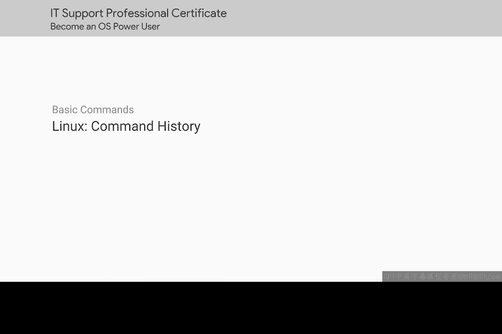
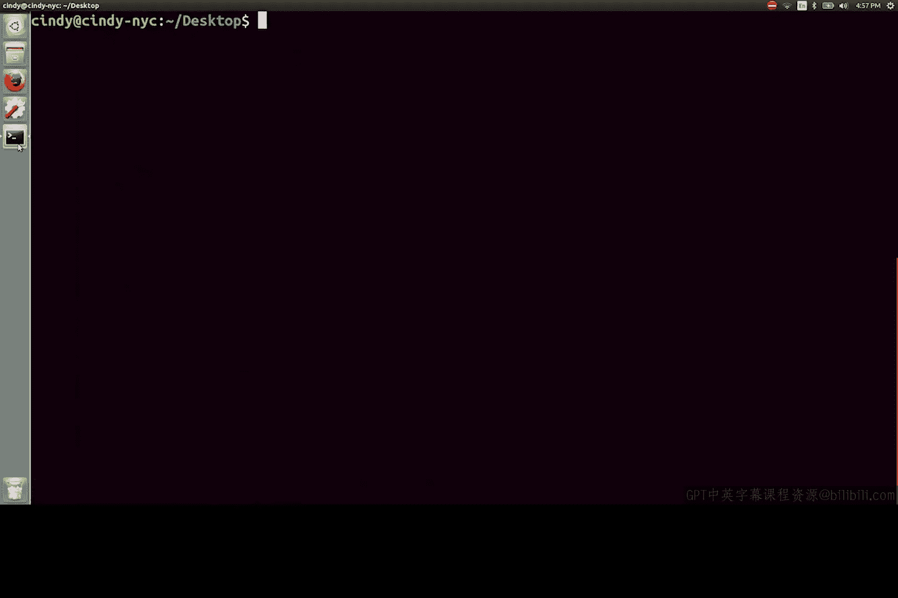

# 谷歌《IT支持（计算机网络⧸操作系统，第2、3课⧸共5课）｜Google IT Support》中英字幕deepseek p105 11_Linux命令历史.zh_en -BV1uyqcYpExr_p105-

The exact same history command that's used in Windows is used in Linux。From here。

 we can use our up and down keys。And even search through our history with control R。

To clear your terminal up， what do you think you do？That's right， the clear command。

