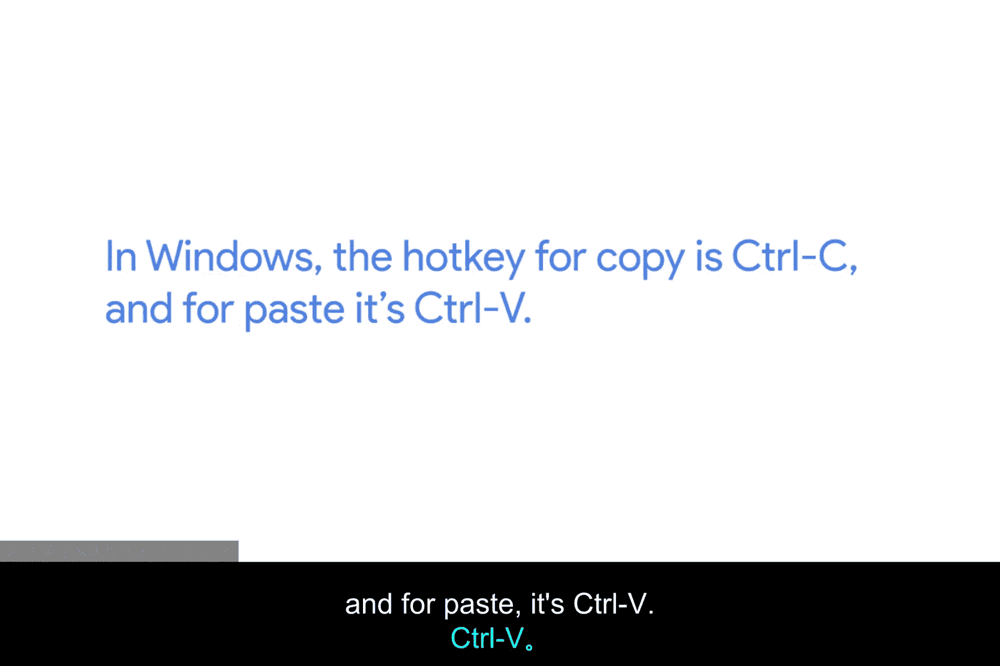
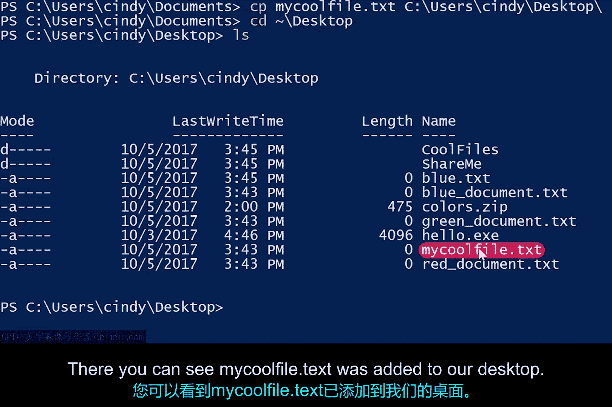
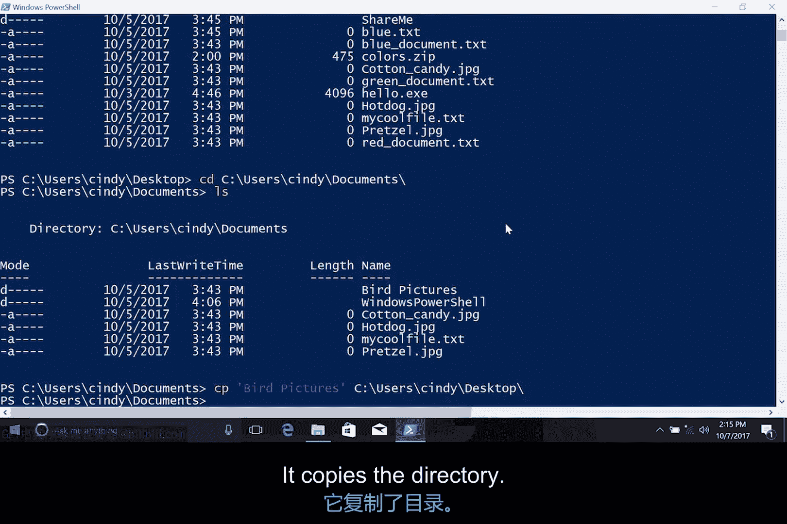
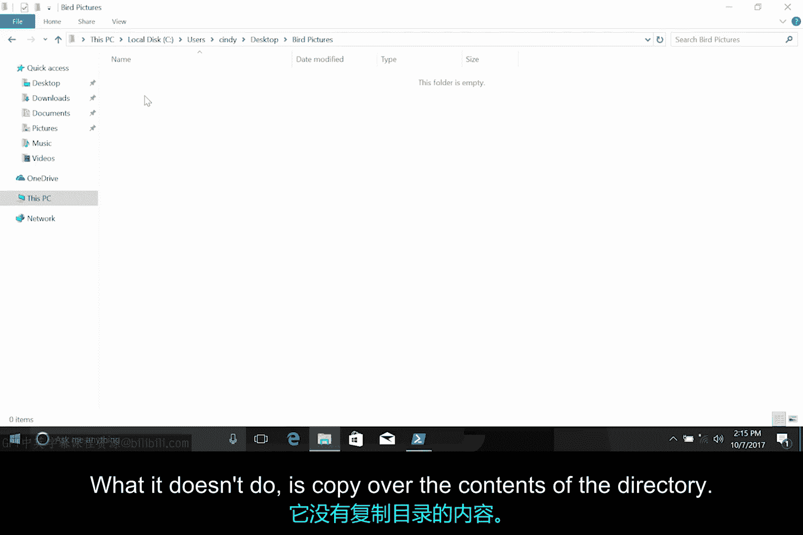
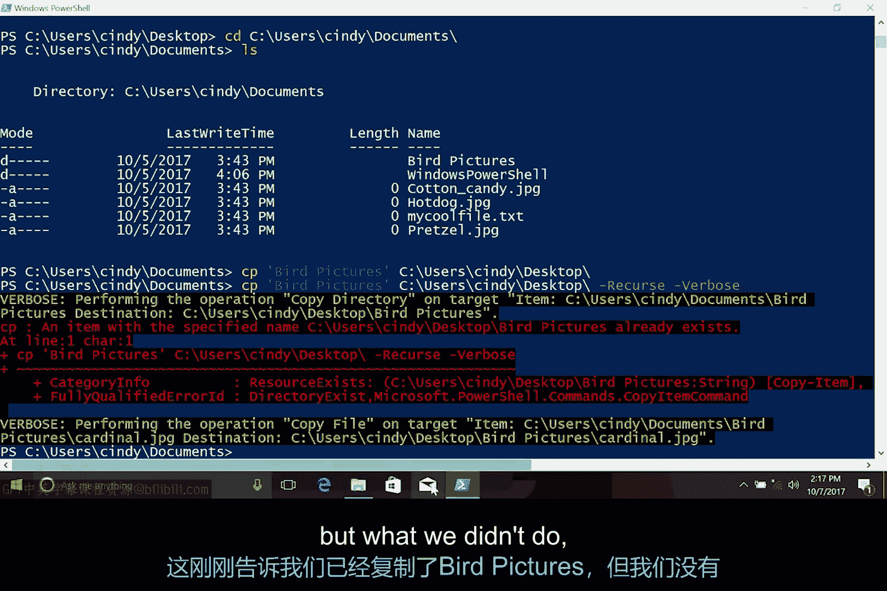

# 谷歌《IT支持（计算机网络⧸操作系统，第2、3课⧸共5课）｜Google IT Support》中英字幕deepseek p106 12_Windows复制文件-目录.zh_en -BV1uyqcYpExr_p106-

We've already created a few files and directories， but we need a couple more。

 We don't want to create them all from scratch， so let's make copies instead in the Windows goi。

 All you need to do is right click， copy， then paste。You can also use hotkeys if you want。

A hotkey is a keyboard shortcut that does some sort of task in Windows。

 the hot key for copy is control C and for Pa it's control V。

In Powershell， the command used to copy something is CP。

We also need to add a file that we want to copy and the path of where we want to copy it too。

Let's copy myCofile。text to the desktop。There you can see my cool file text was added to our desktop。

 I have a few of these files I want to move over， but I'm feeling a little lazy and don't want to run this command over and over again。

So I'm going to use something called a wild card to help me copy over multiple files at once。

A wild car is a character that's used to help select files based on a certain pattern。

 let's say you want to get all the files that were JPEGs and copy them somewhere。

And they go into my documents directory。I have files called hotdog。jPg， cottoncandy。jPEg。

 and pretzel。jPEG。I need to come up with a pattern to help me select all these files。

What do they have in common besides being named after delicious food？The dot JPEG extensionion。

Literally anything else can be in front of the dot JPG file extension and it won't matter。

That's what the wild card asterisk does。It's the pattern for anything。

 so I'm essentially saying select all the files with the pattern， anything do JPEG。

 so to copy over all the JPgGs in the folder， I can use C， the asterisk symbol。Dot jpeg。

And the path I want to copy them too。Let's just verify。There it is。Now。

 instead of copying files one by one， we can use a single command to get all the files we want For now。

 the only selector we'll be using is the asterisk for all。Next up。

 let's say I want to copy over a directory。I'm going to try to copy a folder called Bur Pictures to my desktop。

Let's just go back into documents。Here's bird pictures， now copy。Bird。Pictures to desktop。

Now this does exactly what we told it to do， it copies the directory。

However。This disc directory is empty， what it doesn't do is copy over the contents of the directory。

To copy over the contents of a directory， you need to use another command parameter， recurse。

The dash recurse parameter lists the contents of the directory。

 then if there are any subdirecties in that listing。

 it'll recurse or repeat the directory listing process for each of those subdirecties。

We'll need to use the dash recur parameter with copy to copy the contents of the directory along with the directory itself。

We're going to use a new parameter verbose。Copy doesn't output anything to the CLI by default unless there are errors。

 when we use copypy dashash forbo， it'll output one line for each file of the directory being copied。

Let's give it a try。Copy。Bird pictures。And the recur and verbose flag。

This just message says that we've already copied bird pictures， but what we didn't do was copy over。

The file， which is now here。Excellent， now the directory and all the contents are copied to my desktop。

