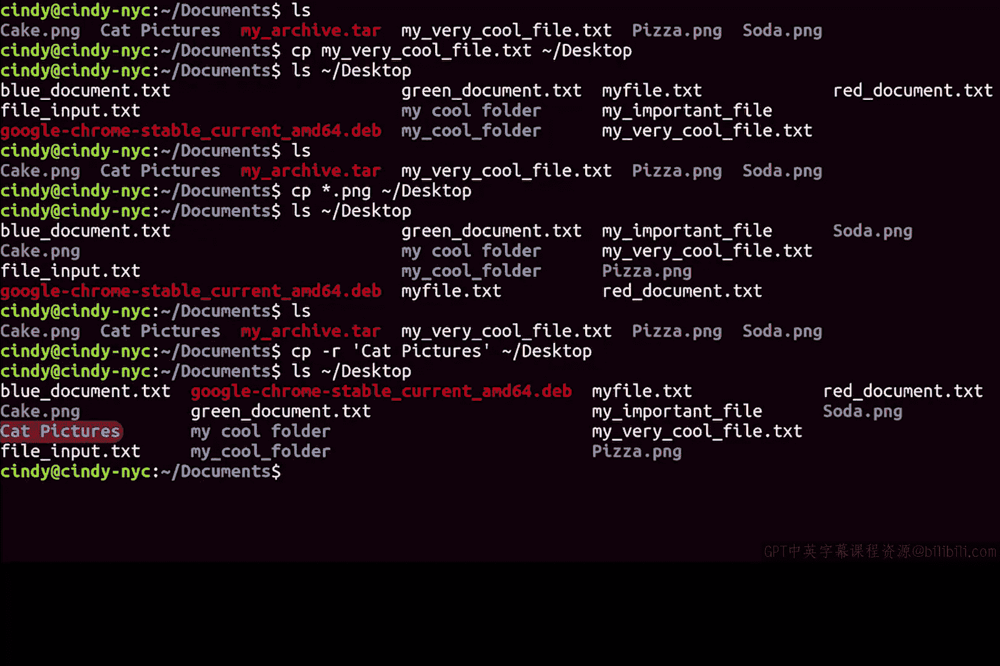

# 谷歌《IT支持（计算机网络⧸操作系统，第2、3课⧸共5课）｜Google IT Support》中英字幕deepseek p107 13_Linux复制文件和目录.zh_en -BV1uyqcYpExr_p107-

In Bsh， the exact same Windows command can be used for copying files。

LetTake a look at this directory。Let's copy my very cool file dot text to my desktop。There it is。

We can also use the same asterisk wild card to select patterns。

Since this is similar to our Windows copy command， what do you think we can use to copy over the dot PNG files in this directory？

I have files called pizzaizz。png， soda。png cake。png， so I can use copy asterisk。png。

 then the desktop directory。Now if I look at my desktop again。There they are。

The same copy rules apply in bash if we want to copy over directory。

 we have to recursively copy over the directory to get all the contents the flag for recursive copy is dash R。

If I want to copy over my cat picturesture folder to the desktop， I could do something like this。

There it is。

