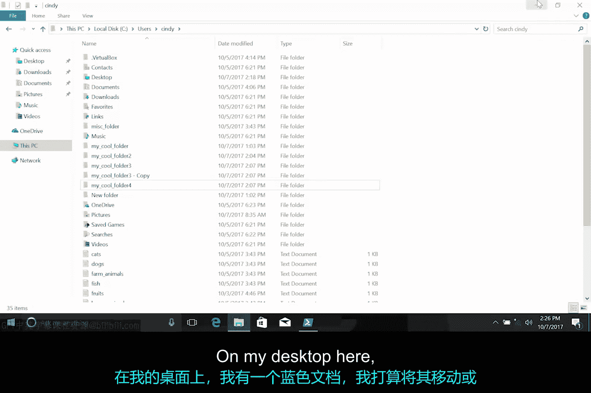
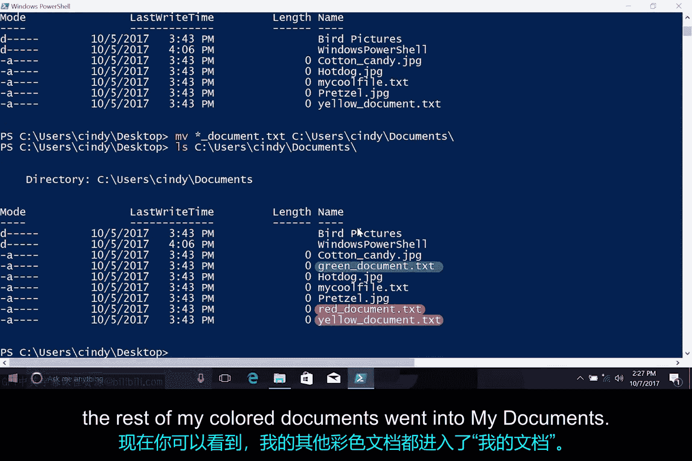

# 谷歌《IT支持（计算机网络⧸操作系统，第2、3课⧸共5课）｜Google IT Support》中英字幕deepseek p108 14_Windows移动和重命名文件-目录.zh_en -BV1uyqcYpExr_p108-

We talked about making and copying files and directories so far。

 but what if we wanted to rename something that we created while in the Windows GuUI。

 if you wanted to rename a file， we just right click and rename。In the command line。

 if we wanted to rename a file， we can use the moveve or moveve item command。It lets us rename files。

 let's move the file without changing the directory that it's stored in。

On my desktop here， I have blue document and I'm going to move or rename it to yellow document。

Now you can see that I have a yellow document。As you might guess。

 the move command also lets us move files from one directory to another。

Let's move the yellow document into my documents。And I can verify that。There it is。Cool。

 you can even move multiple files by using wildcard。

And now you can see the rest of my colored documents went into my documents。

