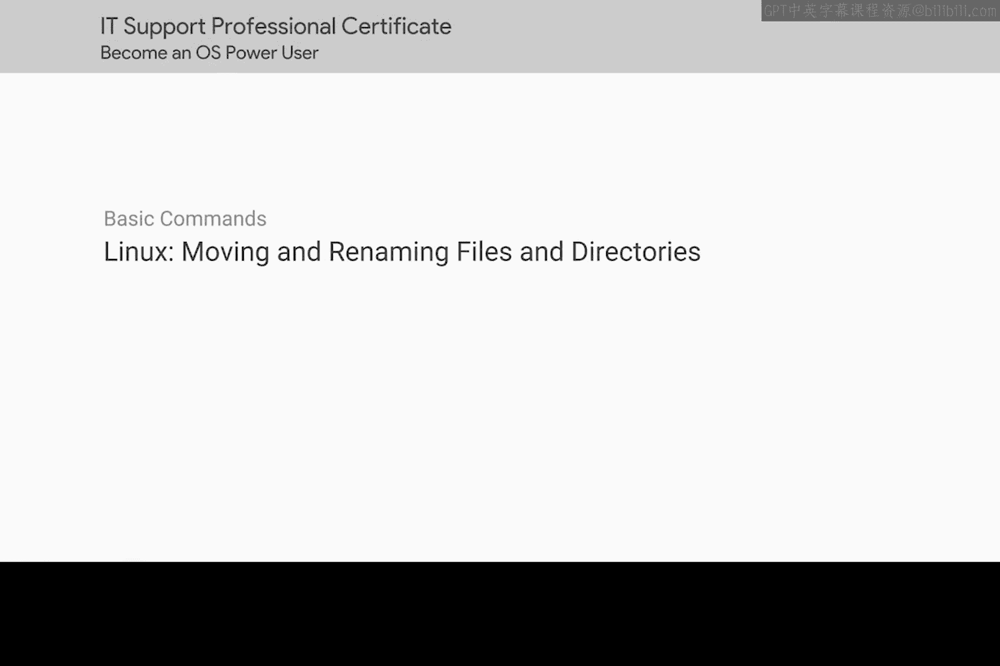
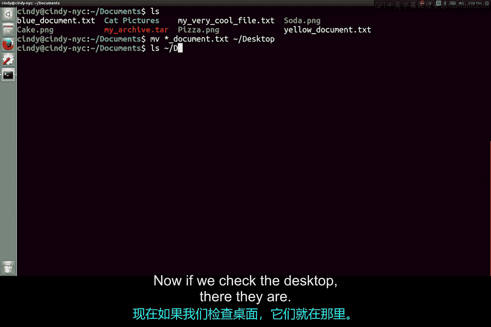

# 谷歌《IT支持（计算机网络⧸操作系统，第2、3课⧸共5课）｜Google IT Support》中英字幕deepseek p109 15_Linux移动和重命名文件-目录.zh_en -BV1uyqcYpExr_p109-

The exact same command can be used for Linux MV or move can rename and move files and directories。

Same thing applies here。I'm going to move my red document and rename it to blue document。

Now we can see it's been renamed a blue document。Then I'm going to move the blue document into the documents folder。

There it is。Using wildcard， we can move multiple files at once， just like Windows。

Let's move all that underscored document。Fileles here。Two our desktop。Now if we check the desktop。

There they are。