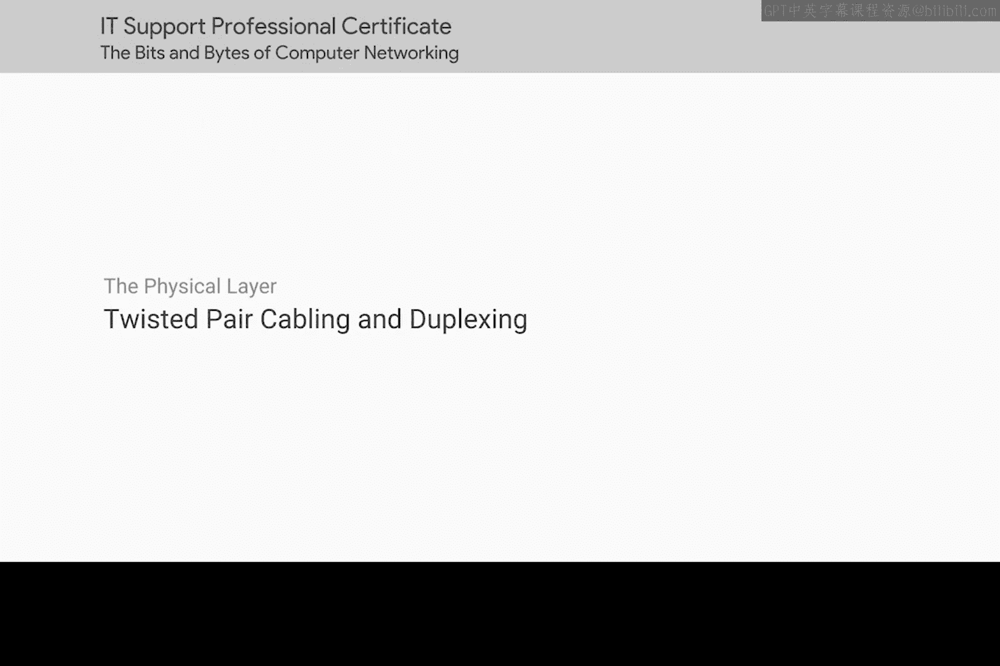
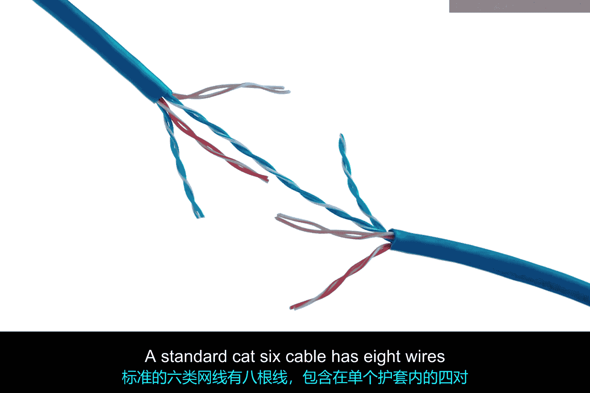
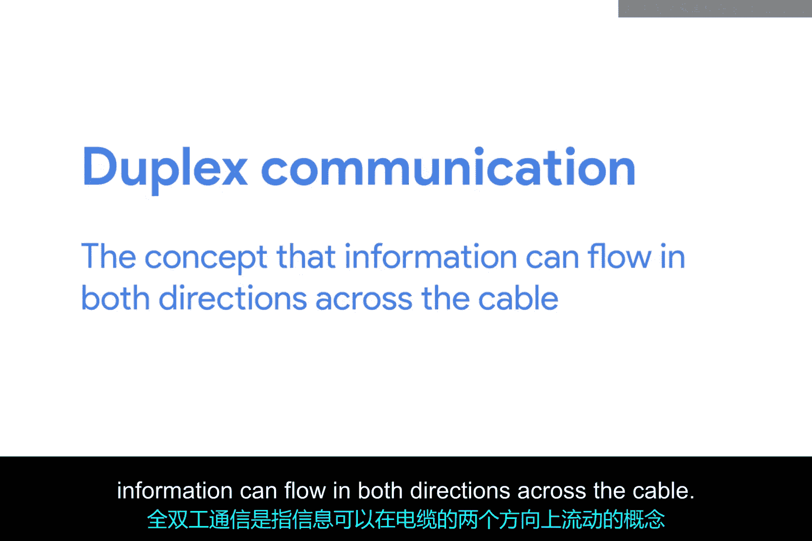
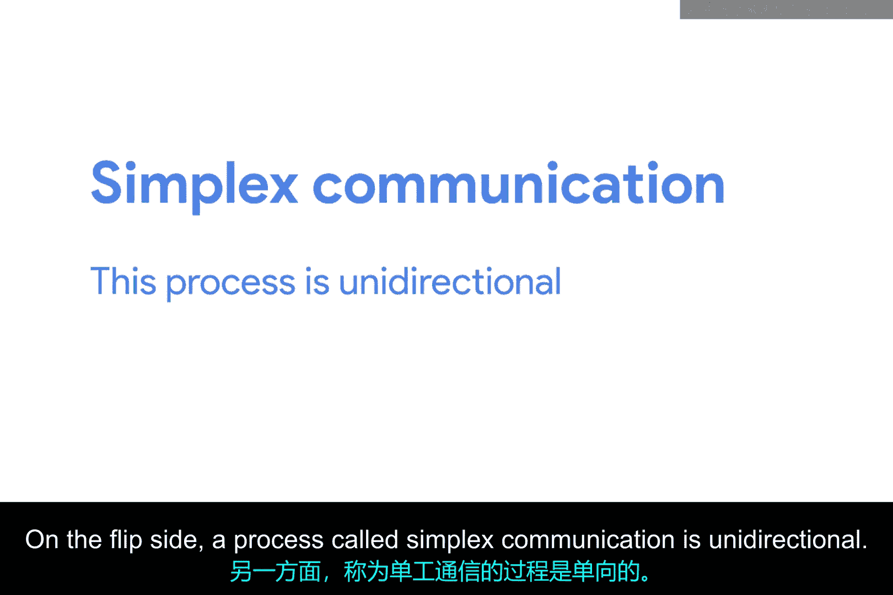
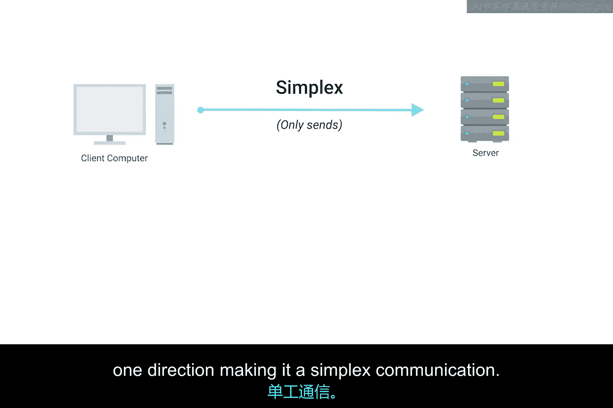
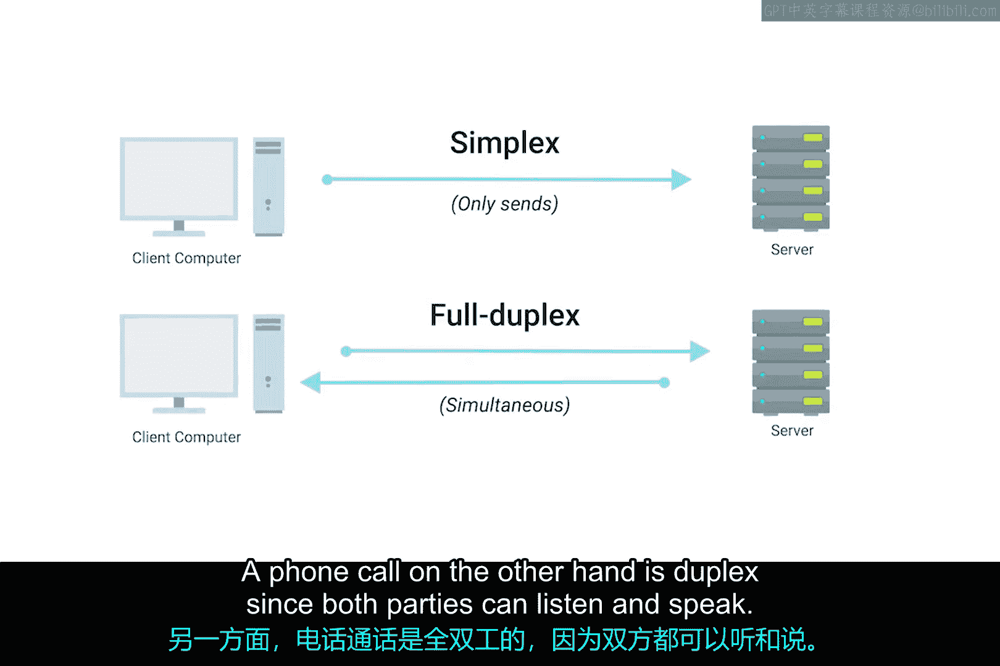
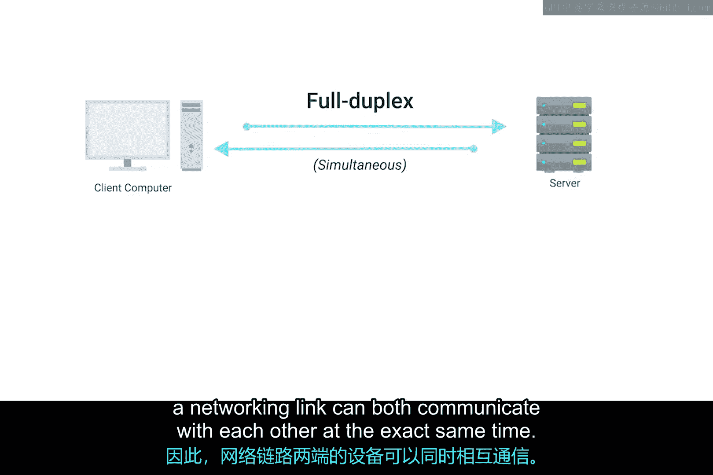
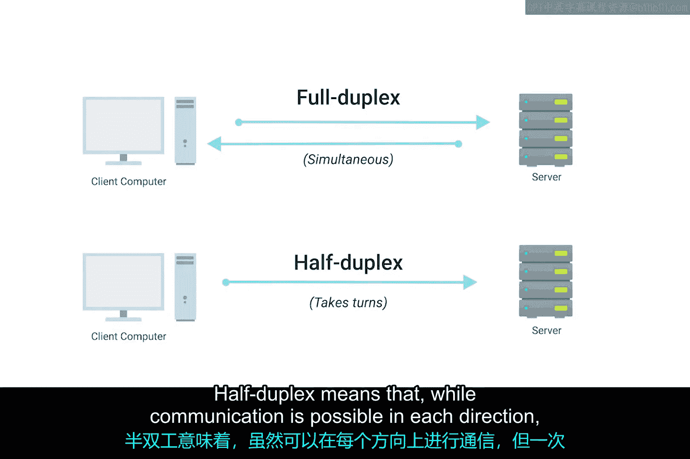

# 谷歌《IT支持（计算机网络⧸操作系统，第2、3课⧸共5课）｜Google IT Support》中英字幕deepseek p11 9_双绞线电缆与双工模式.zh_en -BV1uyqcYpExr_p11-

The most common type of cabling used for connecting computing devices is known as T pair。

It's called a twisted pair cable because it features pairs of copper wires that are twisted together。

 these pairs act as a single conduit for information and their twisted nature helps protect against electromagnetic interference and crosstalk from neighboring pairs。

A standard Catt6 cable has eight wires consisting of four twisted pairs inside a single jacket。

 exactly how many pairs are actually in use depends on the transmission technology being used。

But in all modern forms of networking， it's important to know that these cables allow for duplex communication。

Dupplex communication is the concept that information can flow in both directions across the cable。

On the flip side， a process called simplex communicationic is unidirectional。

Think about a baby monitor where the transmission of data only goes in one direction。

 making it a simplex communication。A phone call， on the other hand。

 is duplex since both parties can listen and speak。

The way networking cables ensure that duplex communication is possible is by reserving one or two pairs for communicating in one direction。

They then use the other one or two pairs for communicating in the other direction。

So devices on either side of a networking link can both communicate with each other at the exact same time。

 this is known as full duplex。

If there's something wrong with the connection， you might see a network linked to grade and report itself as operating as half duplex。

Half duplex means that while communication is possible in each direction。

 only one device can be communicating at a time。

