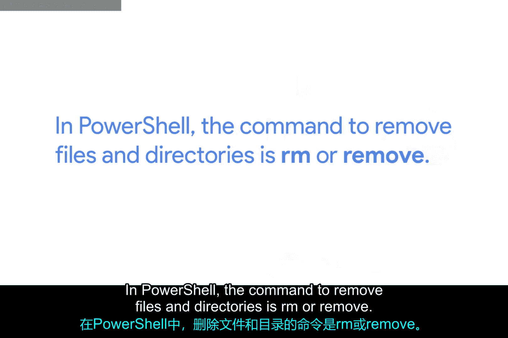
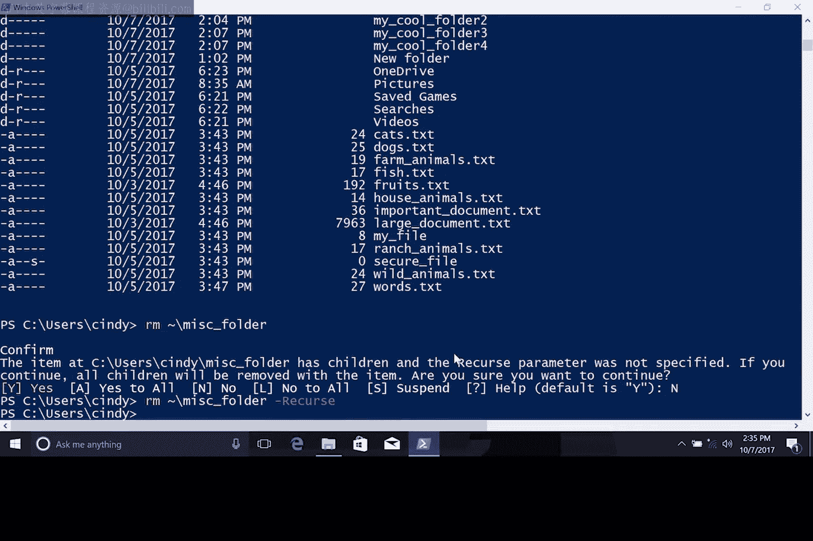

# 谷歌《IT支持（计算机网络⧸操作系统，第2、3课⧸共5课）｜Google IT Support》中英字幕deepseek p110 16_Windows删除文件-目录.zh_en -BV1uyqcYpExr_p110-

Already， now that we've learned how to list， create and move around files and directories。

 let's start removing them in the Windows GuI if you wanted to remove a file or folder。

 just right click and delete。The file ends up in the Recycle bin， which you can find on your desktop。

If you wanted to restore a file here， you could just right click and restore。

If you empty your bin for any reason， you won't be able to retrieve those files。In Powerhell。

 the command to remove files and directories is RM or remove Take caution when using Remove because it doesn't use the recycle bin。

Once the files or directories are removed， they're gone for good。Let's remove a file called Tex1。

text in my Home directory。Who can see。There it is， I'm just going to remove it。And now it's gone。

The remove command might seem like a dangerous weapon in the wrong hands。Fortunately。

 there are safety measures in place that only give this ability to users that are actually authorized to use it。

We'll talk more about file permissions in a different lesson。

 but let's take a quick look at what I mean。Let's remove this file calledImportant System F。Oh。

 I get an error message saying that I don't have permission to delete this file。

In some cases like this one， it's because it's been marked as a system file。In other cases。

 it might be because I don't have enough permissions in the file system to remove the file。

 I do the right permissions this time， but since it is important file。

 PowerShell wants to make sure that I meant to do this。

If I repeat the command with the dash force parameter。Remove we'll go ahead and remove the file。

Let's take a look。Dash force。And you could see the file's gun if the file belongs to someone else or if I'm not an administrator。

 then I might might not have the right permissions to remove the file。 In that case。

 I'll need to access an administrator of account to remove the file。 Okay。

 let's try removing a directory with remove next。Oh here we go。

 here's another place where PowerShell is going to ask us if we really meant to do this。

Since this is in a directory， it contains other files， and we do not use the dash recurse parameter。

 We see a prompt asking us to confirm if we really want to remove the directory and all its contents。

 We can say yes or yes to all to continue。 We can also cancel this command and run it again with a dash recur parameter。

 That way， Power shellll knows that we understand the consequences of what we're doing。

So let's go ahead and cancel this。And try again。Dash recurse。

Yep， now it's gone and that's the remove command in a nutshell again。

 because of the nature of this command， you want to be extra careful when removing files or directories。

