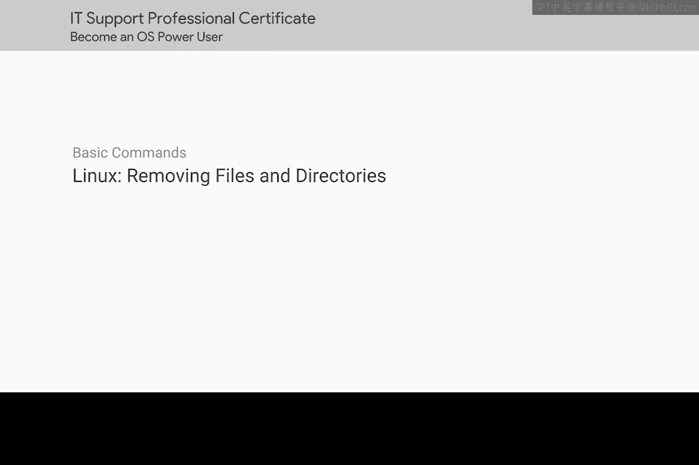
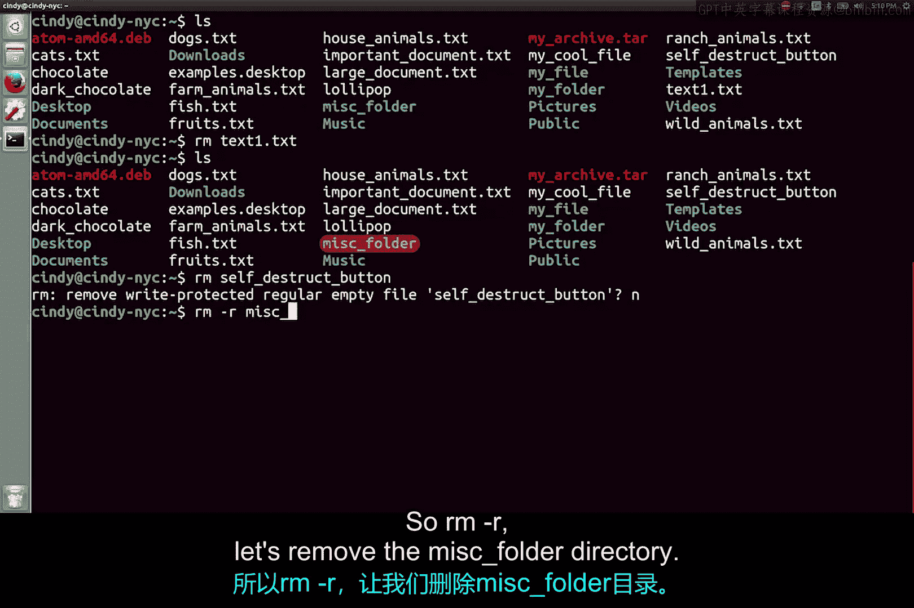

# 谷歌《IT支持（计算机网络⧸操作系统，第2、3课⧸共5课）｜Google IT Support》中英字幕deepseek p111 17_Linux删除文件-目录.zh_en -BV1uyqcYpExr_p111-

To remove files from Linux， just like in Windows， we can use the RM or remove command。

Let's remove this T1 file。Just like that， it's gone similar to Windows。

 we get a message if we try to remove something that we shouldn't be able to。

Let's remove this self destruct button。Awesome， everything is working as intended。Next。

 let's try removing a directory。If you thought to yourself that we need to also recursively remove this directory。

 you'd be right， excellent deduction skills。So RM D R。Let's move。

 Let's remove the Mi folder directory。

And if we check， the MIC folder is now gone。Remember， when using the RM command。

 take extra precaution that you aren't removing something important by accident。

