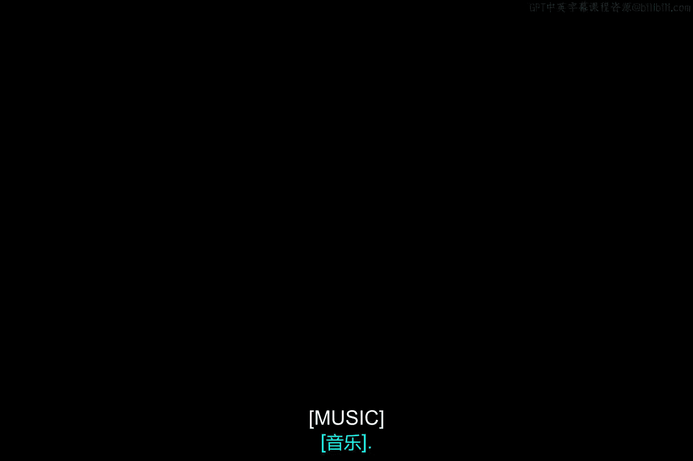

# 谷歌《IT支持（计算机网络⧸操作系统，第2、3课⧸共5课）｜Google IT Support》中英字幕deepseek p112 18_辛迪为何操作系统重要.zh_en -BV1uyqcYpExr_p112-

I knew enough to be dangerous and I think that's what got me into my systems' administrator role in Linux when I got in that role I was working with people who were like。

🎼Insanely brilliant they have Wiikkipedia pages written about them about their contributions to like Linux and all these open source contributions they've done They weren't using the operating system。

 they were like engineering it， they were like contributing code fixing hardware issues and fixing software issues that type of environment really leveled up my skills in terms of Linux because I had to learn I had to keep up somehow so I would read their bug reports and what they did I guess I'd say about after a year I was really comfortable in the command line I it was packaging my own tools and I was writing code and I was contributing to like open source projects and it was definitely definitely an eye opener considering like how much I thought I knew about operating systems to like what I know now the feeling you get when you contribute code to something that thousands if not millions of people might use you kind of don't believe that you just did that but people I mean that's the feeling you get when you do something in the open source community I'm passionate about operating systems because theres a lot of stuff that you can do with them you can contribute code。

an operating system like abuuntu or Debian and you can make an actual like impact I mean I can't go out and build a new CPUU or something and have people use it but I can contribute code I can fix a bug and you know there's like there's like so much stuff you can do with the operating system it's unbelievable。

