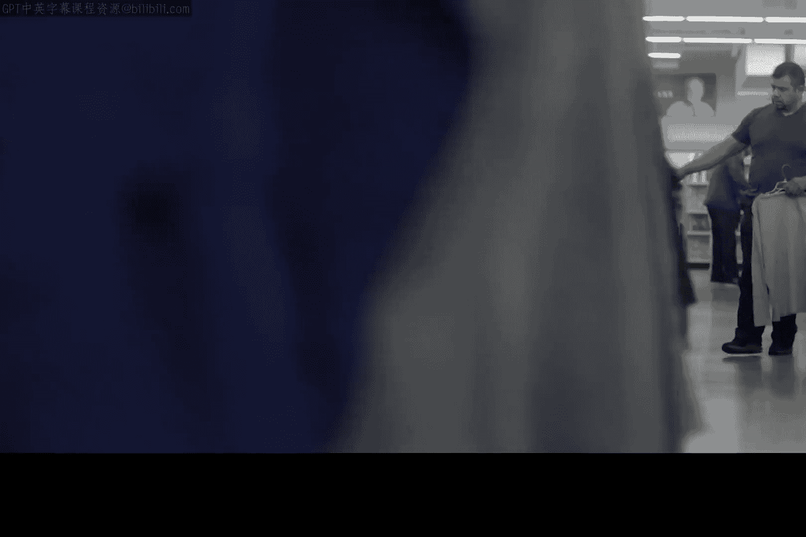
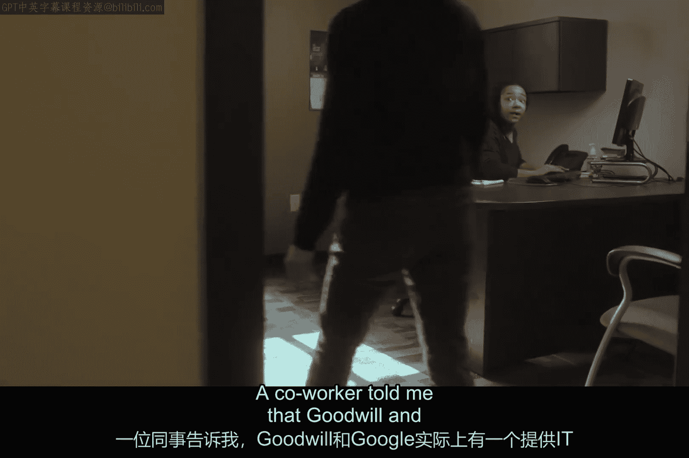
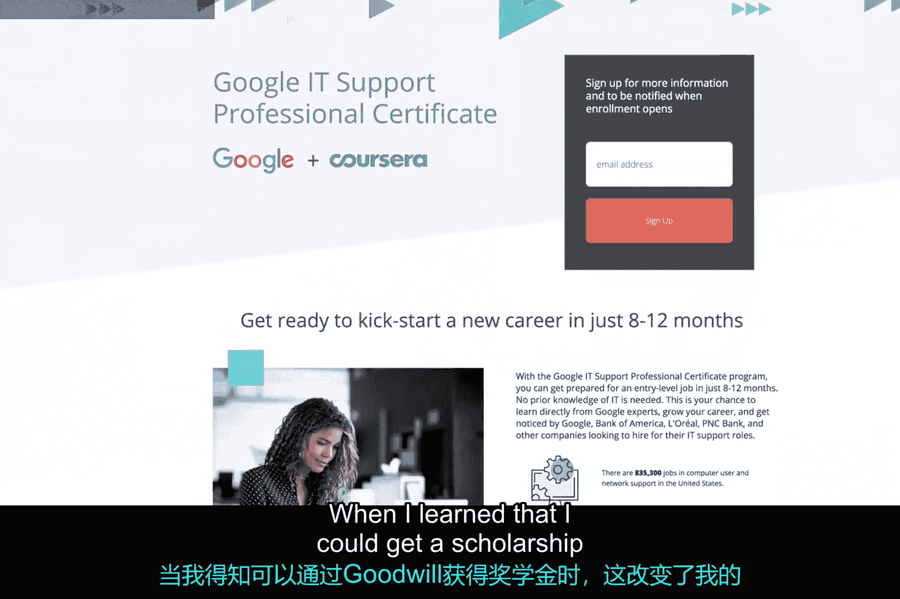
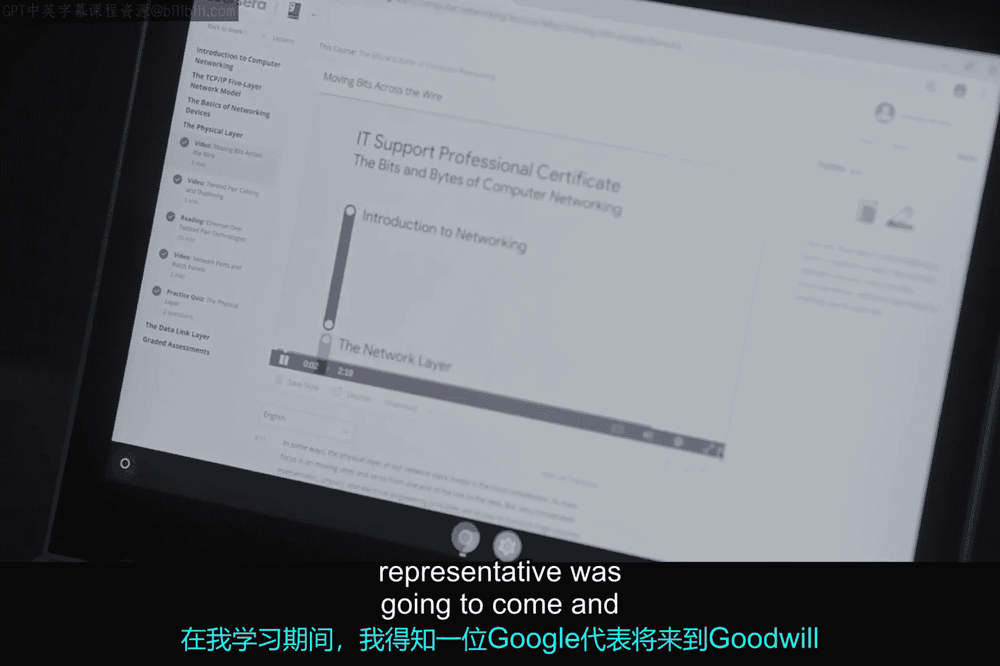
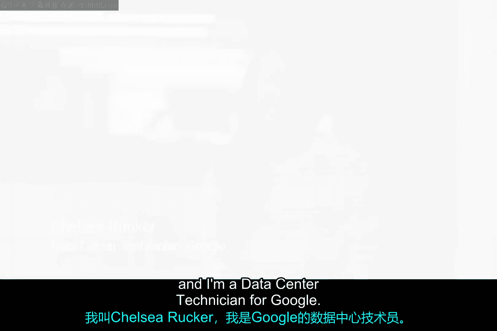

# 谷歌《IT支持（计算机网络⧸操作系统，第2、3课⧸共5课）｜Google IT Support》中英字幕deepseek p113 19_学习者故事：切尔西.zh_en -BV1uyqcYpExr_p113-

The most important thing about being a mother is leading by example。

What do you do when you have nothing？A year ago， I found myself homeless with my daughters。

The whole shelter experience。For the kids， I kept telling them that we were just on vacation and waiting for the house to be ready。

This is the worst thing I ever had to do。I grew up in the housing projects in East Nashville。

 so nobody ever talked about career paths。I didn't know what to do or where to go。

 but I kept saying theyre watching how you handle this。

 you have a serious example to set for these girls。

Most people think that Goodwill is just a retail store， but it's so much more than it。

While I was living at the shelter， I decided to reach out to their career center and I actually got a job as an office a man for Goodwill。

 the coworker told me that Goodwill and Google actually have a program to provide IT Training。

 the program is called the IT Support Professional C。

When I learned that I could get a scholarship through Goodwill， it was life changing。

Chelsea is the kind of person Goodwill was designed to support That's why thanks to the assistance of Google。

org we started the Goodwill Digital Care Acccelerator using tools and resources from growrow with Google the Goodwill Digital Care Acccelerator is focused on connecting more than a million people with the skills they need to advance in digital careers The Google IT support professional certificate was a great building block for this I joined the 4 am。

m club I would get up while the girls are asleep do my schoolwork。While I was studying。

 I learned that a Google representative was going to come and give a TikTok at Goodwill a had to go Chelsea really stood out when I met her at the Goodwill event。

 she asked some really interesting questions and the enthusiasm was tangible so Bastar her to send me a resume。

When I got my interview， I was so nervous， I wasn't sure if I was good enough。

During the interview process， Chelsea demonstrated not only the foundational technical knowledge that she developed but her initiative。

 and that's exactly what we need for people that are working in our data centers。

 so we brought her on board。I absolutely love my job。When I first got the job with my daughter。

 she was like， momom， you got this job that means we'll have a house forever。

In the year that we've been working with Googlegle。org。

 we've seen more than a quarter of a million people build their digital skills and almost 30。

000 people have gone to work。A year ago， I wasn't sure where my life was going。

 I thought everything was falling apart。I feel hopeful about the future now。

I want my daughters to know that they can achieve any goal that they can set for themselves。

My goal is to be a developer， that's what I want to do。I've come this far， I plan to go to the stars。

My name is Chelsea Ruer and I'm a data center techniciannic for Google。

