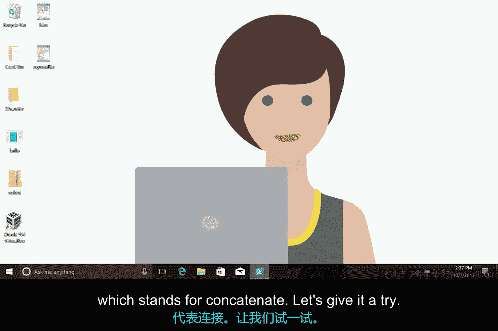
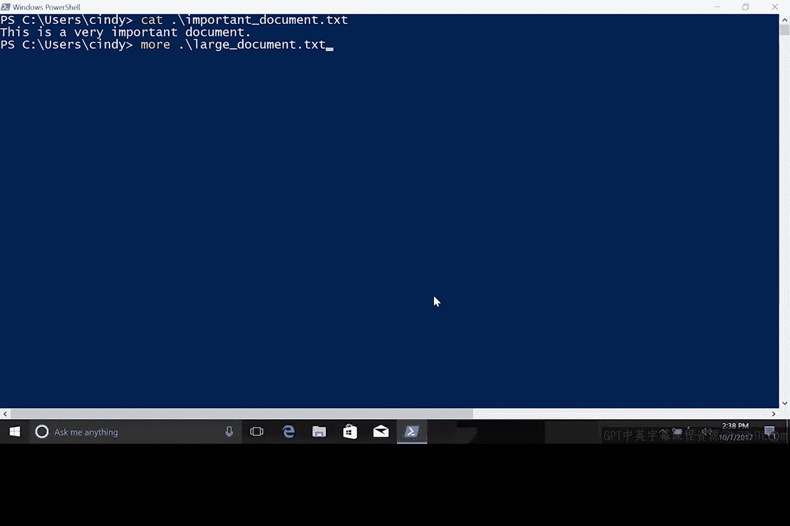
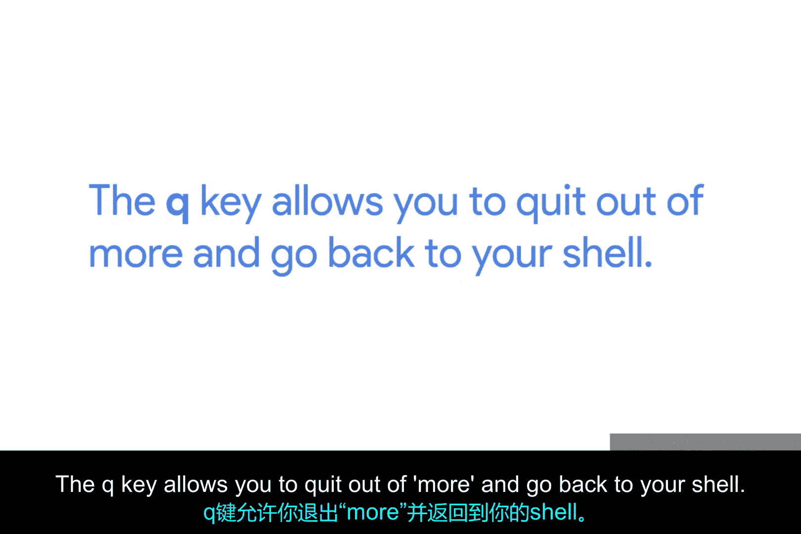
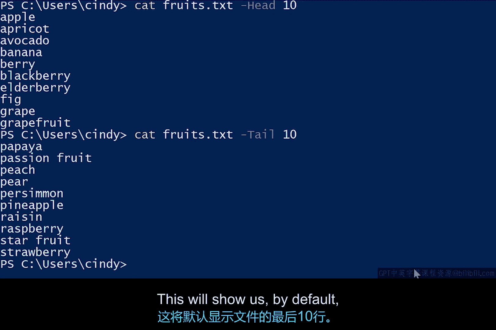

# 谷歌《IT支持（计算机网络⧸操作系统，第2、3课⧸共5课）｜Google IT Support》中英字幕deepseek p114 20_Windows显示文件内容.zh_en -BV1uyqcYpExr_p114-

Now that we've learned the basics of file and directory navigation。

 let's learn how we can display and edit files。Search for text within thousand more in the Windows GuI if we want to open a file and view its contents。

 we can just double click on the file。Depending on the file type。

 it'll open in a default application in Windows， text files default to open in an application calledNotepad。

But we can change this if we want to。To change the default application that opens files。

 just right click and click propertiesperties。Under open with。

We can change the application to another text editor like Wordpad。

Most of the files that we'll be dealing with throughout this course will be text and configuration files。

 So let's just focus on those files instead of images， music files， et cetera。

 Viewing the contents of a file in powerhe is simple using the cat command。

 which stands for concatenate。 Let's give it a try。

This will dump the contents of the file into our shell。

 This isn't the best solution for a file since it just keeps writing the content until the whole file is displayed。

 If we want to view the contents of of the file one page at a time。

 we can use the more command like this。

The more command will get the contents of the file。

 but we'll pause once it fills the terminal window Now we can advance the text at our own pace。

When we run the Mo command， we're launched into a separate program from the shelf。

This means that we interact with the more program with different keys。

The En key advances the file by one line。You can use this if you want to move slowly through the file。

Space advances the file by one page。A page in this case depends on the size of your terminal window。

 basically more will output enough content to fill the terminal window。

The Q key allows you to quit out of more and go back to your shell。

If we want to leave the more command and go back to our show， we can just hit the Q key。Here we are。

Now， what if we just wanted to view part of the file。

 let's say we want to quickly see what the first few lines of a text file are。

We don't really want to open up the whole file。 Instead。

 we just want to get a glimpse of what the document is。 This is called the head of the file。

To do this， we can go back to CA and add the dashhead parameter。

This will show us the first 10 lines of the file。Now what if we wanted to view the last few lines or the tail of the file。

 I bet you can guess what we're going to do。This will show us by default the last 10 lines of the file again。

 these two commands don't seem like they have any immediate use to you yet。

We'll see their benefits when we work with logs in an upcoming lesson Now let's take a look at how to do these same tasks in Linux。

