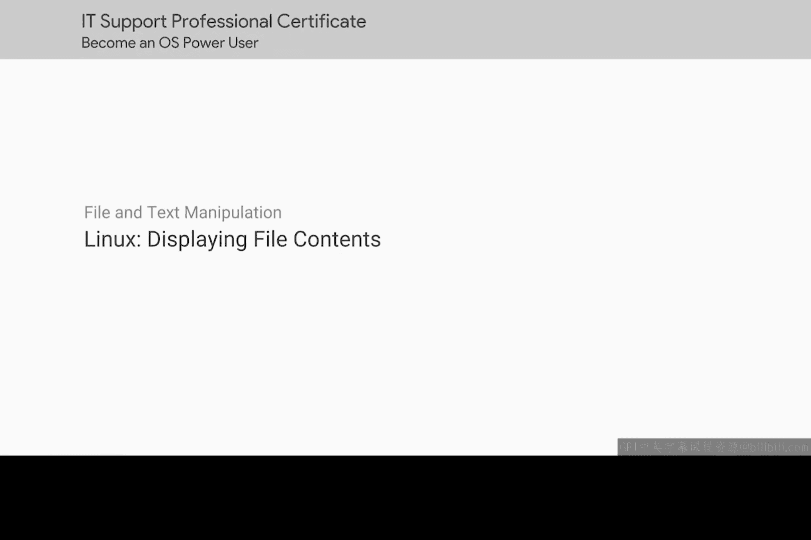
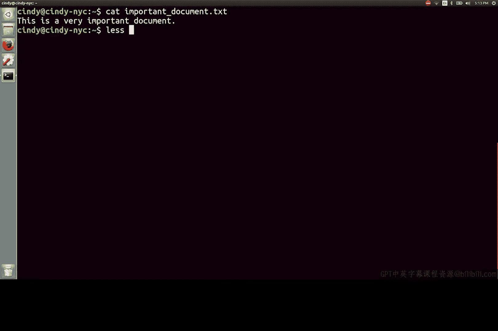
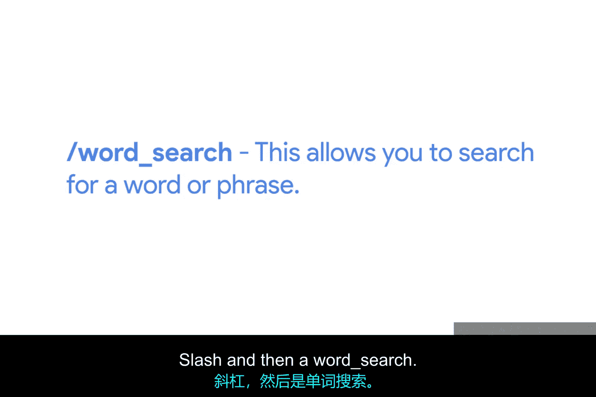
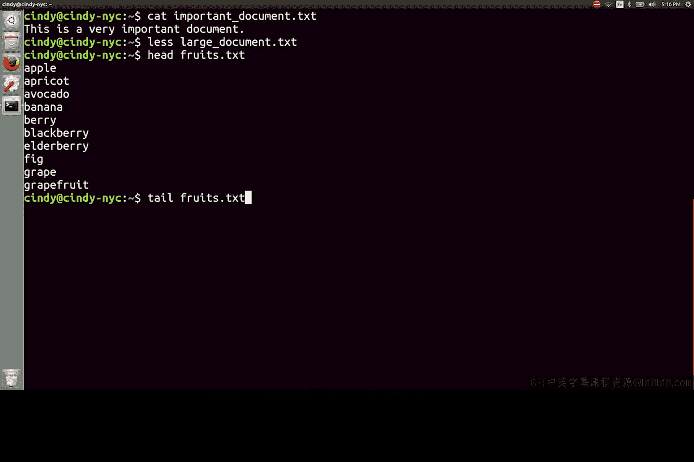

# 谷歌《IT支持（计算机网络⧸操作系统，第2、3课⧸共5课）｜Google IT Support》中英字幕deepseek p115 21_Linux显示文件内容.zh_en -BV1uyqcYpExr_p115-

To read a simple file in bash， we can also use the CAT command to view a document。

So let's look at important。Document。The CAAT command is similar to the Windows CA command since it doesn't do a great job at viewing large files。

 instead we use another command less。

Lest does a similar thing that more does for windows， but it has more functionality。 Fun fact。

 there's a bash command called more， but it's been slowly dying out in favor of less。

 It's literally a case of less is more。😊，Similar to more。

 when we use less we launched into an interactive shell。

 some of the most common keys you'll use to navigate this tool are the up and down keys。😊。

Page up and page down。G， this moves to the beginning of a file。You can see now at the beginning。

 capital G， this moves to the end of a text file。Now we're at the end。

Slash and then a word search This allows you to search for a word or phrase If I type in slash。

 then type the word I want to search for， I can scan through the text file for words that match my search。

Q this allows you to quit out of less and go back to your shell。

 similar to the Q key in the Windows More command。Do you see how less offers functionality like searching within a file？

Less is a great tool to use to view files of any size。

 You'll no doubt end up using this command often as an IT support specialist。

 similar to the Windows cat and head parameter， we can do the same thing in Linux using a command called head。

This will show you by default the first 1 lines of the file。Now。

 what if you wanted to view the last few lines of the file， you can use a command calledT。

This will show you by default the last 10 lines of a file。

