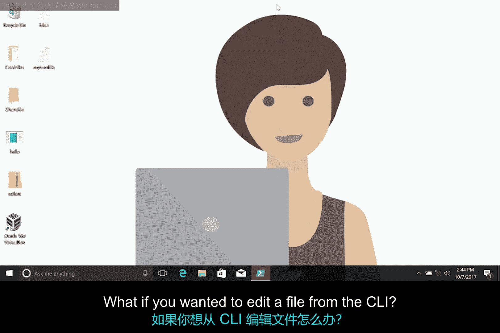
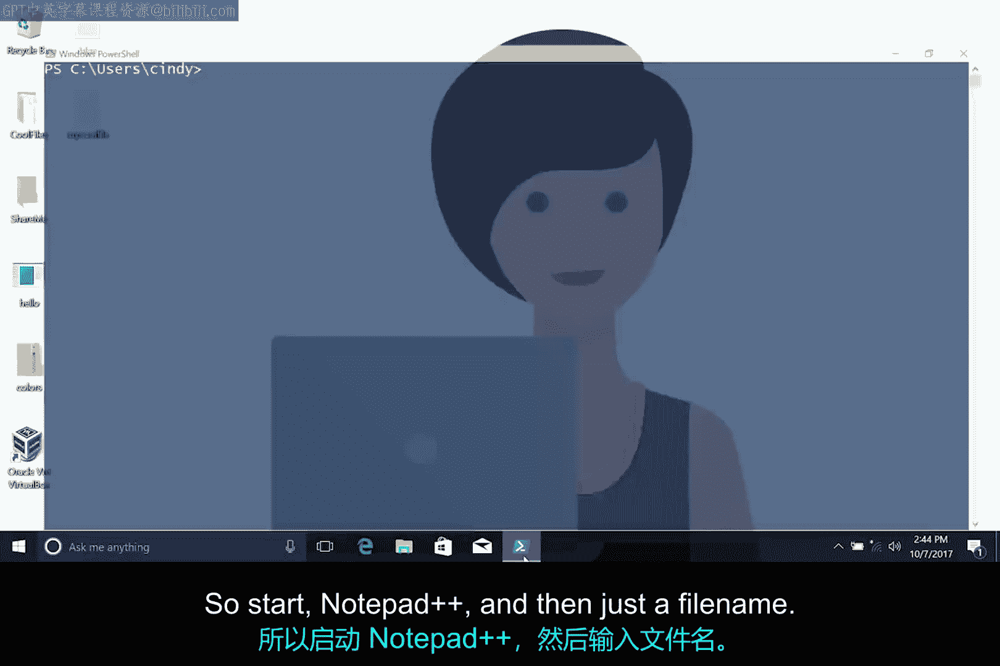
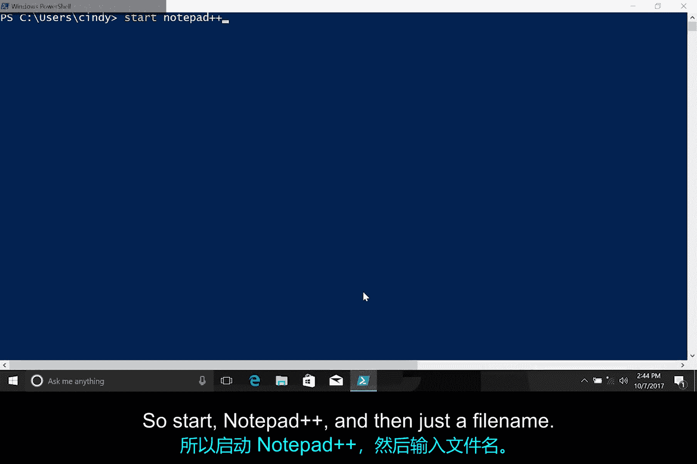
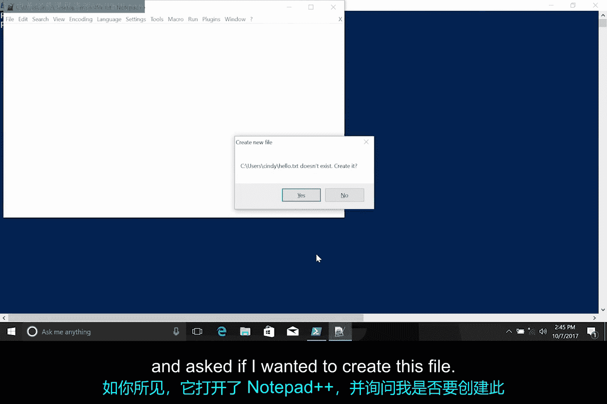

# 谷歌《IT支持（计算机网络⧸操作系统，第2、3课⧸共5课）｜Google IT Support》中英字幕deepseek p116 22_Windows修改文本文件.zh_en -BV1uyqcYpExr_p116-

So far， we've discussed how to read and modify files。

 but we haven't covered how to edit file contents yet。 spoilpoiler alertert， you're about to learn。

 you can edit text based files and notepad， which we used earlier to view a text file。

 Noteepad is great for basic editing， but when making changes to configuration files。

 scripts or other complex text files， you might want it something with more features。

There are lots of good editors out there for the Windows Guoei For this demonstration。

 we'll use one called notepad plus plus。NoPa++， which you can access from the next supplemental reading is an excellent open source text editor with support for lots of different file types。

Notepad plus plus can open multiple files and tabs。

 It also does syntax highlighting for known file types and has a whole bunch of advanced text editing features。

 syntax highlighting is a feature that a lot of text editors provide。

 It displays text in different colors and fonts to help you categorize things differently。

 We've already installed Noteepad plus plus on our machine。

 So you can check out their website do the same。 Now。

 you can edit any file using notepad plus plus by right clicking it and selecting edit with notepad plus plus。

😊。

What if you wanted to edit a file from the CLI？Unfortunately。

 there's no good default editor in the PowerShell terminal。

 but we can launch our Noteepad++ text editor from the CLI and begin modifying text that way。

So， start。Notead。Plus， plus。

And then just a file name。예？As you can see it opened up Notepa++ and asked if I wanted to create this file if you'd like to read about text editors that you can specifically use in the CLI。

 check out the supplement reading on an advanced text editor called VIm。

