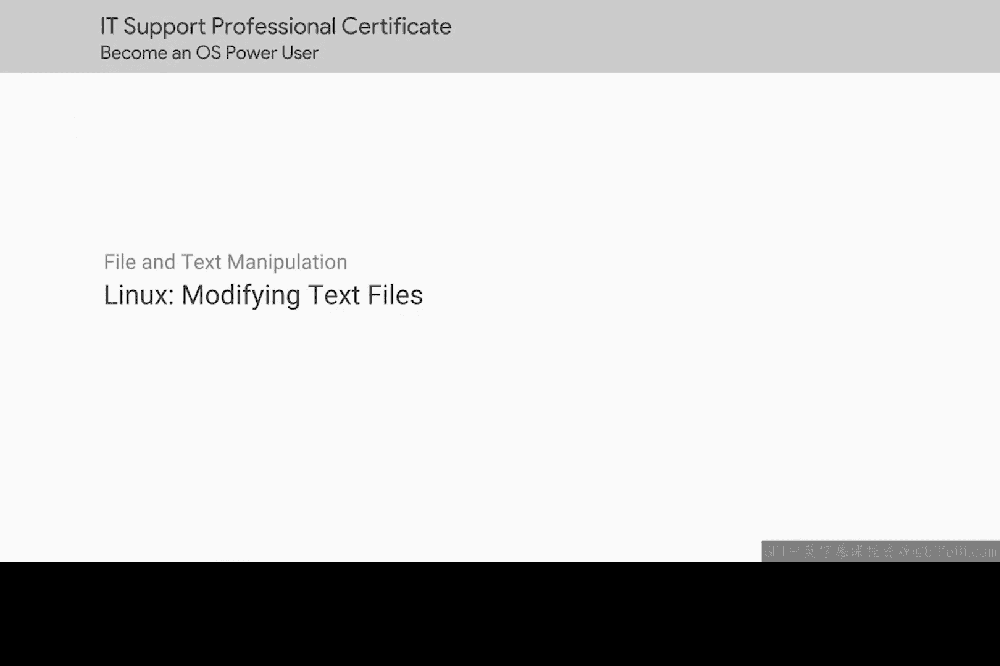
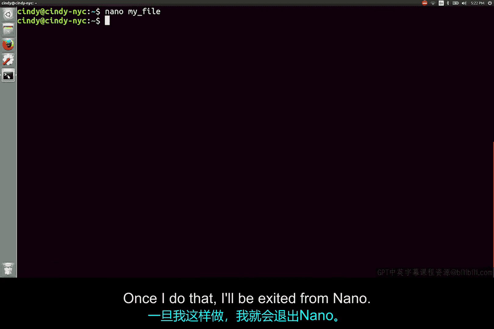

# 谷歌《IT支持（计算机网络⧸操作系统，第2、3课⧸共5课）｜Google IT Support》中英字幕deepseek p117 23_Linux修改文本文件.zh_en -BV1uyqcYpExr_p117-

In Linux， there are many popular text editors that we can use to modify files。

We won't have enough time to cover them all， so let's just focus on one editor that can be found on virtually any distribution nano。

Nano is an extremely lightweight but useful text editor we've included it in the supplementary readings after this video。

 so go check it out to edit a file in Nano， just type Nano then the file name。

Once we do that we'll be launched into the nano program from here we can start editing content as we normally would with any other text editor。

At the bottom of the screen， you'll notice a few options like。Carrot G and carrot K。

The carrot means to use Cl G or C K， we won't talk about all these options。

 but a few that might be useful are Cl G， which helps open up a help page and control X。

 which is used when you want to save your work or exit from nano。 Let's go ahead and edit this file。

 then save our changes。It's asking me if I want to save the file or exit and discard my changes。

I'm just going to hit Y because I want to save them。Once I do that， I'll be exited from Nano。

Let's verify we actually change that file There it is Na is a super useful tool if you need a quick text editor in Linux。

 but if you want to be a true OS power user， I recommend that you read the supplemental material I've included to learn more about the text editors that are used in the industry like Vim or EmX。

