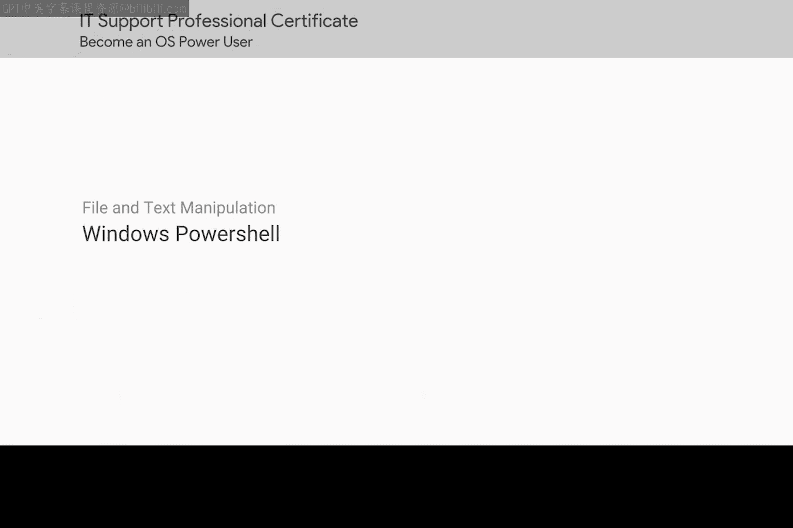
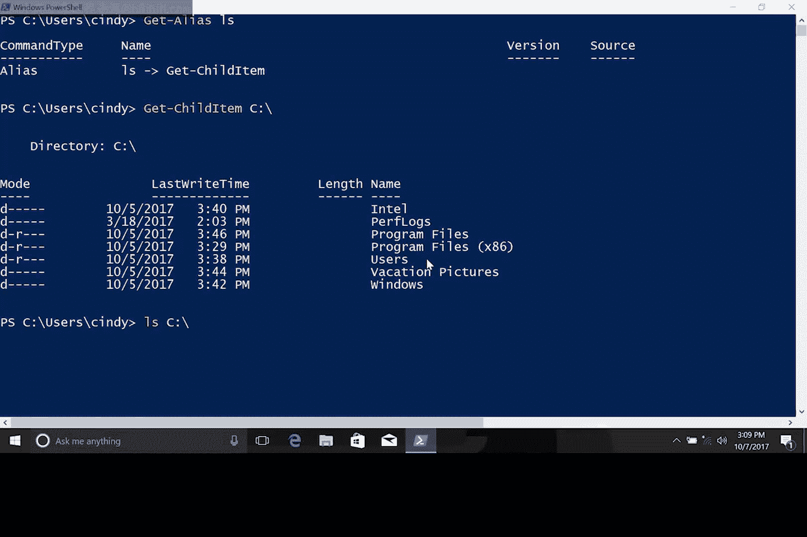
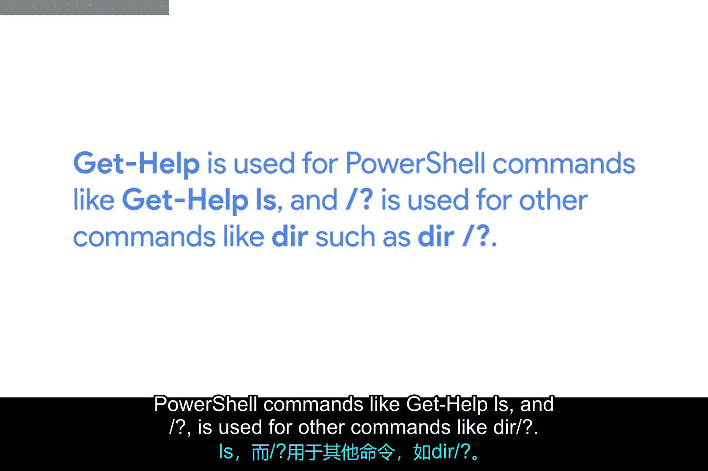

# 谷歌《IT支持（计算机网络⧸操作系统，第2、3课⧸共5课）｜Google IT Support》中英字幕deepseek p118 24_Windows PowerShell.zh_en -BV1uyqcYpExr_p118-

So far in this course， we've been using command aliases in PowerShell。

Phell is a complex and powerful command language that's also super robust。

 we've been able to use common aliases that are exactly the same as their Linux counterparts。

But from here on out， we'll need to deploy some advanced command line features。

 so we'll need to look at real PowerShell commands。

You've already seen an example of a real PowerShell command getHe。

 which is used to see more information about commands There's another PowerShell command that we can use to look at one of our aliases that we've been using LS or List directory to see what the actual PowerShell command is that gets executed。

 we can use the PowerShell command get alias。Interesting， when we call L S。

 we're actually calling the power She command get dash Chil item。 It gets or lists the children。

 which are the files and subdirecties of the given item。

 Let's actually run this get dash childil item command with the item C back slash。😊。

You'll see this is the same output as LSC backslash。

Cool， Powerhell commands are very long and descriptive， which makes them easier to understand。

But it does mean a lot of extra typing when you're working interactively at the CLI aliases for common commands are a great way to work more quickly in Powerhell。

We've been using them up to this point to help us hit the ground running with the command line。

In Windows you pretty much have three different ways you can execute commands。

 you can use real PowerShell commands or the relatable alias names。

 another method we've mentioned but haven't really talked about yet is command。ec commands。Command。

e commands are commands from the old MS dos days of Windows。

 but they can still be run due to backwards compatibility。

 keep that in mind that they aren't as powerful as PowerShell commands。

An example of a command EE command is DR， which coincidentally points to the Powerhell command get dashash Child item。

 which is also where our LS Alias gets pointed to。Remember the PowerShell command gethellp。

 or there's a command parameter that you can use to get help with Command@E commands。

Slash question mark。Keep the difference in mind。 getashhelp is used for Powershell commands like gethel Ls and s question mark is used for other commands like D s question mark if I tried to use Ls/lash question mark it would return nothing because the Powerhell command that LS is an alias of doesn't know how to handle the parameter s question mark and vice versa。

 you're free to use whatever commands you feel comfortable with but in this course we're going to use common aliases and powerhell commands。

