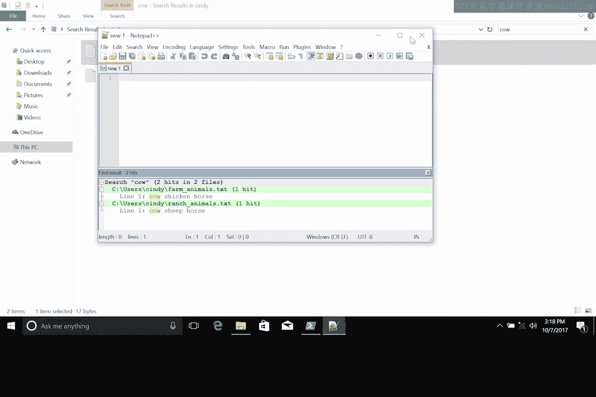
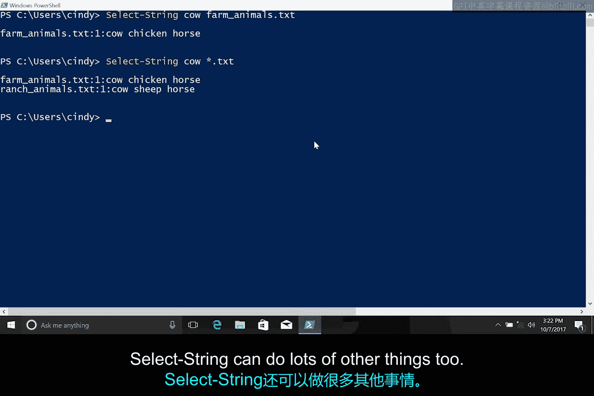

# 谷歌《IT支持（计算机网络⧸操作系统，第2、3课⧸共5课）｜Google IT Support》中英字幕deepseek p119 25_Windows在文件中搜索.zh_en -BV1uyqcYpExr_p119-

You've probably had to search for words in a text document before。

 whether what it was to find and replace words or for something else。

Most text editors work the same way when it comes to finding words in a document。

All you need to do is control F to search for the word， pretty simple， right？

But what if you wanted to see if Word existed in multiple files？There are a few ways we can do this。

 Let's talk about the GuUI options and then we'll turn to Powerhell and learn how to search for words from the CI。

 Windows has a service called the Windows search Service。

 This service indexes files on your computer by looking through them on a schedule。😊。

It then compiles a list of names and properties of the file that it finds into a database。

 This is a time consuming and resource intensive process。So on many Windows servers。

 the search service isn't installed or is disabled。On Windows 8 and Windows 10 desktop computers。

 it's often enabled for files in your home directory， but not for the entire hard drive。 By default。

 the Windows search service will let you find files based on their name。

 path the last time they were modified， their size or other details。But by default。

 you can't search for words inside the files， the Windows search service can be configured to search file contents and their properties。

This increases the amount of time that it takes for the indexer to do its work。

It's sort of like the computer is doing all of the searches that you might want to do ahead of time。

 and then you just have to look up the result。Let's configure the service to index file contents and see what it looks like。

The settings we're looking for are in the control panel。

 but we can use the start menu to find the settings we need faster。

Open the start menu and then type indexing。You'll see the indexing options in your results of the search。

 click on that。Now we want to change the settings for the user folder。

 which is where all the home directories are stored。Select users。And then click advancedd。Now。

 select the fileile typess tab。And select indexd Proties and fileile Cons。Click， ok。

Now close out of the indexing options。When you do this。

 the Windows search service will start to rebuild the index based on your new settings。

 This could be super fast or could take a while。 It all depends on how many files you have and how large they are。

On this system， I've already let the reindixingcomplete。

Now I can use Windows Explorer in my Home directory to find files that have a specific word in them。

Let's search for the word cow。The results turn up farm animals and ranch animalsimals。t。Awesome。

 we can see the word cow in this text file。 If you don't want to use the Windows search service。

 we can also use notepad plus plus。😊，The editor that we installed in an earlier lesson from Noteepad++。

 press C shift F to open the Find In Fi dialog。From here。

 we can specify what you want to find and what files you want to search。

 You can limit your search to a specific directory。To a specific set of file extensions。

 and you can even optionally replace the word with another one from here。

So let's search for the word Calgan。And this time I'm going to search in my home directory。Find all。

Oh， there we go， now it returns farm animals and ranch animals。

If we can't or don't want to use a GuUI， we can search for words within files from the command line。

In PowerShell， we're going to use the SLS or select Dek string command to find words or other strings of characters and files。

You can think of strings as a way for the computer to represent text。

 the select string command lets you search for text that matches a pattern you provide。

This could be a word， part of a word， a phrase， or more complicated patterns that are described using a pattern matching language called regular expressions。

 Keep in mind that this is a really powerful capability that we're just scratching the surface of。

So here we're going to search for a word in a file in my Home directory。

Let's search for the word cow again。You'll see that select D string found Cal and it tells you the file and the line number where it found it。

Excellent。😊，If you wanted to search through several files in a directory。

 you can use pattern matching to select them。Remember the wild card character asterisk for selecting all。

 we can use that here as well。Now we can see that it found farm animals and ranch animals。

Select dash string can do lots of other things too。

We'll get a chance to see that in later lessons。 Being able to find a string in a file or a set of files is going to be a critical skill for you in this course。

 and in your I T support work。 it's also an important tool that we're going to learn to combine with other tools to do really powerful things from the CI。

😊。

