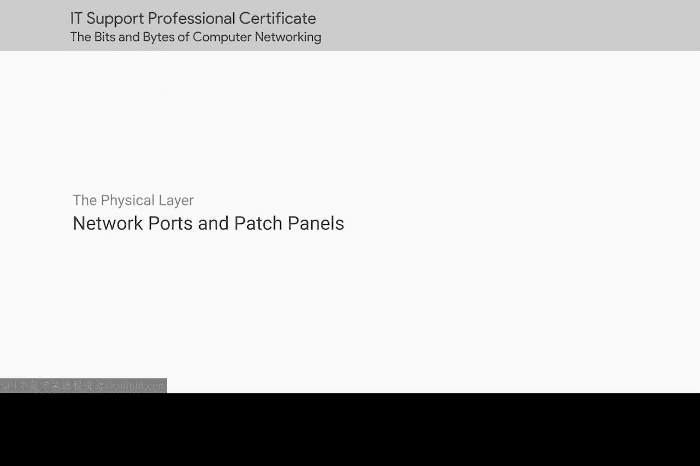
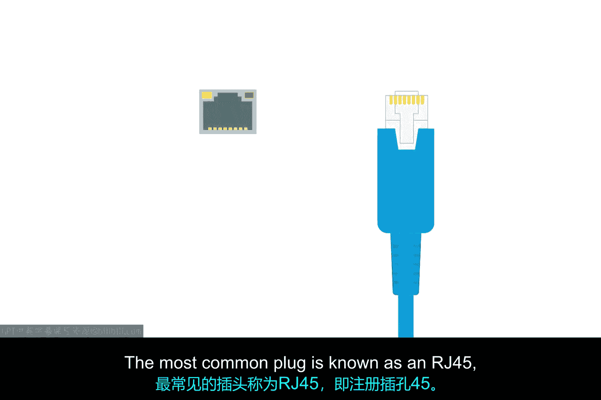
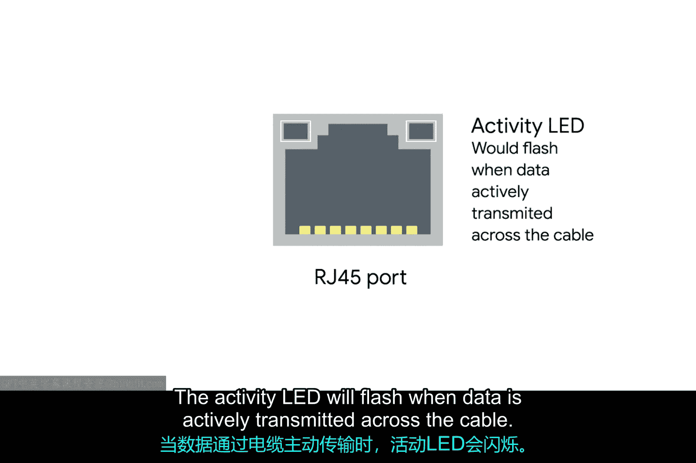
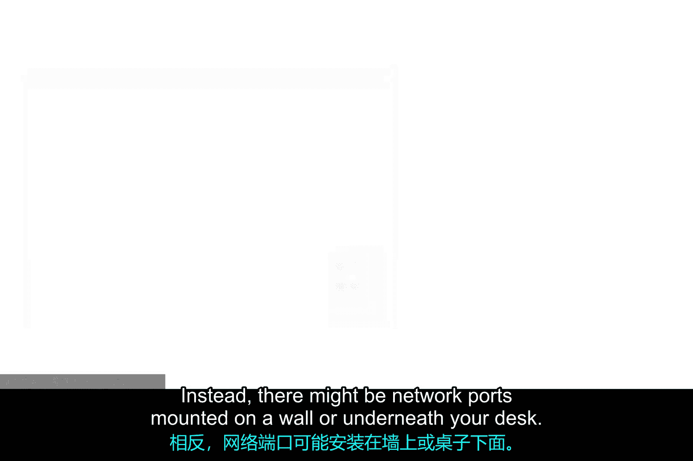
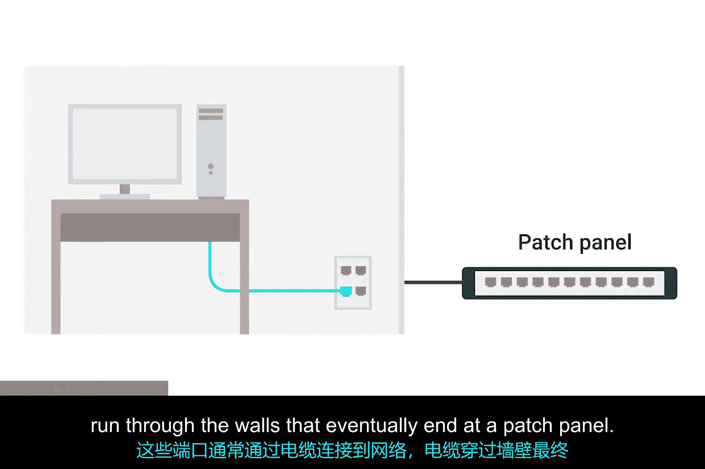
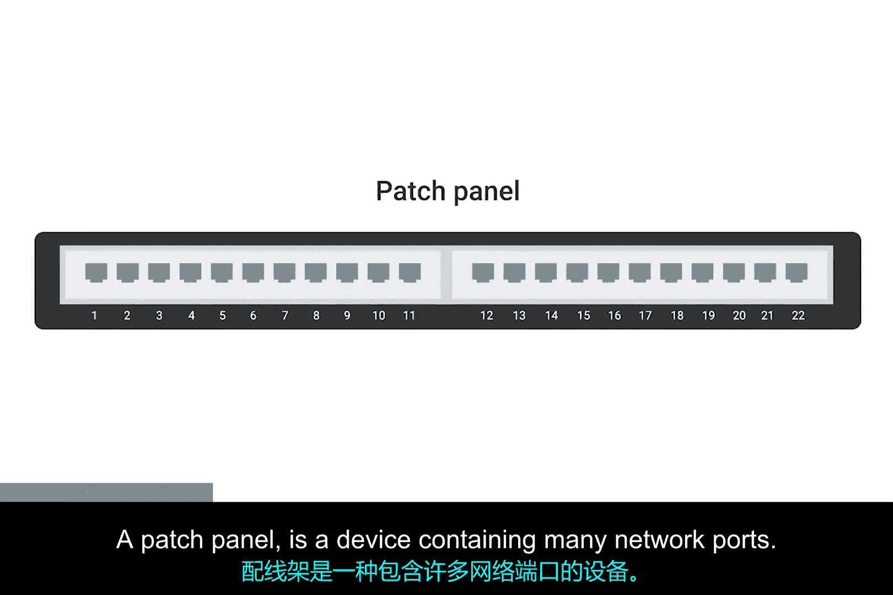

# 谷歌《IT支持（计算机网络⧸操作系统，第2、3课⧸共5课）｜Google IT Support》中英字幕deepseek p12 10_网络端口与配线架.zh_en -BV1uyqcYpExr_p12-

The final steps of how the physical layer works take place at the endpoints of our network links。

Twisted pair network cables are terminated with a plug that takes the individual internal wires and exposes them The most common plug is known as an RJ45 or registered jack 45。

It's one of many cable plug specifications， but by far the most common in computer networking。

A network cable with an RJ45 plug can connect to an RJ45 network port。

Network ports are generally directly attached to the devices that make up a computer network。

Switchches would have many network ports because their purpose is to connect many devices。

 but servers and desktops usually only have one or two。Your laptop。

 tablet or phone probably don't have any， but we'll get to wireless networking in a later module。

Most network ports have two small LEDs， one is the link light and the other is the activity light。

The link light will be lit when a cable is properly connected to two devices that are both powered on。

The activity light will flash when data is actively transmitted across the cable。

A long time ago， the flashing of an activity light corresponded directly to the ones and zeros being sent Today。

 computer networks are so fast that the activity light doesn't really communicate much other than if there's any traffic or not。

On switches， sometimes the same LED is used for both link and activity status。

 it might even indicate other things like link speed。

You'll have to read up on a particular piece of hardware you're working with。

 but there will almost always be some troubleshooting data available to you through port lights Sometimes a network port isn't connected directly to a device instead there might be network ports mounted in a wall or underneath your desk。

These ports are generally connected to the network via cables。

 ran through the walls that eventually end at a patch panel。

A patch panel is a device containing many net port， but it does no other work。

It's just a container for the endpoints of many runs of cable。

Additional cables are then generally ran from a patch panel to switches or routers to provide network access to the computers at the other end of those links。

