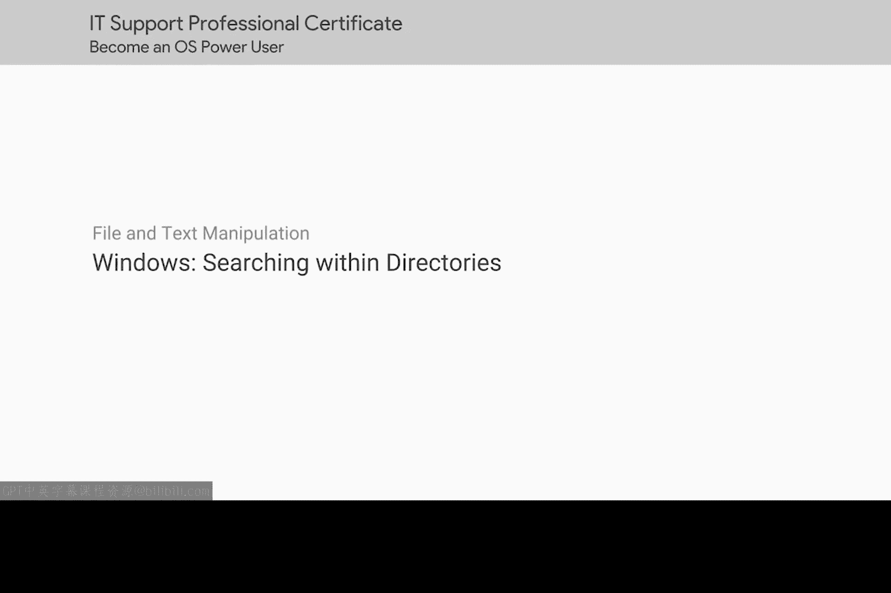
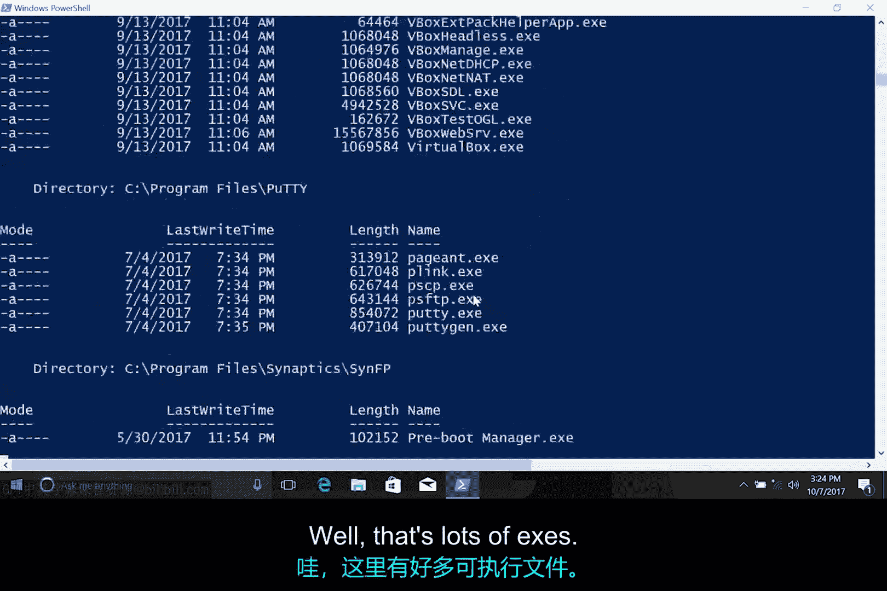
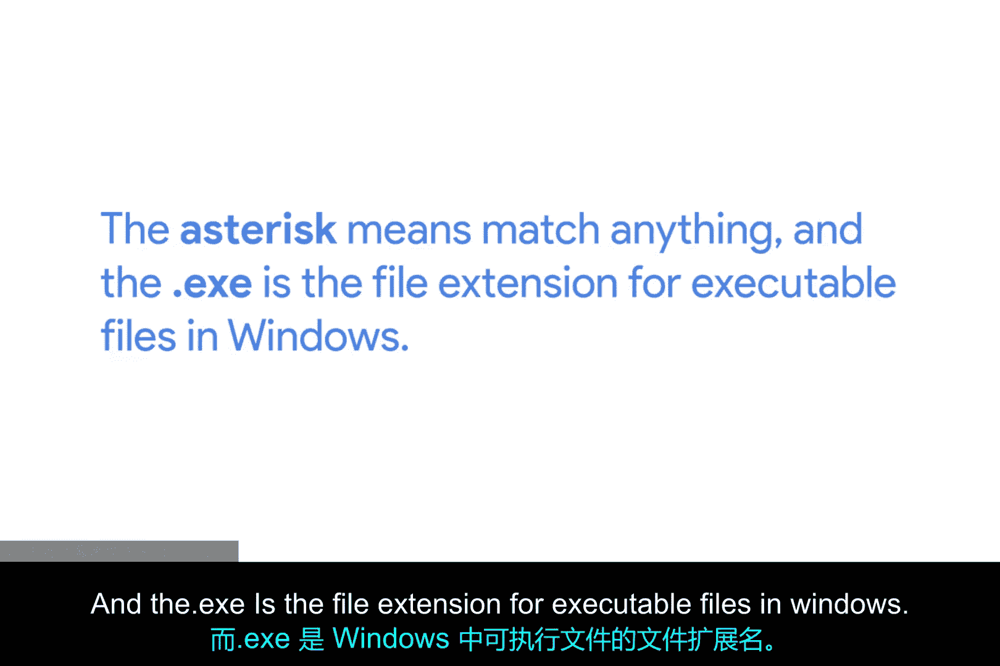

# 谷歌《IT支持（计算机网络⧸操作系统，第2、3课⧸共5课）｜Google IT Support》中英字幕deepseek p120 26_Windows在目录中搜索.zh_en -BV1uyqcYpExr_p120-

What if we wanted to search for something within a directory。

 like looking for just the executables in that same directory。

 this is where the command parameter dash filter comes in。I'm just going to LS。

My programs' files here。With the dash recurse and dash filter。And look for EXs。

Wow， that's a lot of EXs。The dash filter parameter will filter the results for file names that match a pattern。

The asterisk means matchch Anything， and the dot EX is the file extension for executable files and Windows。

So the only results we're going to get are the files that end in。exc cool。

