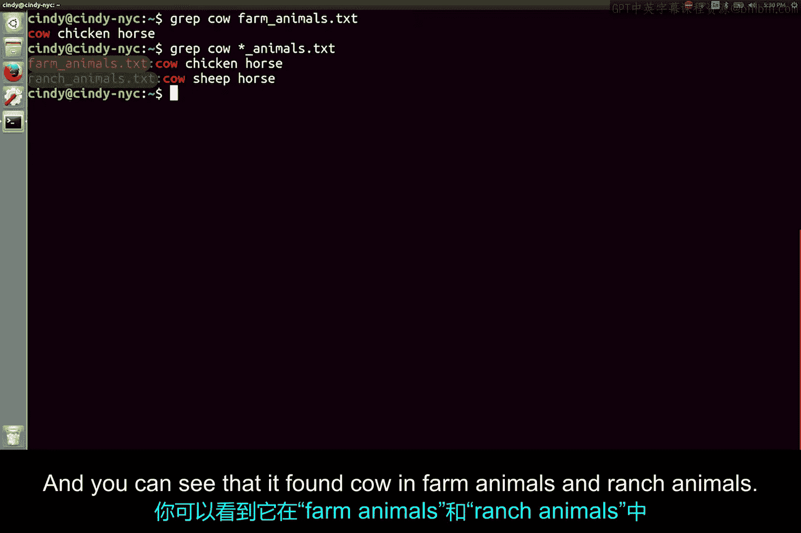

# 谷歌《IT支持（计算机网络⧸操作系统，第2、3课⧸共5课）｜Google IT Support》中英字幕deepseek p121 27_Linux在文件中搜索.zh_en -BV1uyqcYpExr_p121-

In Bash we can search for words within a files that match a certain pattern using the GP command What if you wanted to know if a certain file existed in a directory or if a word was in a file similar to the Powerhell select string command。

 we can use the GrP command in bash。Let's search for the word cow in farm animals。

You'll see that Grp found cow in the textile farm animalsim。

You can also use GrP to search through multiple files。Let's use their asterisk wildcard command here。

And you can see that it found cow in farm animals and ranch animals。

You'll be using GEP a lot throughout this course and in later courses。

 so it's an important command to remember。