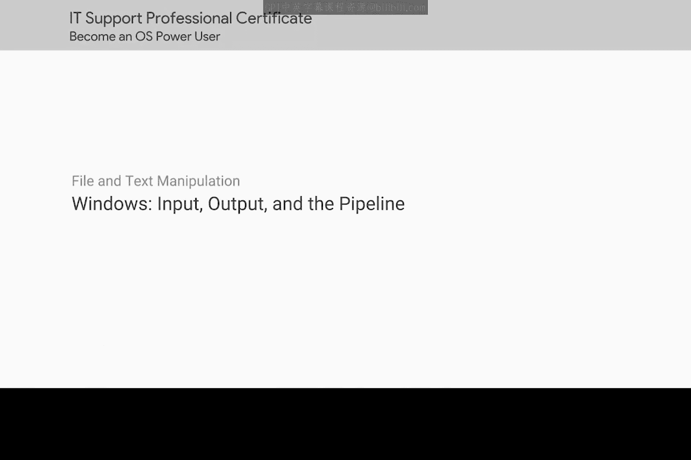
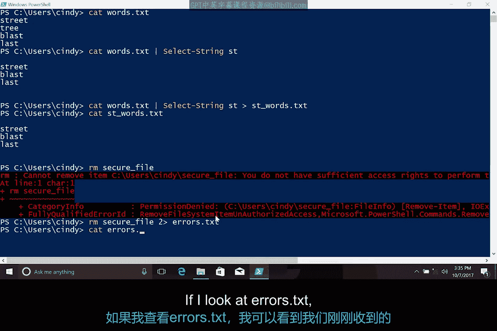
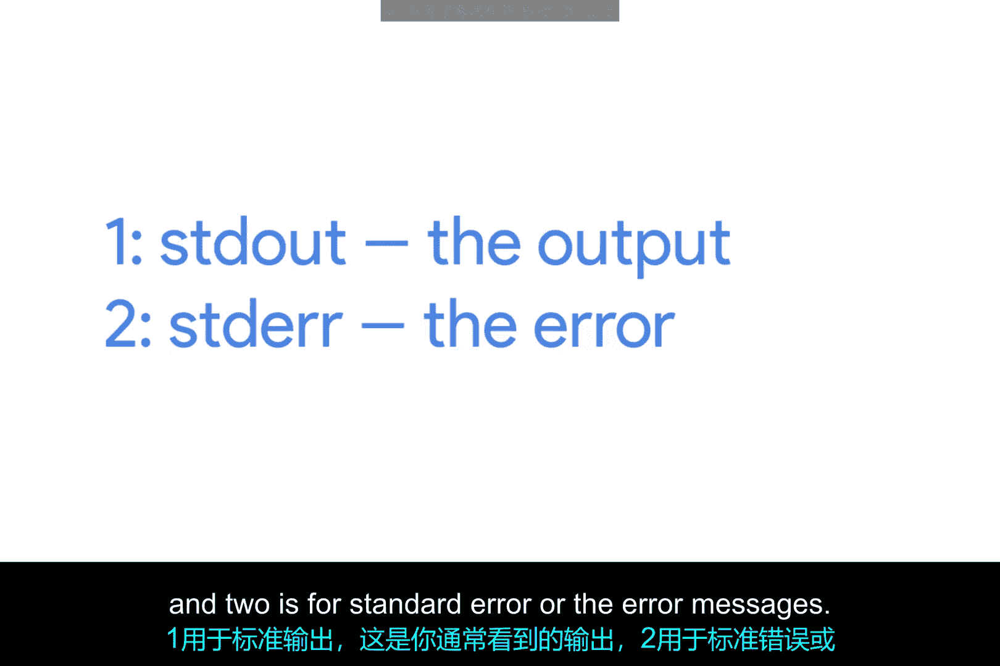
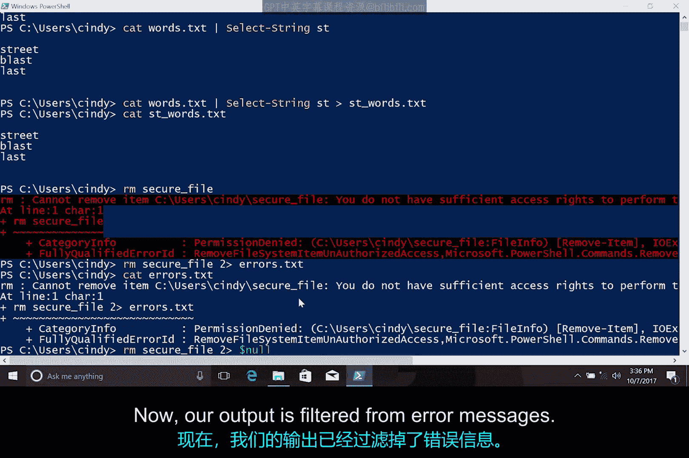

# 谷歌《IT支持（计算机网络⧸操作系统，第2、3课⧸共5课）｜Google IT Support》中英字幕deepseek p122 28_Windows输入输出与管道.zh_en -BV1uyqcYpExr_p122-

Al right， we've learned a bunch of individual， very powerful tools。

These are the most important day to day commands that you'll need to work in PowersShell。

Now we're going to learn how to combine these tools to make them even more powerful。

 let's run the following command in our desktop directory， then we'll break it down piece by piece。

Just got a CDd into my desktop directory。Okay。Echo wolf。Dog dot text。

We to do an L S to check our desktop。And we'll now see a file called Dog dottext。Inside that file。

 we should see the wordwo。Oh， there it is。What's happening here， Let's take a closer look。Echo wolf。

In Powershale， the E is actually an alias for right dash output。

That gives us a clue to what's happening We know the echo command prints out our keyboard input to the screen。

 but how does this work every Windows process and every Powerhell command can take input and can produce output。

To do this， we use something known as IO streams or input output streams。

 Each process in Windows has three different streams standard in。Standard out。 and standard error。

It's helpful to think of these streams like actual water streams in a river。

You provide input to a process by adding things to the standard in stream。

 which flows into the process。When the process creates output。

 it adds data to the standard outstream， which flows out of the process at the CI。

 the input that you provide through the keyboard goes to the standard in stream of the process that you're interacting with。

This happens whether that's PowerShell， a text editor or anything else。

 the process then communicates back to you by putting data into the standard outstream。

Which the CLA writes out on the screen that you're looking at。Now。

 what if instead of seeing the output of the command on the screen， we wanted to save it to a file？

The greater than symbol is something we call a redirector operator that lets us change where we want our standard output to go。

Instead of sending standard out to the screen， we can send standard out to a file。If the file exists。

 itll overwrite it for us otherwise， it will make a new file。

 if we don't want to overwrite an existing file， there's another redirect operator we can use to append information greater than greater then。

 So let's see that in action。Echo， wolf。Greater than greater than dog dot text。

Now if I look at my Dog。t textex file again。We can see that Wolf was added again。

 but what if we wanted to send the output of one command to the input of another command For this。

 we're going to use the pipe operator First， let's take a look at what's in this file。

Cat words dot text。Look at that， it's a list of words。

Now what if we want to just list the words that contain the string ST。

 we could do what we've done before and just use select dash string or SLS on the file directly this time let's use the pipeline to pass the output of CAAT to the input of select dashash string。

So cat words。text， pipe。Select dash string， S T。And now we can see a list of words with the string ST。

To tie things together， we can use output redirection to put our new list into a file。

 so now greater than。And then a new file called ST wordss。text。Now if I cat STwords。text。Yep。

 there it is。That's just a very basic example of how you can take several simple tools and combine them together to do complex tests。

Okay， now we're going to learn about the last IL redirectctor standard error remember when we tried to remove a restricted system file earlier and we got an error that said permission denied。

Let's review that once more， this time I'm going to remove another protected file。RM secure。File。Ha。

 we see errors like we're supposed to。 But what if we didn't want to see these errors。

 Turns out we can just redirect the output of error messages in a different output stream called standard error。

 The redirection operator can be used to redirect any of the output streams。

 but we have to tell it which stream to redirect， so。Let's type RM secure file。Two， greater than。

Arrs dot text。If I look at errors。text。

I can see the error message that we just got， so what does the two mean？

All of the output streams are numbered。1 is for standard out。

 which is the output that you normally see， and two is for standard error or the error messages。

 Heads up。 Powershell actually has a few more streams that we aren't going to use in this lesson。

 but they can be redirected in the same way。 You can read more about them in the supplemental reading right after this video。

So when we use2 greater then， we're telling PowerShell to redirect the standard error stream to the file instead of standard out。

What if we don't care about the error messages， but we don't want to put them in a file？

Using our newly learned redirector operators， we can actually filter out these error messages。

In Powershell， we can do this by redirecting standard error to dollar sign null。

What's dollar sign no？Well， it's nothing。 No really。

 it's a special variable well that contains the definition of nothing。

 You can think of it as a black hole for the purposes of redirection。

So let's redirect the error messages this time to Do sign null。RM secure file。To greater then。

Dollar signalinel。

Now， our output is filtered from error messages。 There's still much more to learn。

 if you're interested。Try get D help about underscore redirection in power shellll to see more detail。

 It may take a little time to get the hang of using redirector operators。 Don't worry。

 that's totally normal。 Once you do start to get used to them。

 you'll notice your command foo skills level up and your job becomes a little easier。😊。

Now let's take a look at output redirection in Linux。

