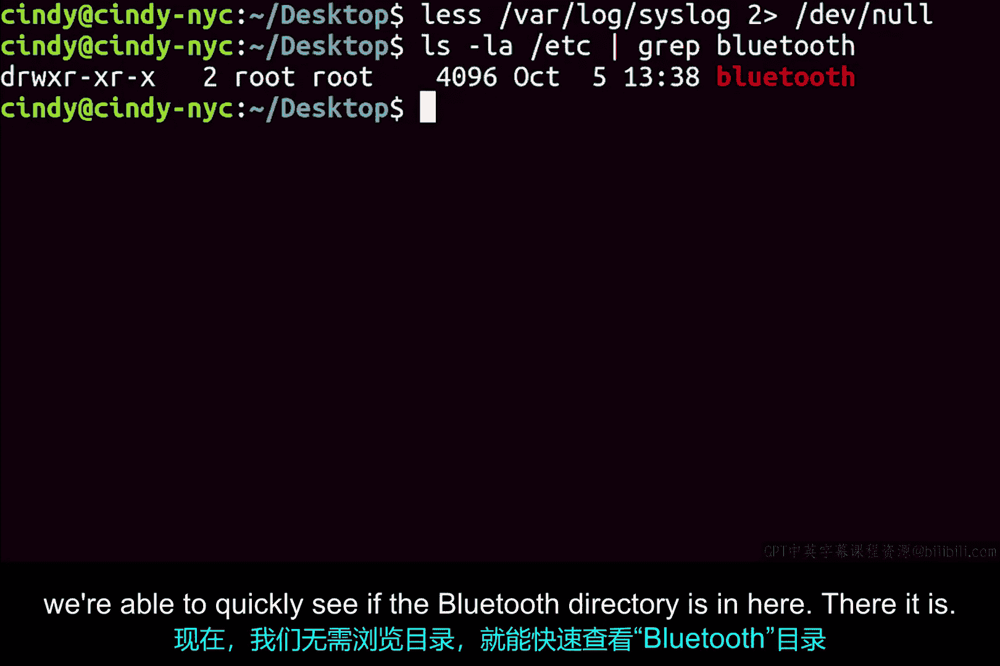

# 谷歌《IT支持（计算机网络⧸操作系统，第2、3课⧸共5课）｜Google IT Support》中英字幕deepseek p123 29_Linux输入输出与管道.zh_en -BV1uyqcYpExr_p123-

Similar to Windows， we have three different IO or input output streams， standard out。

 standard in and standard error。 remember the standard out example in the last lesson。

 while the same concept applies in Linux。We echo the textwoof here。

 but instead of sending it to our screen by default。

 we're going to redirect the output to a file using the standard out redirector operator。

Let's verify。And there it is this overwrites any file named Dog。t with the contents Wolf。

 if we don't want to overwrite an existing file， we can use the append operator or greater than greater then so echo Wolf。

Dog dot text。We could verify that。There it is one redirector operator that we talked about in the Windows lesson but didn't show up an example of was the standard in redirector operator。

 The standard in redirector is denoted by a less than sign Instead of getting input from the keyboard。

 we can get input from files like this。This command is exactly the same as cat。File input。

The difference here is that we aren't using our keyboard input anymore。

 we're using the file as standard In。Finally， similar to Windows。

 the last redirector operator we'll talk about is standard error。

Standard error displays error messages， which you can get by using the two greater than redirector operator。

Just like Windows， the two is used to denote standard error。

So to redirect just the error messages of some output， you can use something like this。Alas， D， fake。

To air。Text。Now if I view that new document。Now we can see the error message in error outputduct text。

 Remember the dollar sign null variable that we used in Windows to toss unwanted output into a metaphorical black hole。

 We have something like that in Linux  too。 There's a special file in Linux called the s dev s null file。

Let's say we want to filter out the error messages in a file and just want to see standard out messages we could do something like this。

Now our output is filtered from error messages。Remember how we talked about taking the output of one command and using it as the input of another command with the Windows pipeline。

 while the same thing exists in Linux， the pipe command allows us to do this。

Let's say we want to see which subdirecties in the slash Etsy directory contain the word Bluetooth。

 We can do something like this。Or using the pipe redirector to take the output of LSla/Etsy and pipepe or send it to the GrP command Now without even looking through the directory we're able to quickly see if the Bluetooth directory is in here。

There it is。You've gotten a glimpse of the power and of redirects。

 and as you dive deeper into the world of Linux， you'll be using them on a regular basis。

 They're super valuable tools to have。 and now they're part of your toolkit。

