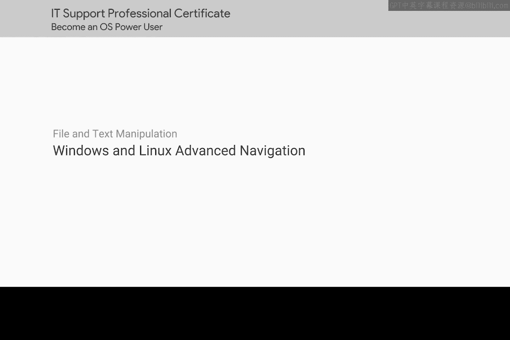
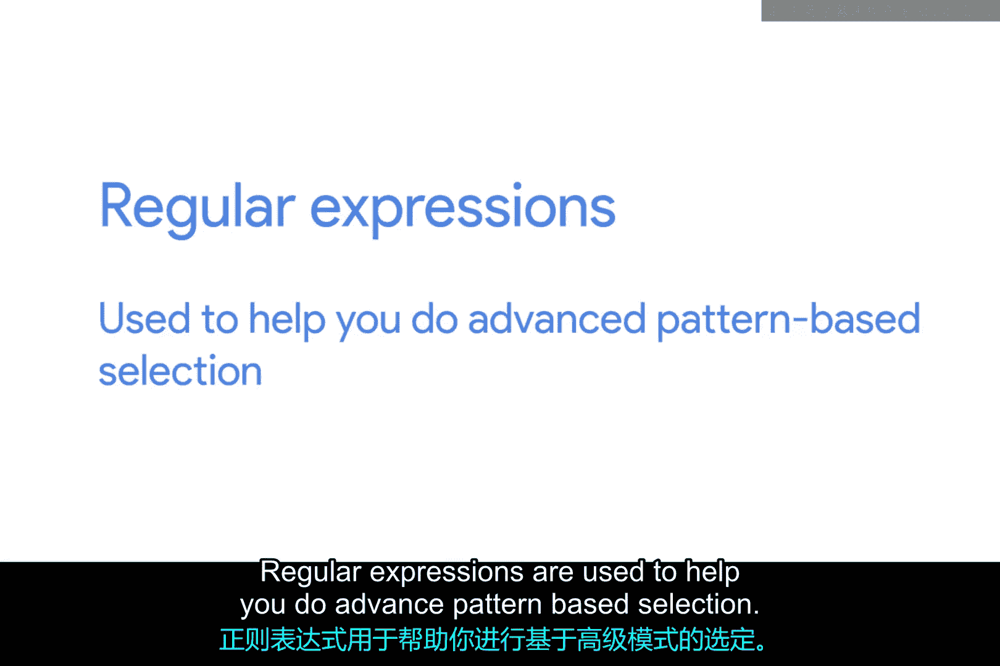

# 谷歌《IT支持（计算机网络⧸操作系统，第2、3课⧸共5课）｜Google IT Support》中英字幕deepseek p124 30_Windows与Linux高级导航.zh_en -BV1uyqcYpExr_p124-

You've learned a lot of commands and tools to help lay a strong foundation for IT support work。

There are many other commands that you haven't seen yet， don't worry。

We'll get to them as they come up as you advance in your career。

 you might even discover that the tools and commands you're using aren't powerful or efficient enough anymore。

Maybe you'll want to search through files using more complex patterns to do that。

 you'll need to know about tools like regular expressions。

Regular expressions are used to help you do advanced pattern based selection。

There's also so much more to PowerShell There are excellent videos and articles that can guide you from the first steps you've learned here to being a Windows CLI master。

If this sounds interesting to you， we really encourage you to check out the supplementary reading right after this video。

 and no， we won't grade you on your knowledge of this material in these courses。

But it could be really useful to you in the IT support field。You've done some seriously awesome work。

 We've covered a lot of information in this lesson。

 Maybe this was the first time you've been exposed to Linux or Windows。 If so。

 you've already passed a huge milestone in your learning journey。😊。

It's super important that you're able to use the commands you learned here by memory。

 I hope you wrote them down in your notes while watching the videos in this course。😊，Next up。

 we'll be testing you on some of the new commands you learned in Bash and Windows CLI。

Make sure to rewatch the videos and practice the exercises if you want a refresher before you start。

 When you're ready， we'll see you in the next lesson。

